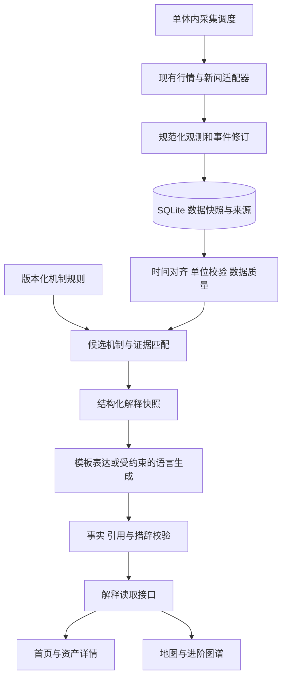
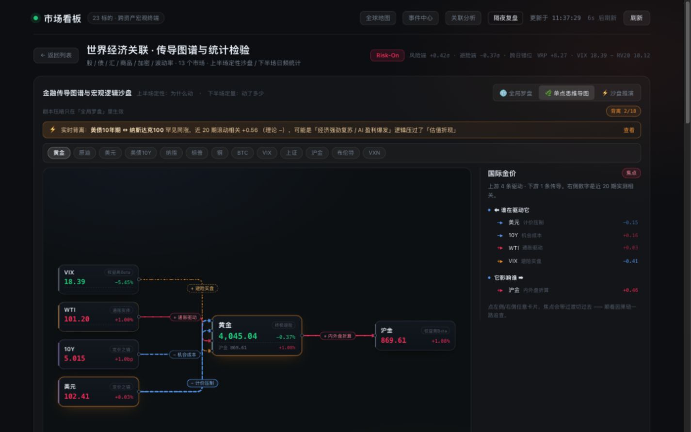
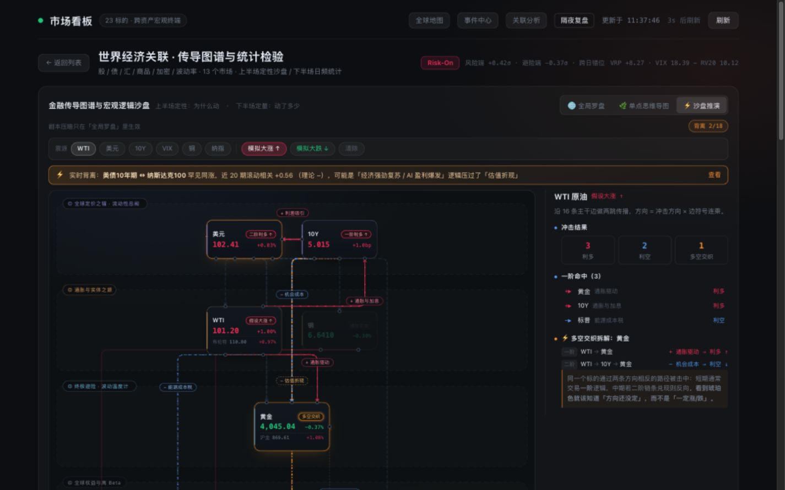

# 面向普通用户的经济解释产品与架构实施方案

- 日期：2026-10-28
- 状态：阶段一、阶段二已完成；阶段三进行中（详见 §14）
- 适用对象：产品设计、前后端开发、数据维护与测试人员

项目的核心目标是让非金融专业用户在一分钟内理解：发生了什么、为什么可能发生、通过哪些渠道影响其他市场，以及哪些条件会改变这个解释。下一阶段围绕“带证据的经济解释”组织现有行情、新闻、地图和传导图谱，先完成黄金场景，再扩展到原油、美元和美债。

本文给出产品流程、解释边界、数据模型、代码落点、实施顺序与验收标准。新增目录、接口、字段和任务均为目标设计，不代表当前已经实现；已完成情况见 §14（2026-10-28 追加）。现状依据为 2026-10-28 的浏览器走查与源码核查；截图中的价格和新闻只用于说明当时界面，不用于证明当日行情的原因。

## 1 产品目标与范围

### 1.1 用户需要完成的任务

用户从一个具体问题出发，例如“黄金为什么下跌”“油价上涨会影响什么”“国际金与国内金为什么不同步”，完成以下阅读路径：

1. 知道所选时间段内发生了什么变化。
2. 理解一到三条可能的作用路径。
3. 看见支持解释的事实，以及可能抵消它的因素。
4. 区分已经观察到的事实、一般经济机制和本次候选解释。
5. 知道下一步应观察哪个数据或事件。

首轮以“能否理解并复述”为产品指标，后续再评估留存、阅读深度和功能使用率。增加标的或新闻数量不等于提高理解程度。

### 1.2 世界经济流动的四种含义

| 信息类型 | 可以表达什么 | 需要什么证据 |
| --- | --- | --- |
| 价格变化 | 黄金、原油、汇率等在明确窗口内如何变化 | 标的定义、报价来源、时间和单位 |
| 影响传导 | 某个事件可能通过成本、利率、需求或风险偏好影响其他对象 | 机制依据、适用条件、当期支持与反向证据 |
| 实际资金流 | 某类基金、账户或跨境渠道的资金净流入和流出 | 对应流量数据、统计口径、币种和周期 |
| 实际货物流 | 能源、商品或贸易从哪里流向哪里 | 贸易量、运输量、金额、地区和统计周期 |

第一阶段聚焦价格变化与影响传导。仅凭价格涨跌、相关系数或新闻标签，不绘制带有实际资金规模含义的流向。真实资金和货物流作为后续独立数据能力接入。

### 1.3 现有能力的保留方式

- 行情表、历史走势、相关矩阵和领先滞后分析保留为深入查看工具。
- X6 图谱继续承载机制路径和聚焦探索，地图继续承载事件发生地与影响范围。
- 保留 Node 单体、SQLite、现有数据适配器、统计纯函数及浏览器依赖构建方式。
- 第一阶段不以更换前端框架、引入微服务或图数据库作为前置条件。

## 2 现状与优先级

P0 表示在推广新的解释体验前应修正的问题；P1 表示完成黄金场景与稳定运行所需能力；P2 表示在前两阶段稳定后扩展。

| 走查步骤 | 当前表现 | 用户影响 | 优先级与处理方向 |
| --- | --- | --- | --- |
| 1 行情首页 | 价格、涨跌、趋势与来源完整 | 新手需要自己判断哪些变化值得关注 | P1 增加问题式摘要入口 |
| 2 国际金价详情 | 长周期图、分时和指标优先展示 | 能看到跌了多少，仍不知道可能为什么 | P1 在图表之前展示解释卡 |
| 3 全局关联图 | 模式、剧本、背离提醒、图谱、统计同时出现 | 首屏学习成本高，容易把箭头理解成已证实因果 | P0 修正文案，P1 默认聚焦当前问题 |
| 4 黄金聚焦图 | 美元、10Y、原油、VIX 等因素同层展示 | 不知道本次哪些因素有证据、哪些只是一般机制 | P1 按支持、反向与未知组织因素 |
| 5 原油上涨沙盘 | 能展示黄金受到相反作用 | 缺少冲击原因，且用路径跳数推断短期与中期 | P0 删除无模型支持的时间顺序，P1 增加条件选择 |
| 6 事件中心 | 多来源、日历、重要度与原文链接 | 新闻数量大，重点与重复报道混在一起 | P1 聚合事件并给简短影响说明 |
| 7 全球地图 | 地区、市场、事件与时间线同屏 | 流向含义与部分地区名称容易被误解 | P0 修正地理语义，P1 明确连线类型 |
| 8 新闻标签复核 | 同一发言重复出现，中国国债期货消息显示美债标签 | 可能建立错误的国家、资产与事件联系 | P0 区分提及实体和影响假设 |

源码中还存在三项直接影响解释可信度的问题：

- `evaluateEdgeReality()` 分别取双方最后非空值，可能将不同日期的变化判断为当期同涨或同跌。
- `fetchMacroSeries()` 回退旧缓存时未完整传递过期状态，生成时间容易与市场观测时间混淆。
- `buildMacro()` 的周频路径使用周收益率计算 RV，但仍乘以日频年化系数，改变了“20 日实现波动率”的含义。

这些问题应进入金融口径回归测试，不能只靠页面显示正常来验收。

## 3 产品流程如何调整

### 3.1 首页按问题组织

默认首页先展示最多三个值得理解的问题，再展示行情入口。第一版使用可控模板生成问题：资产窗口变动、关键数据发布、相关机制出现相反观测；不让模型自由制造耸动标题。

问题卡包含以下内容：

| 内容 | 展示规则 |
| --- | --- |
| 问题 | 写清对象与窗口，例如“过去一个交易时段，黄金为何走弱” |
| 观察事实 | 由行情服务生成数值、基准和截至时间 |
| 简短解释 | 最多两句；有证据才写候选因素，否则写仍待确认 |
| 数据状态 | 显示截至时间、延迟、过期或部分缺失 |
| 主操作 | “看影响路径”，进入同一资产及时间窗的解释详情 |
| 深入入口 | “查看行情”“查看来源”，保留原有数据能力 |

排序先依据数据是否可用，再结合标准化变动程度、事件重要度与用户关注对象。排序原因应可记录和检查；避免简单按百分比把高波动资产长期排在前列。用户阅读期间不自动重排卡片，有更新时显示可主动加载的提示。

### 3.2 资产详情分三层阅读

| 层次 | 内容 | 交互 |
| --- | --- | --- |
| 快速理解 | 一句变化概述、最多三个候选因素、一个重要未知项 | 默认展开，约二十秒可读完 |
| 理解路径 | 事件或变量如何影响目标、相反作用、适用条件 | 点击因素展开单条路径，约一分钟可读完 |
| 查看依据 | 原始数据、来源、时间窗、统计与历史例外 | 按需展开，保留矩阵和历史图入口 |

解释卡固定回答五个问题：发生了什么、可能为什么、什么在抵消、还缺什么、接下来观察什么。每条候选因素都允许查看证据；证据较少时不勉强凑满三项。

“与我有什么关系”放在解释之后，例如购金、出行成本、汇率和借贷成本。内容需要标明地区、传递条件及时间范围，不能由国际油价变化直接推出某地明天的汽油价格。

### 3.3 图谱作为解释的展开视图

从黄金问题进入时，默认聚焦黄金及当前解释涉及的路径。点击某个因素后，只突出对应机制、支持证据和相反渠道；“全部关系”作为进阶入口。

关系边同时表达类型与状态：

- 类型区分计价换算、机制假设、共同驱动、历史相关。
- 状态区分当前观察一致、当前观察方向不同、条件未确认、数据不足。
- 单向箭头只用于表达有依据的机制方向；共同驱动或历史相关使用不暗示单向因果的连接方式。
- 图中颜色同时配文字、符号或线型，不单靠颜色区分含义。
- 提供与图谱等价的文字关系列表，支持键盘进入因素、证据和返回操作。

聚焦模式仍保留整体图谱入口，避免用户只看到单条路径而忽略相反因素。

### 3.4 事件中心先聚合事件再展示影响

同一事件的一组报道展示为一张事件卡，卡内保留不同来源和发布时间。原文列表作为展开内容。默认先展示最多三件重点事件，再提供完整时间线。

事件卡依次说明：主体与动作、发生时间、与预期的差别、可能的传导渠道、受影响对象和来源。只有存在可靠的预期数据时才展示“超预期”，否则展示实际公布值及已知背景。

“AI 复核”改成准确描述处理范围的“AI 辅助分类”或“AI 辅助摘要”。该标签不表示原文事实或资产影响已经被核实。

### 3.5 地图区分发生地与影响范围

将事件发生地、报道主体所在地、资产交易地和可能受影响地区分为不同字段。地理分区、经济组织与交易时区不共用一个标签：广义欧洲不命名为欧元区，广义亚洲不命名为东南亚。

地图选择一个事件时，只展示该事件的路径，并在路径上标明“可能影响”或“机制示意”。真实资金或货物流必须额外显示数据来源、周期和数值单位。

市场开休市状态按对应交易所和品种计算；一个地区存在全天候交易品种，不等于该地区所有股市都在交易。

### 3.6 沙盘从冲击条件开始

原油场景先选择“供给受阻”“需求增强”“原因未知”，再查看价格变化可能打开的作用渠道。原因未知时并列展示可选机制，不自动挑选一个故事。

结果使用“直接渠道”“间接渠道”和“相反作用”。两跳图遍历只说明路径结构，不产生幅度、概率或先后时间预测。美债节点明确区分“收益率上行压力”和“债券价格下行压力”，不笼统写“利多 10Y”。

### 3.7 必须设计的页面状态

| 状态 | 页面行为 |
| --- | --- |
| 正在准备 | 展示已取得的事实与解释准备状态，避免空白页面 |
| 部分数据可用 | 保留可核验内容，逐项指出缺失因素 |
| 证据不足 | 给出一般机制和需要观察的数据，不输出当前主因 |
| 证据冲突 | 并列展示支持与反向因素，不强行合成单一方向 |
| 来源延迟或过期 | 显示实际观测时间、原因及适用窗口，不用刚抓取的时间伪装新数据 |
| 获取失败 | 提供重试；如保留旧解释，保留原截至时间并标明过期 |

默认解释文字应比图表注释更醒目。术语第一次出现时附一句白话，例如“实际收益率：考虑预期通胀后衡量的债券回报”。动画支持暂停和减少动态效果；必要操作不得只在悬停时出现。

## 4 经济解释模型如何设计

### 4.1 事实 机制与本次解释分开

| 层次 | 示例 | 生成方式 |
| --- | --- | --- |
| 事实 | 某窗口内黄金价格下降、某利率指标上升 | 来源数据与确定性计算 |
| 一般机制 | 实际收益率上升可能提高持有无息黄金的机会成本 | 经审查的知识规则和来源 |
| 本次候选解释 | 本次变化与机会成本渠道一致，但还存在其他因素 | 事实、事件、条件和相反证据匹配 |
| 情景演示 | 假设供给受阻，可能通过哪些渠道影响黄金 | 显式假设和机制规则 |

统计相关、领先滞后和新闻同时出现都不能单独证明因果。多元模型也不自动解决该问题。第一版输出有证据约束的候选解释，不输出“某因素贡献了百分之多少”或未经校准的上涨概率。

### 4.2 黄金场景的标准表达

以下为机制示例，不是对审查当天价格变化的归因：

> 石油供应受阻，可能推高能源成本。若市场进一步预期利率会保持高位，而且实际收益率上升，持有不付利息的黄金就相对更不划算，这条渠道可能给金价压力。同一次冲突也可能增加避险需求，因此需要看哪些渠道得到更多当期证据支持。

黄金的实际利率渠道可参考[芝加哥联储研究](https://www.chicagofed.org/publications/chicago-fed-letter/2021/464)，油价变化需区分供给与需求冲击，参考[纽约联储研究](https://libertystreeteconomics.newyorkfed.org/2013/03/a-new-approach-for-identifying-demand-and-supply-shocks-in-the-oil-market/)。上面的链路是基于这些机制组织的教学解释，不能由单个价格方向直接确认。

| 候选机制 | 需要的证据 | 削弱该解释的情况 |
| --- | --- | --- |
| 实际收益率上升 | 同一可比时间窗的实际收益率变化，以及相关事件的先后关系 | 只有名义收益率涨，实际收益率未涨；所指事件晚于行情变化 |
| 美元走强 | 同窗美元指标变化，必要时比较黄金不同币种报价 | 更强的购金或避险因素；报价币种差异无法解释整体变化 |
| 油价经政策预期间接影响黄金 | 可核实的供给事件、政策预期或实际收益率的对应变化 | 原油上涨主要由需求增强推动；中间变量没有变化 |
| 避险需求增加 | 具体风险事件及可用的需求、持仓或流量证据 | 流动性紧张导致抛售换现金；只有 VIX 变化而无进一步支持 |

VIX 是市场波动预期指标，不能直接代替黄金买盘数据。国际金到国内金的解释还要包括汇率、单位换算、境内外溢价和交易时段；国内金不能只由国际金的涨跌方向推断。

### 4.3 黄金场景需要补的数据

| 数据 | 用途 | 接入与限制 |
| --- | --- | --- |
| 国际金、国内金、美元、名义 10Y、原油、人民币汇率 | 现有观察基础 | 统一标的定义、基准和时间窗 |
| 10 年期 TIPS 收益率 | 实际收益率渠道的可观测代理 | 可评估 [FRED DFII10](https://fred.stlouisfed.org/series/DFII10)；日频数据不作为分钟级实时信号 |
| 10 年期盈亏平衡通胀率 | 观察市场隐含的通胀补偿 | 可评估 [FRED T10YIE](https://fred.stlouisfed.org/series/T10YIE)；保留其指标定义，不表述成确定的未来通胀 |
| 事件及发布时间 | 连接变化与候选机制 | 区分发生、发布、抓取时间，保留原文和修订 |
| 央行购金、基金流量等 | 后续补充需求渠道 | 按实际发布周期使用，不能把月度数据写成当日成交原因 |

接入实际收益率前，需要检查采集、持久化、读回、报价和差值计算的完整链路。`parseFredCsv()`、`writeDailyCache()` 和 `toChanges()` 当前存在只接受正值的路径；如复用 `fredQuoteFromRows()`，其当前值与前值校验也需要调整。只修改解析器仍会在写库时丢失零值或负值。

利率及利差可为零或负值，应按指标类型校验；先识别空字符串、`null` 和来源缺失标记，再进行数值转换，不能把缺失转换为零。价格类对数收益率仍要求输入为正。利率变化用百分点差计算，再转换为基点展示，`1 bp = 0.01` 个百分点。数据库元数据中的条数和日期范围应依据实际写入结果，不能按过滤前数组填写。

FRED 新指标应先记录频率、发布时间和数据使用条件，按发布周期采集。没有分钟级数据时，明确将黄金解释限定到可比日频窗口，或把最新日频利率仅作为背景。

### 4.4 文案迁移表

| 现有表达 | 目标表达 | 使用条件 |
| --- | --- | --- |
| 逻辑兑现 | 近期走势与该机制一致 | 只表达观测一致性 |
| 实盘数据验证 | 同期观测与历史相关 | 展示共同窗口、样本数和频率 |
| 罕见同涨 | 同一窗口内同涨 | 只有计算历史频率后才可以使用罕见等频率判断 |
| 光点方向等于因果方向 | 箭头表示所选机制的作用方向 | 同时标注机制类型和条件 |
| 谁在影响谁 | 历史领先滞后关系 | 统计结果不能自动生成因果标题 |
| 短期一阶 中期二阶 | 直接渠道与间接渠道 | 没有时间模型时不推断先后 |
| AI 复核 | AI 辅助分类 | 不对来源真实性或解释正确性背书 |
| 利多 10Y | 收益率上行压力 | 与债券价格方向明确区分 |

## 5 目标系统架构



数值计算、数据质量、机制匹配和降级判断在服务端统一执行。客户端负责阅读层次、图谱交互和证据展开，避免各视图自行生成不同原因。

### 5.1 现有模块与调整落点

以下链接指向现有文件，函数名用于定位；新增文件集中列在下一节。

| 现有模块 | 调整内容 |
| --- | --- |
| [server.mjs](../server.mjs) 的 `startBackground()` | 从仅报价定时刷新扩展为可配置任务调度，注册解释读取接口 |
| [macro.service.js](../src/server/services/macro.service.js) | `fetchMacroSeries()` 透传质量；`buildMacro()` 分离统计频率与固定日频风险指标；`toChanges()` 支持利率零值和负值 |
| [fred.js](../src/server/providers/fred.js) | 按序列类型校验值域，保留指标来源、日期和频率 |
| [daily-cache.js](../src/server/db/daily-cache.js) | `writeDailyCache()` 按指标值域保留合法零值和负值，元数据使用实际写入条数与日期范围 |
| [events.service.js](../src/server/services/events.service.js) | `llmClassifyBatch()` 区分无关、未知与失败；`applyLlmResults()` 允许成功空结果清除旧标签；逐步拆出事件规范化 |
| [divergence-engine.js](../src/client/views/macro/divergence-engine.js) | `evaluateEdgeReality()` 改用共同日期及有效样本数，移除确定归因标签；`propagateShock()` 仅承载条件化机制传播 |
| [knowledge-base.js](../src/client/views/macro/knowledge-base.js) | 增加边类型、适用条件和来源，将经济规则逐步迁入服务端领域层 |
| [panels.js](../src/client/views/macro/panels.js) | 修改 `edgeCard()`、`alertBannerHTML()`、`sandboxPanel()`，消费结构化解释，不从例外描述拼接当期原因 |
| [detail.js](../src/client/views/detail.js)、[list.js](../src/client/views/list.js) | 接入解释卡与问题入口，保留原有图表和行情 |
| [events.js](../src/client/views/events.js) | 先显示事件聚合卡，展开后查看报道 |
| [map.js](../src/client/views/map.js)、[regions.js](../src/client/views/map/geo/regions.js) | 修正地区口径，区分事件与市场地理信息，联动同一解释快照 |
| [store.js](../src/client/shared/store.js) | 按资产、窗口和快照标识缓存解释，防止旧请求覆盖新选择 |
| [sqlite.js](../src/server/db/sqlite.js)、[db/index.js](../src/server/db/index.js) | 版本化迁移及解释、证据、事件修订读写 |

### 5.2 建议新增的模块

```text
src/server/domain/explanations/
  instruments.js       指标定义 单位 频率 值域与比较窗口
  mechanisms.js        版本化经济机制与适用条件
  alignment.js         时间对齐与共同观测
  quality.js           数据是否适合某个解释窗口
  evidence.js          支持 反向 缺失证据与状态规则
  compose.js           组合解释对象与确定性文案
src/server/domain/events/
  normalize.js         实体 国家 动作与时间规范化
  cluster.js           同事件聚合与修订识别
src/server/services/explanations.service.js
src/server/jobs/collector.js
src/server/db/explanations.js
src/client/views/explanations/card.js
src/client/views/explanations/evidence-panel.js
tests/fixtures/explanations/
```

领域模块保持纯函数，不依赖 HTTP、DOM 或数据库。服务层注入观测、事件与规则，数据库层不反向依赖服务层。

当前静态服务只开放 `public/` 和 `src/client/` 中的对应资源，不能假设新增 `src/shared/` 可以直接被浏览器导入。默认通过解释 API 共享计算结果；确需前后端共用的纯函数，通过现有 Vite 构建入口打包，并保留旧导出兼容层。不要为共享代码扩大整个服务端目录的静态暴露范围。

## 6 数据契约与存储

### 6.1 核心对象

| 对象 | 必要字段 | 约束 |
| --- | --- | --- |
| `InstrumentDefinition` | `id`、`kind`、`unit`、`currency`、`frequency`、`calendarId`、`valueDomain`、`comparisonPolicy`、`version` | 利率、价格、利差和流量采用不同计算口径 |
| `Observation` | `id`、`logicalKey`、`instrumentId`、`value`、`observedAt`、`timePrecision`、`publishedAt`、`fetchedAt`、`knownAt`、`sourceRef`、`quality`、`revision` | `logicalKey` 标识同一来源、指标和观测期；修订具有不同 `id`；时间不明确时保留空值和精度，不捏造分钟级时间 |
| `Article` | `id`、`logicalArticleId`、`revision`、`url`、`publisher`、`publishedAt`、`fetchedAt`、`knownAt`、`contentHash`、`excerpt`、`language` | 每个 `id` 对应不可变内容；原文更新产生新版本和新 `id`，转载关系单独记录 |
| `EventRevision` | `eventId`、`revision`、`entityIds`、`countryCodes`、`action`、`occurredAt`、`articleIds`、`relevance`、`knownAt` | 新闻提及对象与影响假设分开；修订不覆盖历史解释所用版本 |
| `Mechanism` | `id`、`version`、`relationType`、`from`、`to`、`conditions`、`direction`、`horizon`、`exceptions`、`sources`、`reviewedAt` | `direction` 可以有条件或未知；没有依据不填写精确时滞 |
| `Evidence` | `id`、`hypothesisId`、`role`、`observationIds`、`eventRevisionRefs`、`sourceRefs`、`window`、`qualityReasons` | 事件引用使用 `{eventId, revision}`；`role` 为支持、反向或背景；同一原始报道的转载不重复计为独立证据 |
| `Explanation` | `id`、`assetId`、`window`、`asOf`、`generatedAt`、`contentStatus`、`facts`、`hypotheses`、`unknowns`、`nextChecks`、`versions` | 事实和候选解释均引用证据；内容状态为 `ready`、`partial` 或 `insufficient`，不等同于预测概率 |
| `Scenario` | `id`、`shockType`、`assumptions`、`mechanismVersion`、`channels`、`conflicts` | 显式标记假设，不混入实时解释事实 |

`quality` 至少包括来源可用性、采样延迟、是否回退、缺失原因和冲突原因。正常日频数据是否适用，由解释窗口判断；“不是实时”与“已超过该数据正常更新周期”需要区分。

### 6.2 时间和统计规则

1. 数据同时保留市场观测、公开发布、系统取得和解释生成时间。`generatedAt` 只说明何时生成，不说明数据新鲜程度。
2. `window` 明确开始、结束、基准类型和交易日历。不能将 24 小时涨幅、昨收涨幅和自然日涨幅无说明地比较。
3. 当期同涨同跌要求双方处于同一可比窗口；回退到较早共同日期时，必须显示那个日期，不能继续称为当前。
4. 相关性返回实际有效配对数、窗口范围和频率。日历长度不能代替样本数；不能将缺失补成零收益率。
5. 日频跨时区数据仍可能不同步。保留收盘时间和交易日口径，必要时提供周频对照，但不据此自动确认领先因果。
6. 固定定义的 20 日 RV 从原始日线计算，矩阵日频和周频切换不能改变其数值、日期或定义。当前 VIX 减 RV 的值应明确为隐含与实现波动率之差，避免把它称作精确的方差风险溢价。
7. `asOf` 是解释可使用的信息截止时点；市场比较期间由 `window` 和 `observedAt` 表达。`knownAt` 是该修订首次被系统取得并可用的时间，重复抓取不得刷新它；历史补录不能伪称系统当时已知。
8. 历史回放对每个 `logicalKey` 选择 `knownAt <= asOf` 的最新修订，不能把多个修订当成多个样本。事件和报道也只选当时已知的版本；后来取得的修订值和新闻不得进入过去时点的解释。

### 6.3 SQLite 最小演进

新增版本迁移入口，先扩展再迁移读取逻辑，保留现有行情、日线和快照表。

| 新表 | 作用 | 建议键或索引 |
| --- | --- | --- |
| `observation_revisions` | 保存解释引用的观测版本与质量 | 主键 `id`；索引 `instrument_id, observed_at, known_at` |
| `articles` | 不可变的原文链接、必要摘录与内容哈希 | 主键 `id`；唯一键 `logical_article_id, revision`；索引 `known_at, published_at` |
| `event_revisions` | 事件聚合结果和修订 | 联合主键 `event_id, revision`；索引 `known_at` |
| `explanations` | 不可变解释快照及其结构化载荷 | 主键 `id`；索引 `asset_id, window_key, as_of` |
| `evidence` | 不可变证据载荷，包含观测版本 ID 和事件版本引用 | 主键 `id` |
| `explanation_evidence` | 解释到证据实体的关联 | 联合主键 `explanation_id, evidence_id`；分别引用 `explanations.id`、`evidence.id` |
| `collection_state` | 每个来源的最后成功时间、错误及退避状态 | 主键 `job_key` |

早期可用 JSON 载荷保存可变结构，常用查询字段保留独立列。机制规则先用版本化代码配置管理，解释记录对应规则版本或哈希；不必立即增加规则管理后台。

`evidence` 的 JSON 载荷保存 `observationIds` 和 `eventRevisionRefs`；`event_revisions` 的载荷保存不可变报道版本的 `articleIds`。第一版在事务内逐项校验这些 JSON 引用存在，关系表启用外键约束；后续需要高频反向查询时，再将 JSON 引用拆成关联表。

写入解释及其证据引用使用同一事务；新证据到达时创建新解释版本，不改写旧快照。数据清理必须遍历解释、证据、事件和报道引用，保留仍被引用的版本。数据库迁移与引用完整性测试是 B3 解释服务上线的前置条件。迁移验证在独立测试库完成，已有数据库迁移前先备份，不在生产库上运行测试样本。

## 7 解释生成与新闻处理流程

### 7.1 解释生成步骤

1. 按资产与窗口选择事实基准，冻结截至时间及可用数据版本。
2. 验证单位、频率、时间窗与质量；输出可用事实和缺失项。
3. 从版本化机制库选择与目标有关的候选渠道。
4. 对每个渠道检查条件和必需中间变量，连接支持、反向与背景证据。
5. 优先展示条件满足、数据可比、来源独立的候选项；相反证据必须保留，不能通过一个总分将其隐藏。
6. 生成结构化解释。第一版优先用模板；如使用语言模型，只允许改写已给定事实和机制。
7. 验证所有数字可回溯、引用存在、措辞与证据状态匹配；失败时回退确定性模板。
8. 保存解释、证据引用和版本，通知相关视图可取得新快照。

候选渠道可使用 `consistent`、`mixed`、`not_supported`、`untested` 状态，界面分别表达“观测一致”“有相反证据”“当前证据不支持”“尚未确认”。这些状态均不表示因果已证明。缺少事件证据时，可以展示一般机制和统计观察，但不能自动填入当期事件原因。

### 7.2 新闻实体与聚合规则

先提取新闻中的主体、国家、动作、对象、时间及对应原文片段，再决定其是否与目标资产有潜在关系。中国国债与美国国债必须是不同实体；“债市”主题不能自动补出“美国 10 年期国债受影响”。

分类结果至少区分以下四种状态：

| 状态 | 后续处理 |
| --- | --- |
| 成功且有实体或影响候选 | 校验后使用结果 |
| 成功且明确为空或无关 | 允许清除关键词产生的旧标签，按无关状态过滤 |
| 尚不确定 | 保留未知状态，不自动升级为有影响 |
| 解析失败或调用失败 | 使用明确标记的规则回退，记录失败，不能伪装为成功空结果 |

聚合先做 URL 与内容去重，再按实体、动作、对象和时间接近程度生成候选事件簇。疑似同一发言的报道合并展示，但保留来源；不同时间的政策修订、同主题但不同事件不能合并。冲突报道在事件内并列，标明各自发布时间。

新闻文本作为数据处理，不能成为执行指令。模型输出必须通过结构、实体枚举和证据片段校验；不得允许其修改采集配置、访问任意地址或决定是否跳过质量校验。

### 7.3 采集与缓存

在单体内为报价、新闻、日历和日频指标建立独立任务。初始周期沿用已有源缓存策略，并根据源发布频率调整；日频指标不跟随行情秒级轮询。

同一任务键只允许一个进行中请求，失败按源退避，其他来源继续运行。成功采集后按受影响资产触发解释重算。没有浏览器访问时也应采集新闻；前端读取快照，不因每次切页重复调用上游和模型。

缓存区分观测缓存、解释缓存和前端缓存。解释快照的身份包含资产、窗口、输入版本、机制版本及生成策略版本。仅经过时间不改写解释内容；读取时重新评估新鲜度。只有相关输入或内容所依据的质量状态发生变化时才生成新版本。

## 8 接口与前端集成

### 8.1 建议新增的读取接口

| 接口 | 用途 | 约束 |
| --- | --- | --- |
| `GET /api/explanations?asset=gold-intl&window=session` | 当前资产解释 | 资产和窗口使用白名单；窗口首版为 `session`、`5d`、`1m`，响应给出实际起止时间 |
| `GET /api/explanations/:id` | 查看固定解释版本 | 返回不可变快照，供各页面一致引用 |
| `GET /api/events/:id/revisions/:revision` | 查看事件及报道依据 | 保留引用时所用版本，避免当前修订替换旧解释证据 |

已有接口保持兼容，先增加字段和新接口，再逐步切换视图。新接口遵循当前同源、方法限制、参数校验与错误响应约定；读取请求不同步等待完整 LLM 生成。

| 返回情况 | HTTP 与载荷行为 |
| --- | --- |
| 有可用快照 | `200`，`explanation.contentStatus` 为 `ready`、`partial` 或 `insufficient`；读取元数据独立返回 |
| 正在准备且无旧快照 | `202`，`explanation: null`，`meta.freshness: unavailable`、`meta.refreshStatus: pending` 与建议重试间隔；同键任务合并 |
| 只有过期快照 | `200`，保留快照原内容和 `asOf`；`meta.freshness: stale`，提供过期原因与刷新状态 |
| 参数不合法或版本不存在 | 分别返回 `400` 或 `404` |
| 系统暂时不可用且无快照 | `503`，可重试提示；不泄露内部路径或配置 |

响应采用 `{schemaVersion, explanation, meta}`。`explanation` 是不可变快照；`meta` 为读取时元数据，包含 `evaluatedAt`、`freshness: fresh | stale | unavailable`、`freshnessReasons` 和 `refreshStatus: idle | pending | failed`。因此“证据不足且过期”可以同时表达。`GET /:id` 也不能改变快照内容或自动换成新版本；历史版本的新鲜度只说明其是否适合当前阅读窗口，不改变当时结论。

`ready` 仅表示解释内容和引用已生成，不代表因果被证实。`insufficient` 是正常业务结果，不是接口故障。新鲜度依据来源日历及窗口策略计算；一个刚生成的证据不足结果也可以是 `fresh`。

### 8.2 证据不足响应示例

以下为目标契约示例，时间及标识为示意，没有填入虚构行情值：

```json
{
  "schemaVersion": 1,
  "explanation": {
    "id": "example-gold-insufficient",
    "assetId": "gold-intl",
    "asOf": "2026-10-28T03:00:00Z",
    "generatedAt": "2026-10-28T03:01:00Z",
    "window": {
      "key": "session",
      "start": null,
      "end": null,
      "alignment": "unavailable"
    },
    "contentStatus": "insufficient",
    "summary": "当前数据不足以解释本次黄金变动。",
    "facts": [],
    "hypotheses": [],
    "unknowns": [
      { "code": "UNALIGNED_WINDOW", "text": "缺少共同时间窗的黄金与实际收益率观测。" }
    ],
    "nextChecks": ["取得共同窗口数据后，检查实际收益率渠道。"],
    "versions": {
      "mechanisms": "example-v1",
      "calculation": "example-v1",
      "language": "template-v1"
    }
  },
  "meta": {
    "evaluatedAt": "2026-10-28T03:01:00Z",
    "freshness": "fresh",
    "freshnessReasons": [],
    "refreshStatus": "idle"
  }
}
```

### 8.3 前端接入顺序

先做独立解释卡，接到现有 `#/d/gold-intl`；验证后再把卡片摘要接到首页，最后联动图谱和地图。使用同一 `explanationId` 展开依据，禁止某个视图用更新行情配旧解释却不提示时间差。

资产和窗口变化时取消旧请求或使用请求序号防止乱序覆盖。新快照到达时保留正在阅读的证据展开状态，提示用户更新；不要重建整个图谱或让焦点跳回默认节点。继续遵守现有视图 `mount/unmount` 的清理约定。

## 9 分阶段实施任务

每一阶段拆成可单独验证的提交或 PR。下面的任务尚未执行，依赖通过后再进入下一阶段。

### 阶段一 修正解释口径与基础数据

| 任务 | 怎么做 | 完成标准 |
| --- | --- | --- |
| A1 文案与关系类型 | 落实文案迁移表；停止从固定例外生成当期原因；为共同驱动和相关边区分样式 | 不再用相关性状态表示因果已兑现；沙盘不输出无依据的先后顺序 |
| A2 时间配对 | 新增共同观测函数，返回日期、双方值、有效样本数和不可比原因 | 不同日期的最新值不会被标为当期同涨；缺失不补零 |
| A3 质量与频率 | 透传缓存降级状态；将 20 日 RV 与矩阵频率拆开；统一 bp 展示 | 源失败可辨识；日周切换不改变固定日频指标 |
| A4 实体与空结果 | 区分提及实体、影响候选、无关、未知和失败；允许成功空结果撤销旧标签 | 中国国债不自动映射美债；AI 无关结果生效 |
| A5 地理口径 | 将地区、经济组织和交易地拆分，修正现有名称 | 俄罗斯不会标为欧元区，澳大利亚不会标为东南亚 |

阶段一可先在现有函数中做针对性修正，再迁入领域层。金融口径发生有意变化时，应给契约测试记录原因，不能仅为了让旧快照通过而保留错误结果。

### 阶段二 完成黄金解释闭环

依赖：A1 至 A4 完成；地图联动依赖 A5。

先完成 B0 数据库迁移及引用完整性验证；B1、B2、B6 可并行推进，B3 接入它们的稳定契约后，再依次接入 B4、B5。

| 任务 | 怎么做 | 完成标准 |
| --- | --- | --- |
| B0 持久化基础 | 按第 6.3 节创建版本表、证据表、关联及事务校验，验证备份与增量迁移 | 不接受不存在的引用；报道改版不覆盖旧摘录；清理不会删除仍被引用的版本 |
| B1 指标与机制 | 接入实际收益率及通胀指标，修正采集、写库、读回、报价和差值计算中的值域过滤；为黄金机制填写条件、例外和来源 | 缺少实际收益率时不会确认机会成本渠道；零值和负值在完整链路中保留，缺失不变成零 |
| B2 事件聚合 | 将重复发言、转载与修订分开，建立事件和报道关系 | 同一事件一张卡，多来源可展开；不同事件不因主题相同而合并 |
| B3 解释服务 | 按第 7 节实现确定性模板、证据匹配、状态和持久化 | 同一输入得到相同事实和证据；无模型也能给出基本解释或未知状态 |
| B4 资产详情 | 增加三层阅读、来源与反向因素，先接黄金 | 用户不离开资产详情即可理解路径和查看依据 |
| B5 首页与图谱 | 首页增加问题卡，聚焦图消费同一解释快照 | 首页结论、详情和图谱的窗口、版本与因素一致 |
| B6 采集与可观测性 | 拆出定时采集，合并进行中任务，记录质量与生成状态 | 无人访问也能采集；并发不重复触发同一轮任务 |

### 阶段三 扩展场景与回放

依赖：黄金理解测试及工程验收通过。

| 任务 | 怎么做 | 完成标准 |
| --- | --- | --- |
| C1 原油 美元 美债 | 逐个补机制、数据口径和代表性案例 | 每个资产具备证据不足和反向案例后再开放 |
| C2 条件化沙盘 | 增加供给、需求、未知条件；复用版本化机制 | 相同涨价可展示不同条件下的路径，不输出伪精确预测 |
| C3 历史解释回放 | 固定数据、事件、规则与语言版本，按当时可知时间读取 | 后续修订不会悄悄改变历史解释 |
| C4 地图与生活影响 | 事件路径联动同一解释；补地区与政策条件 | 影响示意、实际流量和价格变化可辨别 |
| C5 真实流量 | 有可靠数据后接基金流量、贸易或能源运输 | 每条流量有来源、周期、单位及覆盖范围 |

第一阶段出口是“口径可用”，第二阶段出口是“黄金可理解”，第三阶段出口是“可扩展且可回看”。不以图谱节点数量或新闻源数量作为阶段完成标准。

## 10 验收与测试方法

### 10.1 金融口径和降级测试

| 测试场景 | 预期结果 | 现有测试落点或拟新增文件 |
| --- | --- | --- |
| A 最新为周二 B 最新为周一 | 不能标为当期同涨；共同历史日期需明确展示 | `tests/divergence.test.js` |
| 大量缺失或窗口不足 | 返回有效配对数及不可比状态，不输出误导显著性 | `tests/divergence.test.js`、`tests/stats-rigor.test.js` |
| 相同原始日线切日周矩阵 | 20 日 RV、波动率差及其截至日期不变 | `tests/services.test.js` |
| 实际收益率为负或跨零 | 经采集、写库、读回、报价到差值计算仍保留；缺失与零不同，库元数据与实际行数一致 | `tests/providers.test.js`、`tests/db.test.js`、拟新增 `tests/explanation-metrics.test.js` |
| 所有历史源失败 | 历史可回退，质量标识贯穿 API 与解释 | `tests/services.test.js` |
| 名义收益率上涨 实际收益率未知 | 机会成本仅为未确认机制，不成为确定主因 | 拟新增 `tests/explanations.test.js` |
| 油价上涨但冲击类型不同 | 供给、需求、未知产生不同条件集 | 拟新增 `tests/explanations.test.js` |
| AI 明确无关或返回成功空数组 | 清除旧错误标签；失败结果另行处理 | 拟新增 `tests/event-normalization.test.js` |
| 中国国债与美国国债消息 | 实体区分，无主题到资产的强制误配 | 拟新增 `tests/event-normalization.test.js` |
| 同一发言多来源报道 | 一个事件、多条来源；转载不重复计证据 | `tests/news-feeds.test.js`、`tests/events-history.test.js` |
| 模型新增数值或不存在的引用 | 校验失败，回退模板 | 拟新增 `tests/explanations.test.js` |
| 原文包含指令性文字 | 只能作为新闻文本，不能改变生成规则或访问目标 | 拟新增 `tests/explanations.test.js` |
| 并发请求 冷启动及部分源失败 | 同键合并，返回明确状态，其他源继续服务 | `tests/http-integration.test.js` |
| 新修订晚于历史截至时间 | 不进入旧时点解释，旧证据仍可读取 | `tests/db.test.js`、拟新增 `tests/explanation-replay.test.js` |
| 重复抓取及同一观测多次修订 | 首次 `knownAt` 不变；回放只选当时可知的最新修订 | 拟新增 `tests/explanation-replay.test.js` |
| 报道更新 引用错误及历史清理 | 原摘录可读取；无效引用写入失败；被引用版本不被清理 | `tests/db.test.js` |
| 证据不足快照随后过期 | `contentStatus` 与原内容不变；读取元数据独立显示过期和刷新状态 | `tests/http-integration.test.js` |
| 快速切换资产与窗口 | 旧响应不能覆盖新选择，展开状态合理保留 | 客户端测试及浏览器走查 |

测试使用固定时钟、回放数据和内存或临时数据库。复现预期由独立计算或明确金融口径确定，不能把实现自己的输出复制成唯一预期。

### 10.2 浏览器和理解测试

用内置浏览器走通：首页问题卡、黄金详情、单条机制、支持来源、反向因素、条件沙盘、地图事件和证据不足状态。至少检查桌面与窄屏，验证放大文字、键盘焦点、图谱文字替代和减少动画选项。普通正文和操作文本按可访问性要求量化检查对比度，不能只凭截图判断合规。

邀请 5 位非金融用户，每人完成三项任务：解释黄金某次变动的候选路径、解释油价上涨为何可能对黄金有相反作用、从一张卡中找出事实与尚未确认的因素。

首轮建议门槛是至少 4 人能在每项任务的一分钟内说出一条作用路径和一个限制条件，并找到对应来源。记录错误理解的具体词语与停顿位置后迭代。该门槛是试用目标，不是已取得的测试结果。

### 10.3 构建 交付与回退

实现阶段先跑受影响模块测试，再跑整体测试；修改被打包的图谱或依赖代码后执行构建并检查生成差异。现有命令为：

```bash
npm test -- tests/divergence.test.js tests/stats-rigor.test.js tests/services.test.js
npm test
npm run build
git diff --check
```

新增测试文件完成后加入相应验证范围。当前构建产物位于 `public/vendor/`，按仓库约定与源码一致交付；不要假设已经切换为整站 `dist/` 部署。测试运行环境应支持项目实际使用的 `node:sqlite`。

先将解释卡置于可关闭的功能开关后，保留旧行情路径。新解释服务不可用时退回行情和明确状态，不回退到无证据的自动归因。数据库采用增量迁移，回退应用时保留新增表及历史证据。

本次仅新增方案文档和证据图片，以上命令与任务是后续实施要求，不表示功能已实现或本轮已执行这些测试。

## 11 与既有设计文档的衔接

| 文档 | 可继续复用的内容 | 本方案调整的部分 |
| --- | --- | --- |
| [金融传导图谱设计](macro-transmission-design.md) | 聚焦图、机理卡、相反路径与统计联动 | 固定因果边、逻辑兑现、跳数对应时间的表达改为带条件的机制和观测 |
| [工程化与流程图重构方案](engineering-and-flowchart-plan.md) | 模块分层、X6 交互、布局和纯函数测试思想 | 以当前实际目录和构建配置为准，不把旧迁移设想当作当前状态 |
| [全球地图升级方案](worldmap-situation-room-plan.md) | 地图交互、事件聚焦、时间线和地理底图 | 连线增加语义类型；地区、经济组织与市场位置分开 |

本次经济解释功能的产品入口、证据要求与数据语义按本文实施；原文档继续作为对应界面与工程能力的背景。后续实现某项任务时，同步更新其涉及的旧文档，避免两套规则并存。

## 12 关键界面证据

图片为 2026-10-28 本次审查的截图，原图复制到仓库，使用相对链接，避免依赖聊天目录。截图价格、新闻和状态可能随运行时间变化。

### 12.1 黄金聚焦图

已经具备上游与下游关系；需要补充本次证据、相反因素与主次。



### 12.2 原油情景沙盘

已展示黄金受到两种相反作用；需要补冲击条件，并移除没有时间模型支持的短期和中期顺序。



### 12.3 新闻标签与重复报道

同一新西兰联储发言相邻出现，中国国债期货新闻显示美债 10 年期标签。实现时将这些现象转成固定的实体与聚合回归样本，不依赖实时新闻再次出现。


## 13 机制与指标参考来源

- [芝加哥联储 What Drives Gold Prices](https://www.chicagofed.org/publications/chicago-fed-letter/2021/464)：黄金与实际利率、通胀预期及经济悲观预期的研究；统计关联本身不证明因果。
- [纽约联储石油供需冲击研究](https://libertystreeteconomics.newyorkfed.org/2013/03/a-new-approach-for-identifying-demand-and-supply-shocks-in-the-oil-market/)：区分供给和需求驱动的油价变化，以及不同政策与市场反应。
- [FRED DFII10](https://fred.stlouisfed.org/series/DFII10)：10 年期通胀指数国债收益率，单位为百分比、频率为日频，作为实际收益率渠道的候选观测来源。
- [FRED T10YIE](https://fred.stlouisfed.org/series/T10YIE)：由名义与通胀指数国债收益率形成的 10 年期盈亏平衡通胀率，作为通胀补偿的候选观测来源。

参考资料用于支持一般机制和指标定义。当期解释仍需连接对应窗口的数据、事件和反向证据。

## 14 实施状态（2026-10-28）

本节记录 §9 各任务的落地结果与验证位置，供复核时对照；不改变上文的设计口径。

### 14.1 已完成

| 任务 | 落点 | 验证 |
| --- | --- | --- |
| A1 文案与关系类型 | `views/macro/knowledge-base.js`（`RELATION_TYPES`、剧本与边文案）、`panels.js`（`directionLabel`、`corrCaption`）、`flow-nodes.js`（徽章）、`flow-canvas.js`（非因果边不画箭头、不叠流光）、`macro.js`（领先滞后标题） | `tests/views-macro-render.test.js`、`tests/divergence.test.js` |
| A2 时间配对 | `views/macro/divergence-engine.js`（`lastCommonIndex`、`asOf`、`unaligned`、`n` 改为有效配对数）、`panels.js` 显示当期比较日期 | `tests/divergence.test.js`「共同日期配对」 |
| A3 质量与频率 | `providers/fred.js`（值域）、`db/daily-cache.js`（signed 写入）、`services/macro.service.js`（RV 取原始日线、质量透传）、`macro.js`（隐含−实现） | `tests/explanation-metrics.test.js`、`tests/macro-service.test.js` |
| A4 实体与空结果 | `domain/events/normalize.js`（实体证据、四态）、`domain/events/cluster.js`（聚合与转载）、`events.service.js`（`applyLlmResults` 支持清除旧标签） | `tests/event-normalization.test.js`、`tests/events-service.test.js` |
| A5 地理口径 | `views/map/geo/regions.js`（欧洲 / 亚太、`REGION_SEMANTICS`）、`events.service.js` 提示词 | `tests/event-normalization.test.js`「地理口径」 |
| B0 持久化 | `db/migrations.js`（版本表 + 7 张表）、`db/explanations.js`（引用校验、事务、清理只删未被引用者） | `tests/db-explanations.test.js`、`tests/db.test.js` |
| B1 指标与机制 | `domain/explanations/instruments.js`、`mechanisms.js`（条件、例外、来源、版本）、DFII10 / T10YIE 接入 | `tests/explanation-metrics.test.js`、`tests/explanations.test.js` |
| B2 事件聚合 | `domain/events/cluster.js`（同事件一张卡、来源保留、动作不一致不合并）；`/api/events` 附带 `clusters`；事件流按簇折叠成一行并显示「同事件 N 条报道 · M 家来源」，可展开看其余原文 | `tests/event-normalization.test.js`、`tests/views-list-events.test.js`「同事件折叠」 |
| B3 解释服务 | `domain/explanations/{alignment,quality,evidence,compose}.js`、`services/explanations.service.js`、`/api/explanations`、`/api/explanations/:id`、`/api/events/:id/revisions[/n]` | `tests/explanations.test.js`、`tests/explanation-http.test.js` |
| B4 资产详情 | `views/explanations/{card,state}.js`、`views/detail.js`（图表之前）、`public/styles/explanations.css` | `tests/views-explanations.test.js` |
| B5 首页与图谱 | `views/explanations/questions.js`、`index.html#questions`、`main.js` 异步补卡 | `tests/views-questions.test.js` |
| B6 采集与可观测性 | `jobs/collector.js`（同键合并、退避、触发链）、`jobs/index.js`（五类任务）、`/api/health` 暴露任务状态 | `tests/collector.test.js` |
| C1 原油 / 美元 / 美债 | `mechanisms.js`（gold-v3：原油 6 条、美债 3 条、美元 4 条；含事件型供给 / 需求机制）、`evaluateMechanism` 支持 `eventOnly`、`instruments.js` 打开四个资产 | `tests/explanations.test.js` 的原油 / 美债 / 美元三组（含证据不足与反向案例） |
| B5 图谱消费同一份解释 | `views/explanations/graph.js`（边→渠道映射、状态并列、60s 缓存）、`panels.js`（焦点卡解释块、机理卡解释状态行）、`macro.js`（按焦点取数） | `tests/graph-explanation.test.js`、浏览器走查 |
| C2 条件化沙盘 | `knowledge-base.js`（`SHOCK_CONDITIONS`、`SHOCK_CONDITION_SETS`）、`propagateShock` 支持 `activeEdges`、沙盘卡条件选择器 | `tests/divergence.test.js`「条件化沙盘」 |
| C3 历史回放 | 读取路径：`db/explanations.js`（`readObservationAsOf` / `readEventAsOf` / `listExplanationHistory`）；接口 `GET /api/explanations/history?asset=&window=`；详情页「此前的解释（N 版）」+ 回放横幅；事件流「第 N 版」徽章与版本面板（`/api/events/:id/revisions`）；事件修订按内容哈希写入（`recordEventRevisions`） | `tests/db-explanations.test.js`、`tests/explanations-history.test.js`、`tests/event-revisions.test.js`、`tests/views-list-events.test.js`、`tests/explanation-http.test.js` |
| §10.2 理解测试 | 六个问题与「不许出现的措辞」写成断言（不依赖浏览器，可进 CI） | `tests/understanding.test.js` |
| 事件冲击分类 | `domain/events/shock.js`（供给/需求词表、资产相关性过滤、保守返回 null）、归档转证据 | `tests/shock-classification.test.js`、`tests/explanations.test.js`「事件证据与快照」 |
| C4 地图与影响范围 | `views/explanations/impact.js`（发生地=地理赛区、影响范围取同一份解释的渠道状态、固定免责）、`map/layers/broadcast.js` + `map.js` 播报台接入 | `tests/map-impact.test.js`、浏览器走查 |

### 14.2 尚未完成

- **C4 的「地区与政策条件」只完成前半**：播报台现在同时给出发生地（地理赛区）、影响范围（受影响资产 + 渠道状态）与免责说明，但还没有把「政策条件」写进地图（例如同一 OPEC 减产在不同汇率制度下的传导差异），也还没有把解释路径画到地图上（目前只画定价中心弧线）。
- **C5 真实流量**：基金流量、贸易量、能源运输等数据没有可靠来源，保持不做。
- **事件冲击分类器只覆盖规则可判的情形**：`domain/events/shock.js` 用「数量约束词（减产/停产/航道/罢工）」与「需求词（开工率/补库/出行）」两套词表保守判定，两类同时出现或只有价格描述时返回 null（渠道显示「尚未确认」）。仍有局限：反讽、引述他人观点、跨品种同名事件（铜矿罢工）需要人复核，所以分类结果只进证据、不进标题结论。
- **浏览器端 CI**：理解测试已脚本化（`tests/understanding.test.js`），但真实渲染的端到端走查仍是人工执行 Chromium headless 脚本（验证卡片出现、可展开、切窗口后内容更新、无控制台异常）。
- **上游 id 复用的根因**：Google 聚合源偶发把同一个 guid 复用到另一条新闻上，事件修订会把这种变化标成「标题整体更换」并保留上一版标题，但根因在聚合侧，只能标注、无法修正。
- **历史脏数据清理靠一次性脚本**：`scripts/dedupe-event-revisions.mjs`（默认 dry-run）删除「与前一条 contentHash 完全相同」的重复修订 —— 早期写入只靠进程内缓存，重启会给所有事件追加一版重复内容。写入侧已改为读库里最新一版比对。

### 14.3 有意改变的口径（契约测试已记录原因）

- 利率类序列允许 0 与负值（DFII10 长期为负），缺失标记不再变成 0。
- `evaluateEdgeReality` 的当期比较改为共同日期配对；`n` 由数组长度改为有效配对数。
- 沙盘不再输出「一阶 / 二阶」「多空交织」「利多 10Y」；改称直接 / 间接渠道、方向未定、收益率上行 / 下行压力。
- `freshness` 只按本次解释实际引用的指标计算：与结论无关、更新较慢的序列不再把整张解释标成过期。
- `freshness` 进一步只统计**方向性结论**（目标资产 + 给出判定的机制渠道）。历史相关、共同驱动、缺事件未判定的渠道过期时，改列 `meta.backgroundStale`，界面单独提示「背景指标过期」。
- 冲突判定（`mixed`）只在方向性机制之间比较：计价换算、共同驱动、历史相关不是方向预测，不参与「相反证据」判定。
- 机制库版本升到 `gold-v3`（新增原油、美债、美元）；旧快照保留 `gold-v1` / `gold-v2` 的版本号，读取时不会被新规则重新解释。
- 计算版本升到 `calc-v2`：事件型渠道最多引用 3 条已分类报道（其余用 `eventMatchCount` 计数），价格型渠道不再把窗口内全部事件挂到自己身上。
- 快照指纹纳入事件身份（`eventId#revision:shockType`）：日频数据没变但窗口里出现新报道时，会生成新快照，而不是复用 `events=[]` 的旧快照。
- 被引用的事件修订在写快照前先落库（`persistReferencedEvents`），满足「不接受不存在的引用」。
- 事件修订的「内容是否变化」改以数据库中最新一版的 `contentHash` 为准（内存缓存只作快路径）：只靠内存时，进程重启会给所有事件追加一版重复修订。
- 回放时摘掉新鲜度判定：用今天的时钟说一份历史解释「已过期」没有意义，横幅已说明它不是当前状态。
