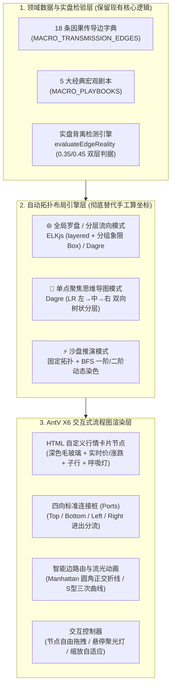

# 项目工程化演进与开源流程图重构方案

> **核心定位与基本原则**
> 1. **告别“零依赖手写一切”的作坊模式，全面走向现代前后端工程化**：引入标准包管理、Vite 构建链路、前后端模块化分层与自动化测试套件，解决单文件膨胀（`server.mjs` 3600+ 行、`app.js` 3500+ 行、`styles.css` 3700+ 行）带来的维护瓶颈。
> 2. **彻底解决手绘 SVG 关系图的“蜘蛛网/简陋感”**：引入工业级开源流程图与自动布局引擎（**`@antv/x6` + `@dagrejs/dagre` + `elkjs`**），用 **真 HTML 卡片节点 + 标准四向连接桩（Ports）+ 正交圆角避障路由（Manhattan / SmoothStep）+ 自动拓扑分层布局 + 可拖拽/缩放/聚光灯交互** 替代手工算坐标的静态 SVG。
> 3. **视觉基因严格锁定**：100% 保留现有深色金融终端配色体系（`--bg: #080b10`、涨红 `--up: #f5455c`、跌绿 `--down: #0ecb81`、负相关蓝 `#5b9cf8`、背离琥珀 `#f59e0b`），不改变任何业务口径与统计严谨性。

---

## 一、 现状痛点诊断：为什么必须工程化？

### 1. 手写 SVG 关系图的三大视觉与维护瓶颈
目前 `public/macro-graph.js`（1388 行）采用纯字符串拼接 `<svg>`，存在三个本质局限：
* **斜线蜘蛛网效应**：16 条主干边全部从矩形边框斜向直拉二次贝塞尔曲线（`Q`），在画布中央形成大量锐角交叉；缺乏现代流程图引擎的 **连接桩（Port/Handle）正交引出** 与 **自动绕障折线（Manhattan / SmoothStep Router）**。
* **SVG `<rect>` + `<text>` 表现力天花板**：SVG 内部无法使用 HTML Flexbox 自适应排版、`backdrop-filter` 毛玻璃、复杂徽章与阴影层次，文本宽度只能靠正则估算（`textWidth`）。
* **静态死坐标，缺乏现代流程图交互**：
  * 每次调整节点或胶囊位置都必须依赖离线求解器硬算 `bend` 和 `pill.t`；
  * 用户无法**拖拽节点**实时观察连线跟随，不支持**画布无级缩放/平移/一键居中（FitView）**，也没有鼠标悬停某节点时**自动点亮上下游一阶链路（Hover Spotlight）**的物理反馈。

### 2. 全栈单文件架构的工程瓶颈
* **前端三巨石**：`public/app.js`（3586 行）、`public/styles.css`（3751 行）、`public/macro-graph.js`（1388 行）全部靠原生浏览器裸加载，无法按需引入 `npm` 生态中成熟的开源图引擎与布局算法库。
* **后端单巨石**：`server.mjs`（3633 行）将 HTTP 服务、SQLite 存储、6 大行情源抓取、统计检验（Newey-West / BH 校正）、宏观日历、快讯聚合、LLM 分类全部揉在一个文件里，缺乏模块边界与标准单元测试入口。

---

## 二、 流程图开源技术栈选型（拍板方案）

在开启工程化（Vite + NPM）后，针对「金融因果传导流程图 + 单点聚焦思维导图 + 沙盘推演」场景，我们对主流开源方案进行了对比，最终拍板采用 **「`@antv/x6`（流程图画布引擎） + `@dagrejs/dagre` & `elkjs`（自动拓扑布局引擎）」** 组合。

### 1. 候选开源库横向对比

| 维度 | **拍板方案：`@antv/x6` + `dagre` / `elkjs`** | 备选 A：`@xyflow/react` (React Flow) | 备选 B：`@antv/g6` (v5) | 备选 C：`Apache ECharts` (`graph`) |
| :--- | :--- | :--- | :--- | :--- |
| **框架依赖** | **纯 TS/JS**，与现有原生代码无缝融合，无需把整个项目重写为 React | 强依赖 React 全家桶，需将外围页面改造为 JSX 组件 | 纯 TS/JS | 纯 TS/JS |
| **节点渲染能力** | **原生支持真 HTML 节点 (`Shape.HTML`)**，直接复用看板深色 CSS 卡片样式 | 真 React/HTML 节点 | Canvas/WebGL 自绘为主，写复杂卡片较繁琐 | 仅支持简单图标/圆点，不支持富卡片 |
| **连接桩 (Ports)** | **原生支持四向/多端口连接桩**，连线严格从端口垂直/水平引出 | 原生支持 Handle | 端口控制较弱 | 不支持端口 |
| **正交/避障路由** | **内置 `manhattan`（正交智能避障）、`metro`（地铁线）、`smooth`（S曲线）** | 内置 `SmoothStep`、`Bezier` | 内置 `orth`、`cubic` | 仅支持直线或简单弧线 |
| **线上胶囊标签** | **支持 HTML/SVG 富标签**，自动沿路径百分比定位并避让拐点 | 支持 `EdgeLabelRenderer` | 仅支持单行 Canvas 文本 | 仅支持简单文本 |
| **内置画布交互** | 节点拖拽、画布平移缩放、小地图（MiniMap）、对齐辅助线（Snapline）开箱即用 | 开箱即用 | 开箱即用 | 仅支持基础缩放拖拽 |

### 2. 核心架构：如何用 `X6 + Dagre + ELK` 打造专业金融流程图？



---

## 三、 金融传导流程图视觉与交互重设计细节

保留现有的深色配色（`#080b10` 底色、`#f5455c` 暖红、`#5b9cf8` 冷蓝、`#f59e0b` 琥珀金），在视觉形态与交互上实现四大升级：

### 1. 节点升级：从 SVG `<rect>` 升级为「真 HTML 金融终端卡片 + 连接桩（Ports）」
每个节点通过 X6 的 `Shape.HTML` 渲染为真正的 DOM 卡片（复用现有 `.row` / `.mg-node` 深色视觉语言）：
```text
              ● (Top Port: 接收上游垂直输入)
      ┌───────────────┴───────────────┐
      │ 🏅 国际黄金          [避险锚] │  <-- 顶部：品种图标/简称 + 生态位微章
      │ 4,018.81             +0.84% ▲ │  <-- 中部：等宽字体大号现价 + 涨跌幅胶囊
      ├───────────────────────────────┤
      │ 沪金 936.42          +0.62% ▲ │  <-- 底部（若有同族子行）：内嵌子标的报价
      └───────────────┬───────────────┘
              ● (Bottom Port: 向下游垂直输出)
```
* **四向连接桩（Ports）分流**：每个卡片上下左右配置标准连接桩。多条边进出同一节点时，自动分配到不同端口槽位（Port Group），**从根源上消除多条斜线挤在节点中心一点的“蜘蛛网感”**。
* **可拖拽微调**：用户可以用鼠标随意拖动任意一张金融产品卡片，连接它的所有传导曲线与机理胶囊会以 60fps 实时平滑跟随重算路径。

### 2. 连线升级：支持「正交圆角流程图（SmoothStep/Manhattan）」与「S型端口曲线」一键切换
摒弃原先斜向直拉的二次曲线，提供两种专业流程图连线风格：
1. **平滑正交折线（Manhattan + Rounded Connector，默认推荐）**：
   * 连线从源节点端口垂直引出 $\rightarrow$ 经过 `radius: 10px` 的圆角 90° 转折 $\rightarrow$ 自动绕开中间挡路的节点（如 `美元 → 铜` 自动绕开 `原油`）$\rightarrow$ 垂直汇入目标节点端口。
   * 视觉效果如同电路板与系统架构图般规整、硬朗。
2. **S 型端口切线曲线（Cubic Smooth Connector）**：
   * 在「单点思维导图」模式下启用，从左列卡片右侧端口水平切线引出，呈优美的 S 型三次贝塞尔曲线汇入中心聚焦卡左侧端口。
3. **动态流光与状态编码**：
   * **正向驱动 `[+]`**：`#f5455c` 暖红线 + 正向流动光点粒子；
   * **负向压制 `[-]`**：`#5b9cf8` 冷蓝虚线 + 流动光点；
   * **实盘背离 `[⚡]`**：`#f59e0b` 琥珀色双层呼吸高亮线，线上机理胶囊自动切换为闪烁琥珀边框。

### 3. 布局升级：`ELKjs` / `Dagre` 自动拓扑分层 + 四象限群组框（Combo/Group）
不再手写死坐标，而是提供两种自动布局策略：
* **因果层级流向图（Dagre / ELK Layered）**：
  自动按因果有向图的拓扑层级从上往下（`TB`）或从左往右（`LR`）排列：
  * **Tier 1（宏观总阀门）**：`美债 10Y` $\rightarrow$ `美元指数`
  * **Tier 2（通胀与波动源头）**：`WTI/布伦特原油`、`COMEX 铜`、`VIX/VXN`
  * **Tier 3（核心大类资产）**：`国际金/沪金`、`标普 500`、`纳斯达克 100`
  * **Tier 4（下游映射与高 Beta 末端）**：`上证指数`、`比特币 (BTC)`
* **四象限分组容器（Group Box）**：
  保留原有的「① 定价之锚」「② 通胀与实体」「③ 终极避险」「④ 权益与高 Beta」四个半透明深色虚线分组容器（Group Node），每个象限作为父容器包裹内部节点，层次一目了然。

### 4. 交互升级：悬停聚光灯（Hover Spotlight）+ 画布控制栏
* **悬停聚光灯（无需点击即可探索）**：鼠标悬停在任意节点（例如 `国际原油`）上时，画布自动将无关节点和连线平滑过渡到 `15%` 透明度，仅高亮 `国际原油` 及其直接相连的 **上游驱动（美元）** 与 **下游传导（黄金、美债10Y、标普）**；鼠标移开即恢复。
* **画布左下角浮动工具条（Canvas Controls）**：
  * `[+ 放大]` / `[- 缩小]` / `[⊡ 适应画布 (FitView)]` / `[↺ 重置节点位置]`
  * `[连线风格：正交折线 ⇄ 平滑曲线]`

---

## 四、 全栈工程化目录架构设计（Project Structure）

将项目从现有的平铺单文件结构，重构为标准的 **`src/client`（Vite 前端） + `src/server`（模块化 Node 后端） + `tests`（自动化测试）** 工程结构：

```text
kanban/
├── package.json                  # 引入 vite, @antv/x6, @dagrejs/dagre, elkjs 等依赖与构建脚本
├── vite.config.js                # Vite 构建配置：开发期代理 /api 到 8787，生产期打包输出至 dist/
├── index.html                    # 前端入口 HTML（Vite 模块化挂载入口）
├── docs/
│   ├── macro-transmission-design.md        # 金融传导图谱业务与统计设计规范
│   └── engineering-and-flowchart-plan.md   # 本工程化与流程图重构方案文档
├── src/
│   ├── shared/                   # 前后端共享常量与纯函数
│   │   ├── universe.js           # 23 个行情标的与 13 个宏观关联标的元数据定义
│   │   └── market-hours.js       # 交易所原生时区（DST 夏令时/Globex/夜盘）开休市判定
│   │
│   ├── client/                   # 【前端工程目录】
│   │   ├── main.js               # 路由控制器 (#/ , #/d/:id , #/macro , #/events , #/map)
│   │   ├── state/                # 响应式状态管理与轮询调度器
│   │   ├── api/                  # 后端接口请求封装 (/api/quotes, /api/macro, /api/events...)
│   │   ├── components/           # 通用 UI 组件（顶栏、新鲜度徽章、SVG 折线/K线基础组件）
│   │   ├── views/
│   │   │   ├── ticker-list/      # 首页 23 标的纵向看板与迷你分时图
│   │   │   ├── detail/           # 标的详情页（日/周/月 K 线、22 项指标、事件竖线标注）
│   │   │   ├── worldmap/         # 全球市场地图（晨昏线、城市 LOD、事件冲击弧线）
│   │   │   ├── events/           # 全球事件中心（FOMC/BLS 日历、快讯流、Welch t 事件研究）
│   │   │   └── macro/            # 【世界经济关联看板】
│   │   │       ├── index.js              # 上下半场容器组装与双向联动控制器
│   │   │       ├── knowledge-base.js     # 18 条因果边、5 大剧本、派生信号定义
│   │   │       ├── divergence-engine.js  # 实盘背离检测算法（0.35+60期同号 / 0.45强背离）
│   │   │       ├── flow-canvas.js        # 基于 @antv/x6 的交互式流程图画布封装
│   │   │       ├── flow-layouts.js       # 基于 @dagrejs/dagre 与 elkjs 的三种视图自动布局器
│   │   │       ├── flow-nodes.js         # HTML 行情卡片节点与连接桩模板渲染
│   │   │       ├── inspector-card.js     # 右侧深度机理、三档相关系数的实盘验证卡
│   │   │       └── quant-panels.js       # 下半场：相关性矩阵、领先滞后、滚动相关、归一化叠图
│   │   └── styles/               # 【模块化样式表（保持深色金融终端视觉）】
│   │       ├── tokens.css        # :root 颜色、字体、圆角、阴影设计变量
│   │       ├── base.css          # 全局布局与顶栏/底栏
│   │       ├── ticker-list.css   # 首页列表样式
│   │       ├── detail.css        # 详情页样式
│   │       ├── worldmap.css      # 全球地图样式
│   │       ├── events.css        # 事件中心样式
│   │       └── macro-flow.css    # 关联看板与 X6 流程图节点/连线/胶囊专属样式
│   │
│   └── server/                   # 【后端工程目录】
│       ├── index.js              # HTTP Server 入口（API 路由 + 静态资源托管）
│       ├── db/
│       │   └── sqlite.js         # SQLite (data/kanban.db) 日线缓存与快照持久化封装
│       ├── providers/            # 上游数据源适配器（各自独立、互不耦合）
│       │   ├── sina.js           # 新浪财经（现货、外汇、期货、7x24快讯）
│       │   ├── eastmoney.js      # 东方财富（全球指数、商品日线、分时）
│       │   ├── cnbc.js           # CNBC 批量全球指数与美债收益率接口
│       │   ├── fred.js           # 美联储 FRED 历史序列兜底（带 stale 透传标记）
│       │   ├── binance.js        # Binance / Coinbase 加密货币实时与 K 线
│       │   └── cboe.js           # CBOE 官方 VIX / VXN 历史 CSV 解析与缓存
│       ├── services/             # 核心业务服务层
│       │   ├── quotes.service.js # 多源并发降级、跨源基差护栏 (basisProxy)、分时环形缓冲
│       │   ├── detail.service.js # 详情页 22 项指标计算、周月 K 聚合、内外盘折算
│       │   ├── macro.service.js  # 13 市场序列对齐、ISO 周聚合、风险偏好 Z-Score、VRP
│       │   ├── events.service.js # 金十/新浪/华尔街见闻聚合、关键词打分、LLM 批量异步复核
│       │   └── calendar.service.js # 美联储 FOMC 官网与 BLS 发布日程解析 + 事件波动率研究
│       └── stats/                # 严谨统计检验算法库
│           ├── correlation.js    # Pairwise Pearson、Fisher z 95% 置信区间、样本内外切分
│           ├── newey-west.js     # Bartlett 核 HAC 稳健标准误与 t/p 值计算
│           └── fdr.js            # Benjamini-Hochberg 多重比较错误发现率校正
│
└── tests/                        # 【工程化自动回归测试套件 (Vitest / node:test)】
    ├── market-hours.test.js      # 交易所本地时区、夏令时切换、跨午夜边界测试
    ├── basis-guard.test.js       # 期货兜底源不污染现货分时图的基差护栏测试
    ├── divergence.test.js        # 18 条传导边的 0.35/0.45 背离检测与簇内边预警测试
    └── stats-rigor.test.js       # Newey-West 标准误与 BH 校正数学准确性测试
```

---

## 五、 核心工程配置文件规划

### 1. `package.json` 依赖与脚本演进
引入极简、高可靠的核心依赖，同时兼顾开发期热更新（HMR）与生产期一键启动：

```json
{
  "name": "tickerwall",
  "version": "2.0.0",
  "type": "module",
  "scripts": {
    "dev": "concurrently \"node --watch src/server/index.js\" \"vite\"",
    "build": "vite build",
    "start": "node src/server/index.js",
    "test": "vitest run"
  },
  "dependencies": {
    "@antv/x6": "^2.18.1",
    "@dagrejs/dagre": "^1.1.4",
    "elkjs": "^0.9.3"
  },
  "devDependencies": {
    "concurrently": "^9.0.0",
    "vite": "^5.4.0",
    "vitest": "^2.1.0"
  }
}
```
* **兼容原有的 `启动看板.command`**：生产/日常双击启动时，直接由 `node src/server/index.js` 托管构建好的 `dist/` 静态产物，依然是**单进程、单端口（8787）秒开**，用户体验与原来完全一致。

### 2. `@antv/x6` + `@dagrejs/dagre` 自动布局核心实现逻辑示意

在 `src/client/views/macro/flow-layouts.js` 中，使用 `dagre` 自动计算节点坐标与连线端口，彻底取代手工调坐标：

```javascript
import dagre from '@dagrejs/dagre';

/**
 * 使用 Dagre 自动计算因果传导流程图布局
 * @param {'TB' | 'LR'} rankdir - 'TB' 用于全局分层罗盘，'LR' 用于单点聚焦双向导图
 */
export function computeDagreLayout(nodes, edges, { rankdir = 'TB', nodesep = 48, ranksep = 72 } = {}) {
  const g = new dagre.graphlib.Graph({ compound: true });
  g.setGraph({
    rankdir,
    nodesep,
    ranksep,
    marginx: 28,
    marginy: 28,
    acyclicer: 'greedy', // 自动处理宏观反馈闭环（如 原油→10Y→美元→原油）
    ranker: 'network-simplex',
  });
  g.setDefaultEdgeLabel(() => ({}));

  for (const n of nodes) {
    g.setNode(n.id, { width: n.width ?? 156, height: n.height ?? 68 });
  }
  for (const e of edges) {
    g.setEdge(e.from, e.to, { weight: e.weight ?? 1 });
  }

  dagre.layout(g);

  return {
    nodes: nodes.map((n) => {
      const pos = g.node(n.id);
      return { ...n, x: pos.x - (n.width ?? 156) / 2, y: pos.y - (n.height ?? 68) / 2 };
    }),
    edges,
  };
}
```

---

## 六、 分阶段平滑落地路线图（Phased Rollout Plan）

为了保证重构过程中**服务随时可用、现有功能零回退、深色视觉无缝衔接**，按以下三个阶段推进：

### Phase 1：引入 Vite + `@antv/x6` + `dagre/elkjs`，重构金融传导流程图（优先落地）
1. 初始化 `Vite` 构建配置与 `@antv/x6`、`@dagrejs/dagre`、`elkjs` 依赖。
2. 抽取 `knowledge-base.js`（18 条边、5 大剧本）与 `divergence-engine.js`（0.35/0.45 双层背离判据），保持现有数据口径 100% 不变。
3. 使用 `@antv/x6` 重写 `#/macro` 顶部的图谱画布：
   * 实现 **HTML 自定义深色行情卡片节点**（含连接桩 Ports、实时价格、涨跌幅、同族子行 `布伦特`/`沪金`/`VXN`、簇内锚点徽章）；
   * 实现 **Manhattan 圆角正交避障连线** 与 **S 型三次贝塞尔曲线**，挂载 HTML 机理胶囊与流光动画；
   * 接入 **Dagre / ELK 自动分层布局**（全局传导流向图 + 单点左右双向思维导图 + 沙盘推演两跳染色）；
   * 加上 **节点自由拖拽、滚轮缩放、适应画布（FitView）、悬停聚光灯高亮上下游** 交互。

### Phase 2：前端全量视图与样式的模块化拆分
1. 将 `public/styles.css`（3751 行）按 `tokens / base / ticker-list / detail / worldmap / events / macro-flow` 拆分为独立模块，由 Vite 统一打包。
2. 将 `public/app.js`（3586 行）按五大视图拆入 `src/client/views/*`，消除超长单文件与全局状态污染。

### Phase 3：后端服务解耦与自动化测试固化
1. 将 `server.mjs`（3633 行）按 `providers / services / stats / db` 拆分至 `src/server/*`。
2. 编写 `Vitest` 自动化测试套件（时区夏令时边界、期现基差护栏、背离引擎、Newey-West 与 BH 统计检验），接入 `npm test`。

---

## 七、Phase 1 执行记录（已落地）

> 落地时间：2026-10-27。以下记录以实测为准，与上文方案有出入的地方都已标注理由。

### 1. 产物与路径

| 方案约定 | 实际落地 |
| --- | --- |
| `src/client/views/macro/*` | ✅ 七个模块：`knowledge-base` / `divergence-engine` / `flow-nodes` / `flow-layouts` / `flow-canvas` / `panels` / `index` |
| `vite` 生产打包到 `dist/` | ⚠️ 改为 lib 模式输出 `public/vendor/macro-flow.js`（见「偏差 2」），Phase 2 再切 `dist/` |
| `@antv/x6` + `@dagrejs/dagre` + `elkjs` | ✅ x6 3.1.8 / dagre 3.1.3 进产物；`elkjs` 降级为 devDependency（见「偏差 1」） |
| 依赖清单 | 额外显式安装 `tslib` —— `@antv/x6` 的构建产物会 `import 'tslib'`，但它没把 tslib 写进自己的 `dependencies`，不装就 `ERR_MODULE_NOT_FOUND` |

体量：`public/vendor/macro-flow.js` 848KB / gzip 226KB，懒加载，只在 `#/macro` 拉取，首页零成本。

### 2. 与方案的偏差

**偏差 1：全局传导图不使用 dagre / elkjs 自动分层。**

`tools/layout-lab.mjs` 可复现实测结果：

```
dagre + node.rank        → us10y y=39,  dxy y=197   （node.rank 被 network-simplex 忽略）
dagre compound(四簇)     → 925×1273，簇相互嵌套错位
elkjs layered+partition  → us10y y=24,  dxy y=188   （partition 不保证同行）
layoutTiered（本项目）    → dxy/us10y 同处 y=34
```

这张图有 3 个因果闭环，拓扑层级不唯一；业务要的是「四层生态位」。因此层级由 `knowledge-base.js` 的 `tier` 声明，行内顺序用「相邻交换 + 交叉计数」局部搜索（dagre `ordering` 阶段同款）。手工坐标（旧版的 `bend` / `pill.t` / `pill.dy`）已全部删除，折点交给 `manhattan` 路由器。单点导图仍用 dagre `rankdir:'LR'`。

**偏差 2：Phase 1 不整站迁 `dist/`。**

项目硬约束是「双击 `启动看板.command` 秒开、零安装」。整站切 Vite 后，没跑过 `npm run build` 的机器打开即白屏。故 Phase 1 只把 X6 画布拆为独立产物、由 `app.js` 动态 `import()`，其余原生前端原样保留；产物入库，`import()` 失败自动回退旧的手绘 SVG 渲染器。Phase 2 完成五大视图搬迁后再切 `dist/` 并让服务端按 `dist → public` 回退。

**偏差 3：机理胶囊改为独立 HTML 节点。**

X6 的 `edge label` 会与 `Edge.defaultLabel.attrs` 合并（该默认样式按 `text` / `rect` 选择器写死，与自定义选择器不相交，胶囊会被 `refWidth:1` 压成文字宽度），且只能钉在弧长比例上。改成节点后可沿弧长多档比例 + 垂直偏移做避让。

**偏差 4：流光用叠加边。**

X6 只对 `selector: 'line'` 的 `path` 写入路由结果，同一条边内的第二个 `path` 是静态的。故每条边额外挂一条 `flow-<id>` 叠加边。

### 3. X6 v3 集成踩坑清单

| 现象 | 真因 | 修法 |
| --- | --- | --- |
| 画布上一根线都没有 | `d` 由 `attrs.<selector>.connection: true` 在 attr 管线回填，不是 view 直写 | `line` / `hit` / `flow` 全部加 `connection: true` |
| 卡片撑到 1100px 高、端口飘散 | `foreignObject` 内浏览器注入 `<body>` 包装，`height:100%` 失去确定参照 | 卡片尺寸改内联像素 |
| 端口渲染成满屏大圆斑 | `portMarkup` 是 `Node` 根属性，写在 `ports` 里被静默忽略 | 提到节点层级 |
| 切模式后 DOM 多出 4~15 个幽灵节点 | `clearCells()` 同 tick `addNode`，已排队的旧 view 仍会挂上 DOM | 渲染后按 `data-cell-id` 对账，只保留 X6 当前持有元素 |
| 容器高度雪崩到 6000px+ | `graph.resize()` 会把尺寸写回容器 inline style，与 `autoResize` 形成正反馈 | X6 改挂内层绝对定位 div，外层尺寸由 CSS 独占 |

### 4. 已确认的微调项（Phase 2 顺手做，不返工 Phase 1）

**底排短边胶囊贴到分组带底边。** 用户复核后确认当前效果可接受，不返工；留一条几何备忘：

| 量 | 值 |
| --- | --- |
| `CARD_GAP_X` | 40（`flow-layouts.js:29`） |
| 胶囊宽度 | 65~84px（`textWidth + 16`） |
| 卡片高 | 78 / 98（含子行） |
| 胶囊半高（含 padding） | `17/2 + 3 = 11.5` |
| **垂直让开一张 78 高卡片所需 `|dy|`** | `78/2 + 11.5 = 50.5`，取整走 `±54` |
| 分组带下沿相对行顶 | `-96*0.34 + (78 + 96*0.68) = 110.4`，即比卡片底边外扩 **32.4px** |
| 胶囊在 `dy=+54` 时的下沿 | 行顶 `+39+54+8.5 = 101.5`（仍在带内） |
| 胶囊在 `dy=+68` 时的下沿 | 行顶 `+115.5`（越过 110.4 → **跑到带外**） |

> 注：原先备忘里写的是「跨过半卡高 `33 + 11.5 = 44.5`，与 `±40` 差 4.5px」。按当前卡片实高 78 重算，跨过半卡应是 `39 + 11.5 = 50.5`，所以 `±40` 本来就不够、`±54` 才刚好清空卡片，越界发生在 `±68` 那一档。

两种收进框内的做法（二选一）：
1. 底排 `CARD_GAP_X` 从 40 拉到 ≥ 88（大于最宽胶囊 84），水平直连边 `dy=0` 就不再擦卡片，胶囊自然回到连线中段；
2. 末行 `band.height` 的 `gapY * 0.68` 系数单独提到 `0.9`（+21px），把 `dy=+68` 那一档也圈进框内。

### 5. Phase 3 已提前切下的第一刀：统计层抽离 + Vitest 接手

Phase 2 会把手写的 `macroState` 单例改成按视图注入，`evaluateEdgeReality` 的调用点要挪；没有测试网就裸拆 3500 行风险太高。所以先把 Phase 3 里最干净的两块提前做掉。

**A. `src/server/stats/`（零 I/O 纯函数，`server.mjs` 引回）**

| 文件 | 导出 | 来源 |
| --- | --- | --- |
| `distribution.js` | `normalCdf`、`pFromT` | 原 `server.mjs` 同名函数 |
| `correlation.js` | `pearson`、`fisherCI`、`corrStats`、`alignSeries`、`pairwiseCorr` | 同上 |
| `newey-west.js` | `olsNeoeyWest`、`nwCorrT` | 同上（两个变体带宽口径不同，保持原样） |
| `fdr.js` | `benjaminiHochberg` | 同上 |

比方案多拆了一个 `distribution.js`：正态 CDF 被 correlation 和 newey-west 都要用，单独放才能避免两个模块互相 import 成环，同时**保持所有原函数签名不变** —— `server.mjs` 的调用点一行都没改，只把函数体换成了 import。

**等价性验证方式（比「看起来一样」硬）**：抽离前先抓一份 `/api/macro` 的真实载荷，抽离后重启进程再抓一份，然后逐叶子比对：

```
generatedAt  before: 2026-10-27T04:00:09.039Z
generatedAt  after : 2026-10-27T04:03:49.781Z      ← 新进程重新算过，不是缓存
numeric leaves     : 4629
max abs diff       : 0
diffs (非时间字段)  : 0
```

**B. `tests/`（Vitest，67 个用例）**

| 文件 | 用例 | 关键断言 |
| --- | ---: | --- |
| `tests/divergence.test.js` | 30 | 0.35 / 0.45 两侧、`dayDiverged` 两类徽章、`pickAlert` 簇内边不漏报、`propagateShock` 黄金 conflict、真实快照 E06/E08/E15 三场景 |
| `tests/stats-rigor.test.js` | 37 | Fisher z 解析解、Pearson 手算点、NW vs 朴素 OLS 双向对照、BH 拦下 100 个噪声 p 值、样本内外符号翻转 |

`tests/fixtures/macro-snapshot.json`（83KB）是 `/api/macro` 的裁剪快照，让背离判据有真实回归基准，而不是只有合成数据。

**过程中被实测纠正的两个假设**（已写成断言固定下来）：

1. Newey-West **不会**因为残差自相关就放大标准误 —— `x` 为 iid 时交叉项期望为 0（实测 ratio 0.82）。它放大的是「自变量本身持续」的场景（`x ~ AR(1) 0.8` + 误差 AR(1) 0.9 → ratio 1.72）。两条都进了测试，防止后人用乘系数的方式「修」一个不存在的 bug。
2. `fmtChg` 是对数收益率口径：`exp(log 0.99) − 1 = −1.00%`，不是 −1.01%。

### 6. Phase 2 第一步已完成：styles.css → 11 个分片（零逻辑变更）

3751 行按主题拆成 `public/styles/` 下 11 个文件，**整段搬移 + 保序**，不重新归类。

| 文件 | 原区间 | 行数 |
| --- | --- | ---: |
| `tokens.css` | L1–42 | 31 |
| `base.css` | L43–146 + L441–475 | 128 |
| `ticker-list.css` | L147–440 | 283 |
| `responsive.css` | L476–532 | 51 |
| `detail.css` | L533–1232 | 688 |
| `macro-matrix.css` | L1233–1454 | 213 |
| `events.css` | L1455–2000 | 534 |
| `worldmap.css` | L2001–2627 | 614 |
| `wide-screen.css` | L2628–2694 | 54 |
| `recap.css` | L2695–2828 | 122 |
| `macro-graph.css` | L2829–3751 | 912 |

**顺序契约（写进了 `tests/styles-order.test.js`，8 个断言）**
- `tokens.css` 必须第一个（其余文件全用 `--var`）；
- 含 `.row` 选择器的 `@media` 必须排在 `ticker-list.css` 之后（`responsive.css` / `wide-screen.css`）——否则同优先级覆盖失效；
- 11 个文件的 `@media` 合计 13 个、`@keyframes` 合计 16 个，与拆分前守恒；无重复 keyframes 名。

**等价性证据**
1. 规则级：556 → 556 条，多重集合完全相同；序列比对定位出唯一变动 = 3 条（`.skeleton…` / `@keyframes shimmer` / `.foot`），即设计里唯一搬动的 L441–475；该块 6 个选择器与列表段 `147–440` 完全不相交（机械求交验证，交集为空）。
2. 元素级同会话 A/B（同一 DOM 来回切换两套样式，44 个 computed 属性 × 5 视图 × 3 宽度）：12 组差异为 0；map 的 14 处全是 `path.terminator` 的 opacity，属扫描线动画相位（同模式连采亦有差异）。
3. 不变量：首屏 23 行 / 行高 `{100:20,110:3}`；五视图 1920·1280·390 全 `ovX=false`。

**顺带修的两个既有缺陷**
- `.macro-graph-section .neg` 与 `.mgx-pill.neg` 同权重平局：拆前靠「inline 后注入」侥幸取胜，改成 `<link>` 前置就会静默翻色。已用 `.mg-x6` 前缀抬到 `(0,3,0)` 固定胜负。
- 详情页 390px 横向溢出（`.d-table` 最小内容宽 403 > 容器 362）：窄屏 `table-layout: fixed` + 表头换行，压到 332；仅作用于 `.d-table:not(.hist-table)`。

### 7. Phase 2 第二步已完成：app.js → 12 个 ES 模块 + 生命周期收敛

**拆分结果**：3655 行 → `src/client/` 下 12 个模块（`main` / `router` / `shared/{dom,format,store,calendar,bus}` / `views/{list,detail,events,map,macro,briefing}`），`public/app.js` 只剩一行转发。整段搬运，只改边界。

**生命周期**：原 `route()` 88 行 if-else 逐分支手动清理，改为每视图自实现 `mount()` / `unmount()`，router 只负责「除目标外全 unmount + 目标 mount」。

| 泄漏项 | 修前 | 修后 | 观测手段 |
| --- | --- | --- | --- |
| X6 画布 / ResizeObserver | 5 轮进出泄漏 5 个 | 创建 5、disconnect 5 | monkey-patch `ResizeObserver` 计数 |
| `llmRetry` 一次性定时器 | 离开事件页后仍补发 1 次 `/api/events` | 0 次 | `llm.pending=true` 载荷 + 离开后数 9s 内请求 |

**等价性证据**：跨次加载比 DOM 会因实时数据漂移而不稳定（价格 / 时间 / sparkline 坐标），归一化掉数字也不够（坐标精度位数会变）。改用 CDP `Fetch.fulfillRequest` 冻结 `/api/*` 全部载荷 + 冻结 `Date`，两种实现渲染同一批数据后，五视图归一化 DOM 哈希逐字节相同：

```
#rows   583 节点 b57895cc      #detail 3873 节点 3b8ce83c
#map    464 节点 ecfbd9ad      #events  593 节点 28821a82
#macro 1142 节点 cdf72aed
```

**踩坑记录（都写进了契约测试）**

1. `macro.js` 从 `public/` 搬进 `src/client/views/` 后，`./worldmap.js`、`./macro-graph.js`、`./vendor/macro-flow.js` 三个相对路径全部错位 → 改成 `/worldmap.js`、`/macro-graph.js`、`/vendor/macro-flow.js`。`MAP_SIZE is not defined` 是同一个错导致的连锁症状（外部 import 进来的名字既不在本模块声明里，也不在依赖表里，静态分析会漏掉）。
2. 批量把 `let eventsState` 改成 `store.events` 时，**声明行**也被替换成了 `export let store.events = null` —— 直接语法错误。这类机械改写必须显式跳过声明行。
3. `destroyMacroFlow(macroEl)` 静默空转：画布实例挂在 `#macro-graph-host` 上，必须用同一个元素做 WeakMap key。
4. X6 是 `async: true` 的 rAF 批处理渲染，**后台标签页里 rAF 不触发、一个 cell 都不会进 DOM**。曾被误判为「拆分破坏画布」，直到量到 `document.hidden === true`。CDP harness 现在 attach 时统一 `Page.bringToFront`。

**新增契约测试** `tests/client-modules.test.js`（12 条）：import 路径必须可解析、DOM 引用只能在 `shared/dom.js`、只有 router 监听 `hashchange`、四视图必须有 `mount`/`unmount`、每个 `unmount` 必须停自己的表、`events.unmount` 必须清 `llmRetry`、`macro.unmount` 必须 dispose 画布且用对 key、共享状态只能挂在 `store`、`public/app.js` 必须是一行转发。

**零构建**：`server.mjs` 的 `serveStatic` 增加 `/src/client/**` → 仓库 `src/client/` 映射（只开放该子树，越界与 `../` 穿越均被拦）。Phase 3 切 `dist → public` 回退时替换此映射。


1. `public/styles.css`（3751 行）按 `tokens / base / ticker-list / detail / worldmap / events / macro-flow` 拆分。
2. `public/app.js`（3586 行）按五大视图拆入 `src/client/views/*`，消除全局 `macroState` 一类单例。
3. 拆分完成后把 `vite.config.js` 切为多页构建，服务端按 `dist → public` 回退，再删掉 `public/macro-graph.js` 这条回退路径。


### 8. Phase 3 第一步已完成：抽两个纯逻辑域 + 62 个后端用例

**做了什么**：`server.mjs` 4559 → 4350 行。抽出 `src/server/domain/market-hours.js`（221 行：`MARKET_PROFILES` / `GLOBEX_ET` / `localClock` / `isMarketOpen` / `marketStatusOf` / `parseDataTime` / `gradeFreshness` / `humanAge`）与 `src/server/domain/history-ring.js`（80 行：`createHistoryRing` / `historyWriteVerdict` / `BASIS_JUMP_LIMIT`）。`pushHistory` 保留为一行薄壳，所有调用点未动。

**等价性方法**：先测同代码 5 秒间隔的地板（`/api/quotes` 9497 叶子、`/api/detail/gold-intl` 43634 叶子**全等**，因服务端缓存 15s），再用同一把尺子比重启前后。结果：`/api/macro` 6717 叶子数值全等，`/api/detail/btc`、`/api/calendar`、`/api/briefing` 结构 0 差异。`/api/quotes` 与 `gold-intl` 的差异全部归因到「时间推进」与「东财 push2 当前 HTTP 000 不可达」（直接探接口验证）。**定点核验被搬动的字段：23 个标的的 `marketStatus` 与 `priceBasis` 逐字节相同。**

**测试**：`tests/market-hours.test.js` 36 例 + `tests/basis-guard.test.js` 26 例，全部断言写成「具体时刻/具体价位 + 期望结果」。含美股时令切换、美欧错周、北京时间凌晨的周几归属、Globex 17–18 点结算窗、上金所跨午夜夜盘、`parseDataTime` 四格式、`gradeFreshness` 双容忍度；护栏侧含「期货兜底三连不产生断崖针」、0.25% 边界、按显示精度判重且不改时间戳。

**被测试纠正的两处认知**：欧盟收盘比我以为的晚（`13:30Z` 在柏林是 14:30）；「周五夜盘」在当前配置里不存在（夜盘上半场只登记周一～周四）。后者如实钉住，不夹在抽离里改业务规则。

**下一步（Phase 3 第二步）**：`src/server/db/`（SQLite `kanban.db` + `data/` 落盘）与 `src/server/providers/`（新浪 / 东财 / CNBC / FRED / Binance / Coinbase / CBOE + `fetchRaw`）。


### 9. Phase 3 第二步已完成：`db/` 与 `providers/` 抽层

`server.mjs` 4350 → 4053 行，新增 `src/server/db/`（5 文件 455 行）与 `src/server/providers/`（5 文件 370 行）。

**依赖方向**：`domain/ ← db/ ← providers/ ← server.mjs`。`fredQuote` 依赖 `readDailyCache`，所以先落 `db/` 再落 `providers/`，顺序上天然无环。该约束已写成断言（`db/` 之下不得 import `providers|services|domain`）。

**测试钩子**：`useDatabase(':memory:')` 与 `setFetcher(fn)` —— 前者让 34 个持久层用例跑在内存库，后者让 46 个 provider 用例全部喂录制文本、零网络。

**等价性**：`/api/detail` 的 SQLite 子树 26920/41520 叶子结构 0 差、字符串 0 差；`/api/macro` 6717 叶子数值 0 差；`/api/quotes` 的 `source` 与 `stale` 字段 23/23 完全一致（provider 选择与降级路径未变）。

**遗留（业务决策，未改）**：快照表收进了 n225 的异常价（44946 与 63268 两个来源口径交替），导致隔夜复盘基准抖动。建议在 `takeSnapshot` 用现成的 `MOVE_SUSPECT_PCT` 做跳变过滤。

**下一步（Phase 3 第三步）**：按 `quotes` / `detail` / `macro` / `events` / `calendar` 拆 `src/server/services/`，根目录 `server.mjs` 收敛为 HTTP 路由分发 + 静态映射 + 轮询调度的薄壳。


### 10. Phase 3 第三步（进行中）：确定性夹具 + 首个服务拆出

**夹具（先立尺子）**：`providers/replay.js` 让 `fetchRaw` 的 fetcher 可录制/回放（`PROVIDER_RECORD` / `PROVIDER_REPLAY`），`db/sqlite.js` 增加 `KANBAN_DB` 环境变量指向冻结库副本。回放未命中即抛错，不回退网络。同一份回放跑两遍，8 个端点 82,035 个叶子完全一致（时钟派生字段归一化）——地基可信。

**首个服务**：`services/events.service.js`（743 行，整段搬移）。`server.mjs` 4053 → 3340 行。对外仅 `getEvents` / `loadLlmStore` / `archiveEvents`。

**金标准抓到两个静默降级**：`readFileSync` 漏 import 导致 LLM 复核整体关闭（`llm.enabled` true→false）；`fsp` 漏 import 导致事件归档静默失败——后者端点金标准看不见（副作用不进响应），靠归档链路自检发现（209→210 行，重复 id 仍 210）。据此在 `tests/services.test.js` 加了「用了就必须 import」的断言。

**测试** 239 passed（+10）。**已验证**：8 端点冻结比对全等；正常模式首屏不变量与零 console error。

**剩余**：`quotes → detail → macro → calendar`。防环点：①`cboeIndex*` 需下沉 `providers/cboe.js`（`INSTRUMENTS` 加载时即调用）；②`historySourcesFor` 应随日线源适配器落 `providers/`，或按单向链导出。


### 11. Phase 3 第三步 · 前置下沉完成

**金标准补齐第四层冻结**：`KANBAN_DATA_DIR`。踩坑记录——只冻结上游与 SQLite 时，`/api/quotes` 的 `history[].p` 会以「最旧一小段不同、长度与末值相同」的形状漂移；根因是分时历史从 `data/history.json` 载入，而该文件被两次抓取之间的真实运行改过。补齐后 8 端点两跑逐字节一致。

**两个前置下沉**：`providers/cboe.js` 补运行时（`cboeIndexRows`/`cboeIndex`/`fetchCboeIndexDetail`/`fetchCboeVix`，因 `INSTRUMENTS` 加载期即调用）；新增 `providers/daily.js`（12 个日线适配器，零 db 依赖）。

`server.mjs` 3340 → 3019 行。`services/` 拓扑降为：events(0)、quotes(0)、detail→quotes、macro(0)、calendar→macro。

**验证**：8 端点全等；`macro`/`calendar`/`eventstudy`（依赖日线抓取器）在下沉前后 0 差异 → 搬动行为中性。测试 244 passed（+5 providers 分层断言）。

**下一步**：`quotes → detail → macro → calendar` 逐个拆，每个都用同一把尺子 + 副作用自检（新增了 `KANBAN_DATA_DIR` 后，`history.json` 与事件归档的写盘也进了可复现范围）。


### 12. Phase 3 第三步 · `quotes.service.js` 拆出

`server.mjs` 3019 → 1625 行；`services/quotes.service.js` 1457 行（L87–L1393 + 快照节流/隔夜复盘）。零同层依赖。

**漏 import 四连**（全部为静默降级类）：`createHistoryRing` 错放模块、`path`、`getDb`（日志一行「SQLite 迁移失败」但服务照起）、`parseCnbcQuotes`（7 标的 `ok:false`，金标准叶片 9523→6050 才暴露）。

**新增两条静态断言**：内置符号必须有 import；跨层符号表全量核对「用到却没 import」。

**验证**：8 端点 82,035 叶子全等；`history.json` 重写 + 快照 +23 行副作用正常；246 passed；正常模式首屏不变量与零 console error。

**下一步**：`detail.service.js` → `macro.service.js` → `calendar.service.js`（分别 ~490 / ~420 / ~360 行）。


### 13. Phase 3 完成：五服务拆完，入口收口 279 行

`server.mjs` 4559 → **279 行**；`services/` 五模块 3598 行。拓扑仅两条同层边（detail→quotes、calendar→macro），已写成断言。

**逐服务验证**：events(743) / quotes(1457) / detail(530) / macro(445) / calendar(423)，每拆一个都过 82,035 叶子四层冻结金标准 + 写盘副作用自检。累计抓到 7 处漏 import，其中 `parseCnbcQuotes`（7 标的静默 ok:false）只能靠金标准发现。

**工具沉淀**：`.scratch/scan-imports.mjs` 跨层符号扫描器（规则经四轮收敛：排除自身、排除本地声明、去字符串注释、只认变量位置）。后两个服务靠它一次过。

**测试**：258 passed / 10 文件；新增 `tests/golden-contract.test.js`（端点结构与「historyErrors 无 ReferenceError」契约）。

**遗留（业务决策，未改）**：快照表混入 n225 的异常价（两源口径交替），建议在 `takeSnapshot` 用 `MOVE_SUSPECT_PCT` 做跳变过滤。


### 14. 快照跳变护栏：`sina:int_*` 僵尸价

实测确认低值（`n225 44946.64` / `ftse 9284.83` / `dji 46247.29`）是 `sina:int_*` 停更源的僵尸价，东财的 63268 才是实时行情。东财偶发断连降级时僵尸价入库，与真实基准做差 → `/api/briefing` 出现 +40%。

**治写**：`takeSnapshot` 加「最近 6 刻度中位价 + 超阈值挂起、连续两次确认」的迟滞护栏，避免脏锚点死锁；阈值由调用方按品种传入，`db/` 零上层依赖。
**治读**：`buildBriefing` 拦下 `|movePct| > MOVE_SUSPECT_PCT[id] ?? 12` 的行，记入 `dropped`。

**验证**：265 passed（+7）；金标准仅新增 `dropped` 字段，业务叶子全等；真实库 briefing 23 项全在 ±1%。
**治本（独立提交）**：摘掉整族 `sina:int_*`（5 个），`n225/ftse/dji/bvsp` 改走 CNBC、`hsi` 接上 `tencentQuote`。三处根因：僵尸源秒回 200 致永不降级（`bvsp` 因此整年挂旧价）、`tx` 配了未参与 `sources` 组装、新 CNBC 符号未登记批量清单（静默 ok:false）。

同时修掉护栏自身缺陷：待定状态原在内存，进程重启即清零、换挡永远确认不了 → 落 kv 表，跨进程一致（实测第 1 轮挂起 4 个、第 2 轮写回 23 标的）。
