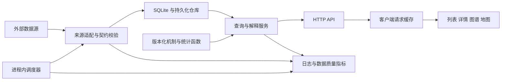

# 工程化改进与开源项目借鉴方案

- 更新日期：2026-10-28
- 状态：待实施
- 当前代码基线：`e1a9afa`；本机 Node `v24.21.0`
- 适用范围：当前 Tickerwall 工程及后续经济解释功能

当前最有价值的工程投入，是让数据采集、测试、构建和发布脱离开发机的隐含状态，并让每次解释能够追溯到数据与代码版本。建议保留 **Node 模块化单体、SQLite、原生前端和 X6**，先建立可重复交付和可靠采集，再按实际瓶颈扩展基础设施。

本文补充[经济解释产品与架构方案](economic-explainer-product-and-architecture-plan.md)，重点回答工程上如何实施。经济机制、时间语义、解释快照与证据状态继续使用该方案的定义。

## 1 优先决策

| 决策 | 当前建议 | 理由 |
| --- | --- | --- |
| 应用结构 | 保留模块化单体，继续明确模块职责 | 已有服务、数据源、存储和统计分层，可以逐段改进 |
| 前端框架 | 保留原生 JS，先完善请求层、状态和生命周期 | 当前关键问题是状态一致性与验证能力，换框架不能自动解决 |
| 类型与契约 | JSON Schema 管边界，JSDoc 与 `checkJs` 渐进检查 | 可以保持浏览器直接加载 JS，并先约束数据和接口 |
| 数据库 | 保留 SQLite，补迁移、备份、恢复与写入观测 | 当前没有证据证明数据库容量或多写者已成为瓶颈 |
| 采集 | 进程内调度、同键请求合并、按来源限流；可恢复任务才持久化 | 先把页面读取与外部抓取分开，避免过早增加 Redis 和消息队列 |
| 构建 | 先固化现有 vendor 产物，再单独评估整站构建 | 保住双击启动和已有原生模块路径，降低一次迁移的影响范围 |
| 发布 | 增加可验证的发布包；服务部署以单容器为可选路径 | 开发环境、用户运行环境和常驻部署需要各自清晰的契约 |

## 2 当前工程的具体问题

项目已有 Vitest、真实 HTTP 测试、数据源替换与回放、SQLite WAL、统计纯函数及视图 `mount/unmount`。这些能力值得继续使用。下面列出下一步需要补齐的环节。

| 优先级 | 当前事实与代码依据 | 影响 | 改进落点 |
| --- | --- | --- | --- |
| P1 | [package.json](../package.json) 声明 Node `>=20`，[启动脚本](../启动看板.command) 也提示 Node 20，但 [sqlite.js](../src/server/db/sqlite.js) 直接导入 `node:sqlite` | 用户按声明安装仍可能启动失败 | 统一版本、启动预检和 CI 环境 |
| P1 | [golden-contract.test.js](../tests/golden-contract.test.js) 默认依赖 `/tmp/golden-baseline`，没有文件就跳过；[HTTP 测试](../tests/http-integration.test.js) 直接读取可能不存在的真实数据库文件属性 | 本机测试通过不能保证干净 checkout 可用 | 固定夹具、测试数据隔离、必要契约禁止静默跳过 |
| P1 | [server.mjs](../server.mjs) 在监听前调用 `seedHistory()`；`DISABLE_BACKGROUND` 在监听后才生效 | 关闭后台任务仍不能保证离线启动 | 把离线模式覆盖到初始化、请求与后台任务 |
| P1 | [vite.config.js](../vite.config.js) 只构建两个 vendor 入口，产物入库；仓库没有已跟踪的 GitHub Actions 工作流 | 修改源码后可能继续运行旧 bundle | 构建文件集合及摘要比对、发布冒烟测试 |
| P1 | [报价服务](../src/server/services/quotes.service.js) 有进行中请求合并；[详情](../src/server/services/detail.service.js)、[宏观](../src/server/services/macro.service.js)、[事件](../src/server/services/events.service.js) 的入口没有同等合并机制；后台定时刷新主要覆盖报价 | 多页面并发可重复抓取，新闻归档依赖访问 | 统一请求键、调度与缓存行为 |
| P1 | [数据库入口](../src/server/db/sqlite.js) 用 `CREATE TABLE IF NOT EXISTS` 建表；旧数据导入以单个迁移标记记录完成 | 难以表达版本演进、部分失败与安全恢复 | 版本化迁移、导入清单、备份恢复工具 |
| P2 | [quotes.service.js](../src/server/services/quotes.service.js) 仍混合来源适配、标的定义、缓存、历史补种、旧数据迁移和复盘 | 服务之间借用大量无关能力，修改影响难以预测 | 抽离标的注册表、来源适配器、存储和分析函数 |
| P2 | [共享 store](../src/client/shared/store.js) 混合请求缓存与界面状态，视图各自管理刷新 | 后续首页、图谱、地图可能展示不同批次的解释 | 请求缓存与视图状态分开，共用快照 ID |
| P2 | [健康接口](../server.mjs) 只返回运行时间等信息；部分延迟落盘失败被吞掉；没有统一退出排空流程 | 进程还活着时，采集或保存可能已经失效 | 数据健康、结构化日志、有时限的退出流程 |

`node:sqlite` 从 Node 22.5.0 开始提供，22.13.0 起不再要求实验开关，因此 `>=20` 不能准确表达当前代码要求。Node 官方发布表将 24 列为 LTS；建议以 24 为本项目当前验证基线，并固定经测试的补丁版本。[Node SQLite 文档](https://nodejs.org/api/sqlite.html)、[Node 发布状态](https://nodejs.org/en/about/previous-releases)。

## 3 开源项目中值得借鉴的设计

选取标准是与当前需求的接近程度，以及能否从源码确认工程做法。下面区分原项目已有实现与对本项目的改造建议；不以星标数量作为架构质量依据。

### 3.1 OpenBB 的数据适配契约

当前 GitHub 连接返回的仓库是 [openbq-org/OpenBB](https://github.com/openbq-org/OpenBB)，本次固定检查提交 `7df7d0c5592bf25be88e87e130a05c71e243d2d8`。审查范围是开放数据平台核心，主要使用 Python、Pydantic 与 FastAPI；不等同于商业 Workspace。[核心依赖](https://github.com/openbq-org/OpenBB/blob/7df7d0c5592bf25be88e87e130a05c71e243d2d8/openbb_platform/core/pyproject.toml)。

其 [Fetcher](https://github.com/openbq-org/OpenBB/blob/7df7d0c5592bf25be88e87e130a05c71e243d2d8/openbb_platform/core/openbb_core/provider/abstract/fetcher.py#L35) 将查询转换、原始抓取、结果转换分开；[结果对象](https://github.com/openbq-org/OpenBB/blob/7df7d0c5592bf25be88e87e130a05c71e243d2d8/openbb_platform/core/openbb_core/app/model/obbject.py#L41) 同时保留结果、来源、警告和扩展信息。

**本项目采用方式：**将来源适配统一为“校验查询 → 抓取原文 → 解析 → 校验标准观测”，让新浪、CNBC、FRED 接受相同契约测试。来源、单位、观测时间和质量随数据传递；多源解释仍逐条关联证据。保留 JS 显式注册表，暂不移植其 Python 插件体系和命令生成系统。

该提交根 [LICENSE](https://github.com/openbq-org/OpenBB/blob/7df7d0c5592bf25be88e87e130a05c71e243d2d8/LICENSE) 声明仓库文件采用 Apache-2.0；数据供应商内容和商业产品不属于这一声明的自动覆盖范围。

### 3.2 Ghostfolio 的采集任务和数据状态

[Ghostfolio](https://github.com/ghostfolio/ghostfolio) 是投资组合产品，本次固定检查提交 `97722822ed63245e3040fa59f268ca06761298a1`。其技术栈包括 Angular、NestJS、Nx、Prisma、PostgreSQL 和 Redis/Bull。[依赖配置](https://github.com/ghostfolio/ghostfolio/blob/97722822ed63245e3040fa59f268ca06761298a1/package.json)。

[采集服务](https://github.com/ghostfolio/ghostfolio/blob/97722822ed63245e3040fa59f268ca06761298a1/apps/api/src/services/queues/data-gathering/data-gathering.service.ts#L63) 将工作加入队列，[处理器](https://github.com/ghostfolio/ghostfolio/blob/97722822ed63245e3040fa59f268ca06761298a1/apps/api/src/services/queues/data-gathering/data-gathering.processor.ts#L87) 独立控制并发，并区别处理退市等永久失败。[MarketData 模型](https://github.com/ghostfolio/ghostfolio/blob/97722822ed63245e3040fa59f268ca06761298a1/prisma/schema.prisma#L167) 保存数据源、日期、行情类型（盘中或收盘）和是否沿用旧值，并对来源、标的和日期建立唯一约束。

**本项目采用方式：**借鉴任务边界、失败分类和显式质量标记，先在单进程中实现。历史回补和解释重算保存可恢复任务状态，普通报价轮询只更新任务水位。沿用旧值可以服务展示，但不得作为新的真实观测参与相关性计算。当前不引入其整套框架、数据库和队列部署。

该提交 [package.json](https://github.com/ghostfolio/ghostfolio/blob/97722822ed63245e3040fa59f268ca06761298a1/package.json) 声明 AGPL-3.0，根 [LICENSE](https://github.com/ghostfolio/ghostfolio/blob/97722822ed63245e3040fa59f268ca06761298a1/LICENSE) 为 AGPL v3 文本。本文借鉴工程模式；若后续复制源码或打包依赖，需要另行核对实际使用范围。

### 3.3 World Monitor 的数据降级与模块边界

[World Monitor](https://github.com/koala73/worldmonitor) 与当前新闻、金融信号和地图看板最接近。本次固定检查提交 `33d5bd6149e90a8c06aa51a84b1ceb730e6412b5`；其工程包括原生 TypeScript、Vite、地图渲染、缓存和多种部署入口。[架构文档](https://github.com/koala73/worldmonitor/blob/33d5bd6149e90a8c06aa51a84b1ceb730e6412b5/ARCHITECTURE.md)。

[缓存与熔断工具](https://github.com/koala73/worldmonitor/blob/33d5bd6149e90a8c06aa51a84b1ceb730e6412b5/src/utils/circuit-breaker.ts) 区分缓存 TTL、最大可服务年龄和 `live/cached/unavailable`，并合并刷新；[服务端缓存契约](https://github.com/koala73/worldmonitor/blob/33d5bd6149e90a8c06aa51a84b1ceb730e6412b5/server/_shared/cache-contract.ts) 会检查载荷的降级语义，避免只凭 HTTP 200 决定缓存结果。还有[超龄缓存测试](https://github.com/koala73/worldmonitor/blob/33d5bd6149e90a8c06aa51a84b1ceb730e6412b5/tests/circuit-breaker-max-serve-age.test.mts)和[模块边界检查](https://github.com/koala73/worldmonitor/blob/33d5bd6149e90a8c06aa51a84b1ceb730e6412b5/scripts/lint-boundaries.mjs)。

**本项目采用方式：**每个来源分别定义“多久刷新”和“多久后不能再用于当前解释”。刷新失败不覆盖最后合格数据；超过使用上限后不能继续当作当前行情，但仍可保留为带时间的历史记录。把分层依赖方向加入 CI。当前不移植其多变体、双地图引擎、边缘服务、relay 和桌面端体系。

其[许可说明](https://github.com/koala73/worldmonitor/blob/33d5bd6149e90a8c06aa51a84b1ceb730e6412b5/docs/license.mdx)对平台声明 AGPL-3.0-only，并列出部分薄客户端的 MIT 例外；[LICENSE 末尾](https://github.com/koala73/worldmonitor/blob/33d5bd6149e90a8c06aa51a84b1ceb730e6412b5/LICENSE#L663)却包含允许后续版本的表述。本方案采用独立实现的设计模式，直接复用代码前需核实具体文件许可及这一差异。

### 3.4 Apache Superset 的预计算与结果保留

[Apache Superset](https://github.com/apache/superset) 是 BI 平台，本次固定检查提交 `9561e058ef13ba2829c18fea7eebfec94fa8035a`。它的 Python 后端和 React 前端与本项目不同，但后台计算与结果读取的职责划分有参考价值。

其[缓存预热任务](https://github.com/apache/superset/blob/9561e058ef13ba2829c18fea7eebfec94fa8035a/superset/tasks/cache.py)将预计算独立于页面访问；[配置](https://github.com/apache/superset/blob/9561e058ef13ba2829c18fea7eebfec94fa8035a/superset/config.py)区分图表缓存与异步结果后端。[官方异步部署文档](https://superset.apache.org/admin-docs/configuration/async-queries-celery/)要求周期调度只有一个负责人；[缓存文档](https://superset.apache.org/admin-docs/configuration/cache/)说明异步结果保留需要覆盖执行、轮询和读取过程。

**本项目采用方式：**常用解释在后台生成；任务完成后必须能读取对应快照。`jobId` 关联终态与稳定 `snapshotId`，只有结果和引用完成持久化后才发布成功。快照保留期与数据新鲜度分别管理。暂不引入其 BI 编辑器、SQL 引擎适配、企业权限及 Celery 集群。

可参考其[单测工作流](https://github.com/apache/superset/blob/9561e058ef13ba2829c18fea7eebfec94fa8035a/.github/workflows/superset-python-unittest.yml)的结果留存方式，不复制大型测试矩阵。该提交使用 [Apache-2.0](https://github.com/apache/superset/blob/9561e058ef13ba2829c18fea7eebfec94fa8035a/LICENSE.txt)，另有 [NOTICE](https://github.com/apache/superset/blob/9561e058ef13ba2829c18fea7eebfec94fa8035a/NOTICE)；这些声明不自动覆盖所有依赖、数据与品牌。

### 3.5 对照结论

| 参考项目 | 直接借鉴 | 在本项目中的落点 | 当前不移植 |
| --- | --- | --- | --- |
| OpenBB | 标准查询、来源适配、结果与警告 | schema、provider registry、来源契约测试 | Python 服务和通用插件平台 |
| Ghostfolio | 任务分离、失败分类、沿用值标记 | scheduler、可恢复回补、质量字段 | NestJS、Redis/Bull、PostgreSQL 全套迁移 |
| World Monitor | 最大数据年龄、语义缓存、依赖边界 | 缓存策略、降级测试、导入检查 | 多端、多变体和复杂部署拓扑 |
| Superset | 预计算、单调度者、异步结果保留 | 解释任务、快照持久化、发布门禁 | Celery 集群和 BI 平台能力 |

## 4 模块边界与技术选择

### 4.1 目标数据流

图中箭头表示数据流向，模块依赖规则见图后说明。



服务端 `domain` 和统计模块只依赖纯计算与契约；`providers` 只处理外部协议与解析；`db` 负责存储；`services` 编排它们。调度器和 HTTP 都调用服务，不让服务反向依赖 HTTP。客户端只消费公开接口，不能导入服务端存储、来源密钥或运行配置。

增加轻量导入检查，禁止 `domain → services`、`providers → routes`、`server → client/views` 和 `client → server`，检测循环依赖。构建 alias 与合法动态导入纳入解析；不要仅凭文件名或目录数量判断分层完成。

### 4.2 建议增量目录

以下为拟新增或逐步调整的位置，不要求一次搬完现有文件。

```text
src/contracts/                    API 与标准观测的 JSON Schema
src/server/app.js                 createApp 与依赖组装，不在导入时监听
src/server/routes/                解析参数并调用服务
src/server/domain/instruments.js  标的定义 单位 值域 市场日历
src/server/providers/registry.js  来源与能力注册
src/server/jobs/                  调度 限流 请求合并 回补任务
src/server/services/             查询与解释编排
src/server/db/migrations/         顺序迁移与校验
src/server/observability/         日志 计时 健康状态
src/client/shared/api.js          请求 错误 取消与版本适配
src/client/shared/query-cache.js  请求状态与数据缓存
src/client/views/                 视图自身状态及 mount/unmount
tests/fixtures/providers/        可公开 脱敏 固定的来源样本
tests/contracts/                 各来源与 API 的同一套契约
tests/e2e/                       关键用户路径
tools/doctor.mjs                  环境预检
tools/verify-build.mjs            构建一致性
tools/backup.mjs                  备份清单和校验
tools/restore.mjs                 恢复到新目录
.github/workflows/               CI 与发布工作流
```

先将 `quotes.service.js` 中的标的定义和来源函数移到对应模块，再抽迁移和历史持久化。保留临时转导出兼容旧调用方，每次迁移跑冻结输入测试；最后收口转导出。日历与宏观共用的序列处理放在统计或领域层，不继续从另一个业务服务借函数。

### 4.3 类型检查与运行时校验

第一步使用 JSON Schema 定义 `Observation`、`DataQuality` 和新解释 API；选择一种验证库，例如 Ajv，避免为同一契约并行维护多套规则。`instrumentId`、日期、有限数值、单位和状态枚举在边界检查；利率与价格使用各自值域。失败返回带来源与错误码的结果，不能无记录地转为空数组。

第二步对 `domain`、`providers`、`db` 和新解释模块加入 JSDoc，并用 TypeScript `allowJs + checkJs + noEmit` 检查。使用独立配置逐层扩大范围，服务端与浏览器分别设置环境类型，避免 DOM 和 Node 全局对象混用。[TypeScript checkJs](https://www.typescriptlang.org/tsconfig/checkJs.html)。

共享 schema 是契约的唯一来源；若生成类型或文档，CI 检查生成物一致性。浏览器可使用 JSDoc 类型引用，但不要为了加载共享定义开放整个 `src/` 静态目录。确需客户端运行的校验代码，经构建进入 `public/vendor/` 或放在受控的客户端目录。

已有 API 保持响应形状，通过适配器增加质量字段。新解释 API 沿用产品方案的 `{schemaVersion, explanation, meta}`，并保持 `contentStatus` 与 `freshness` 分离；不能借“统一封装”之名一次改坏全部调用方。

## 5 可重复构建与运行

### 5.1 固定运行环境

选择 Node 24 的经测试补丁版本，写入 `.nvmrc`，同步 `engines`、CI、发布镜像和启动提示。当前开发机的 `24.21.0` 可作为首轮候选，不把“本机能运行”当作已完成多平台验证。记录 npm 版本并使用提交的 `package-lock.json` 与 `npm ci`；更新运行时通过独立变更验证。

`doctor` 在导入应用入口前检查：Node 版本、`node:sqlite` 可用性、配置值域、数据目录可写性、静态入口与产物存在性。它只报告可操作的错误，不自动改变全局 Node、不打印配置密钥。macOS 双击脚本应报告实际 Node 路径及版本，避免终端和 Finder 使用不同运行环境。

配置统一解析一次：区分缺失、零值与非法数字；为端口、超时、TTL 和并发设置范围。部署模式只从显式配置读取模型凭据；本地已有的外部工具配置回退作为兼容选项保留，迁移时明确提示。`.env.example` 仅列字段与占位值。

### 5.2 先验证现有 vendor 产物

`verify-build` 从独立空临时输出目录构建，核对完整文件集合和内容摘要，包括新增 chunk、CSS 与资源，不能只检查两个固定 JS 文件。将结果与仓库中的受管产物比较，漏提交、旧文件残留或摘要不同均使检查失败。不能沿用当前 `emptyOutDir:false` 后，误把旧产物当成本轮输出；同一提交在不同临时路径各构建一次，也应得到相同文件摘要。

为构建记录维护产物清单，包含输入源码摘要、锁文件摘要、工具链版本和输出摘要。源码提交号放在发布包清单中，避免把当前提交号嵌入同一提交要追踪的 bundle 而形成自引用变化。固定名称资源使用可验证的缓存策略；整站构建后才统一切换为带内容哈希的资源名。

检查必须覆盖 import map、动态 import、CSS 和 d3 单实例约束。当前 `d3-selection` 与 `d3-transition` 同 bundle 的要求继续保留，不能为了拆包让它们出现两份实例。[现有依赖约定](../README.md)。

### 5.3 区分开发环境与发布包

| 环境 | 入口 | 需要保证的行为 |
| --- | --- | --- |
| 开发 | 安装开发依赖，运行测试和构建 | 能修改源码、重建 vendor、查看错误 |
| 本地发布包 | `node server.mjs` 或双击启动 | 带齐 `public/` 和当前浏览器需要的 `src/client/`，不依赖开发机缓存 |
| 常驻服务 | 同一发布包制作单容器镜像 | 明确数据卷、配置、健康检查、日志和重启策略 |

发布包通过白名单收集应用文件和许可证，排除真实 `data/`、用户配置及测试录制中的敏感内容。当前服务端依赖 Node 内建模块，可以验证没有 `node_modules` 的启动；以后增加服务端 npm 依赖时，必须先决定随包交付或显式安装，不能继续声称无需依赖安装。

整站 Vite 构建单独立项：先让所有视图在构建输出中完整工作，再生成可直接运行的 release 包。生产环境一次选择一整套构建，缺文件就报错，避免逐文件 `dist → public` 回退把新旧版本混在一起。保留旧发布包供回退。

## 6 测试和持续集成

### 6.1 先修可复现性

1. 将必要样本放入 `tests/fixtures/`，标明来源类型、录制时间、许可或使用依据、脱敏方式和覆盖场景。必要契约样本缺失直接失败；人工录制的额外诊断可继续按需运行。
2. 用固定时钟、临时数据目录和独立数据库驱动测试。真实数据库不存在时断言测试没有创建它；存在时不能依赖运行中应用会变化的 mtime 作为唯一隔离证据。优先在隔离副本中构造“存在”和“不存在”两种场景。
3. 测试子进程使用必要环境变量白名单，显式关闭外部配置读取，避免从开发机继承模型凭据。关闭后台任务之外，还要关闭启动补种并统一替换所有网络出口。
4. 回放模式在缺样本、坏样本、未知请求时失败，不回退真实网络；样本读取失败也不能成为静默空结果。
5. 修正 [replay.js](../src/server/providers/replay.js) 请求键：目前请求体只以长度区分，同长度不同内容会碰撞。改为方法、规范化 URL、请求体摘要及必要语义头；敏感请求必须先脱敏，不能把完整认证信息写入夹具。
6. 将“当前市场价格应在某区间”的检查留给有明确时间的样本或线上质量监测；不要让市场正常变化导致程序契约测试失败。

### 6.2 分层测试目标

| 层级 | 验证内容 | 失败时如何定位 |
| --- | --- | --- |
| 领域单测 | 单位、利率差值、时区、时间窗、缺失与修订选版 | 固定输入和独立预期 |
| 来源契约 | 正常、空、格式变化、超时、429、负利率、错误实体 | 指向具体来源和样本 |
| 服务集成 | 回退、同键合并、快照一致性、部分来源失败 | 使用回放与临时库 |
| 存储测试 | 旧库升级、事务失败、幂等导入、引用保留、恢复 | 迁移版本及校验报告 |
| HTTP 测试 | 状态码、参数、公开字段、静态边界、健康信息 | 真服务进程或可注入应用实例 |
| 浏览器测试 | 页面导航、取消旧请求、解释展开、图谱和地图加载 | Trace、截图与控制台错误 |

延续现有覆盖率基线，对高风险模块补分支测试。不要直接将注释中的 90%–95% 目标改成全仓门槛；先测量，再为有明确遗漏风险的模块逐步收紧。

2026-10 实测：全站 71.4%（statements），`src/server/**` 97.4%、`src/client/shared/**` 98.9%、`views/map/geo|logic` 95.9~97.9%、`src/client/views/**` 51.7%。门槛已按实测值写进 `vite.config.js`（只许升不许降），视图层维持 50% 而不是 95% —— 理由同上一段：DOM 拼装的行覆盖不等于行为覆盖。

浏览器测试建议加入 Playwright，先覆盖黄金详情、图谱、地图和新闻四条核心路径，使用固定 API 数据；再增加少量通过真实本地 API 与来源回放的完整路径。CI 保存失败 trace 和截图，便于复现。[Playwright CI 文档](https://playwright.dev/docs/ci-intro)。

### 6.3 CI 执行顺序

| 作业 | 必须执行的内容 | 通过条件 |
| --- | --- | --- |
| 基础检查 | 固定 Node/npm、`npm ci`、格式、lint、核心类型检查、契约校验 | 无新增错误；生成物一致 |
| 离线测试 | 单测、契约、HTTP、存储迁移测试 | 不连接外网、不读取个人数据，必要测试零跳过 |
| 构建验证 | 临时构建与受管产物比对 | 文件集合和摘要一致，静态资源可解析 |
| 浏览器冒烟 | 固定数据的四条核心路径 | 无关键控制台错误，读到预期解释或明确降级状态 |
| 发布演练 | 从打包结果在新目录启动，使用空数据和迁移样本 | 启动、关闭、恢复成功；发布清单完整 |

依赖安装与浏览器下载阶段可以联网；“离线”门禁约束安装完成后的应用和测试网络请求。PR 作业不给生产密钥。真实来源探活另设手动或定时作业，记录来源故障，不让第三方短暂断连直接阻塞所有代码提交。

现有 `npm test`、`npm run test:cov`、`npm run build` 可继续使用。拟新增的 `lint`、`typecheck`、`test:contract`、`test:e2e`、`verify:build`、`doctor`、`release:check` 必须随对应 PR 实现，再写入 CI；本文中的命令名称不是当前已可执行的能力。

上述表格是最终门禁范围。E03 先接入 E02 已修复的测试、构建一致性与基本发布启动；E04 增加 schema 和类型门禁，E05 增加迁移恢复，E07 增加浏览器路径，E08 补齐部署与退出演练。每一项在对应能力交付时转为必需检查，避免早期 CI 引用尚不存在的脚本。

## 7 数据采集与任务可靠性

### 7.1 来源注册表与缓存策略

来源注册表记录：稳定 ID、支持的指标和频率、查询参数、超时、并发上限、请求预算、能力开关、认证是否可用及缓存策略。保留 [providers/http.js](../src/server/providers/http.js) 的可注入网络出口和现有新闻抓取池，在其上收口策略，避免每个 service 重做一套。

缓存键包括来源、指标、频率、窗口和影响结果的参数；日志只记录安全键或摘要。对同键进行中请求合并；刷新按钮也遵守来源限流，不能用 `force=1` 无限绕过保护。多个消费者共享同一采集任务时，取消某个页面请求不应终止其他消费者仍需要的采集。

刷新 TTL 与最大可用数据年龄分别配置；后者根据来源频率、市场日历与用途判断。HTTP 200 但载荷表示失败或数据不可用时，不覆盖最后合格结果；合法空结果则按其业务语义缓存，不能将“暂无新闻”等正常空结果一律视为故障。验收覆盖语义失败、合法空结果和旧数据超龄。

为每个来源设置有限重试和带随机扰动的退避，尊重可用的 `Retry-After`。鉴权错误、参数错误和格式变化进入不同处理分支；长时间失败暂停正常频率并尝试恢复探测。先测量再调整阈值，不把所有失败都视为“网络抖动”。

### 7.2 调度和持久任务分开

| 任务类型 | 执行方式 | 持久化内容 |
| --- | --- | --- |
| 报价、新闻、日历、日频指标轮询 | 单进程 scheduler，按来源频率与日历触发 | `collection_state` 中最后成功时间、下次运行时间、错误和水位 |
| 历史回补、批量解释重算 | 有去重键的可恢复任务 | `collection_jobs` 中输入版本、状态、尝试次数、下次尝试和完成结果 |
| 页面读取 | 读取已生成快照；需要时请求刷新 | 不为每次 GET 创建一条永久任务记录 |

普通 15 秒报价轮询不需要无限保存任务行，重启后抓取最新一轮，不补跑所有错过的轮询。`collection_state` 的键至少区分来源、指标和频率，并记录最近尝试、最近成功、下次尝试、失败次数和数据截止时间。手动与定时刷新共用同键合并机制。

运行日志按容量和保留期滚动；长任务按批次保存进度，数据写入与对应检查点在同一事务提交。持久任务需要过期租约回收、取消、最大尝试次数和终态保留策略，重启后恢复未完成工作；执行结果用唯一键防止重复写入，不宣称“只执行一次”。验收时在批次中途终止进程，验证恢复后不漏数据、不重复生效。

解释任务只有在快照与证据引用已提交后才能标记成功，并返回稳定结果 ID。不能清理仍被任务结果或解释引用的快照；新鲜度过期不会自动删除历史版本。这一约束与产品方案的不可变解释保持一致。

第一版只允许一个采集写者实例。若应用被启动两份，要么启动时拒绝重复写者，要么显式分为只读服务与单独采集进程，不能依赖 SQLite 自动防止业务重复采集。

### 7.3 数据质量贯穿链路

按产品方案保留 `observedAt`、`fetchedAt`、`knownAt`、来源、观测修订和质量。源请求成功但内容陈旧，仍应标为陈旧；旧缓存恢复读取，不刷新其观测时间。合法零值、负值、缺失和被沿用的值分开表示。

新增指标使用相同入口校验，数据保存后再生成解释快照。采集质量与页面可用性分别报告：某来源不可用时可以继续展示旧数据，但应限制哪些新解释可以成立。

## 8 前端状态与交互验证

保留当前路由与视图生命周期，新增 `api.js` 和 `query-cache.js`，逐个视图迁移。请求缓存保存 `data、fetchedAt、error、refreshStatus、inflight`；选择的资产、窗口、展开项和图谱位置留在视图状态中。

统一请求层负责参数编码、状态码处理、超时和取消。切换资产时使用请求序号或 `AbortController` 防止旧响应覆盖新选择；卸载视图时释放定时器、事件订阅、ResizeObserver 和图谱实例。新快照更新数据时保留阅读位置，并通过同一个 `explanationId` 联动首页、详情、图谱与地图。

缓存更新时间不能当成经济观测时间。客户端只展示服务端计算的事实、机制和质量状态，避免为了渲染方便在多个视图中重复实现金融判断。

先记录首屏可交互时间、图谱首次加载耗时和重复导航的内存变化，再设性能预算。若分析计算确实阻塞主线程，优先移到 Web Worker；若服务端统计阻塞请求，先限制范围和复用计算结果，再评估 worker threads。改变线程模型前要有可复现的耗时证据。

## 9 数据迁移与运行维护

### 9.1 数据库迁移

新增 `schema_migrations(version, checksum, appliedAt)`，每步迁移有固定脚本、事务边界和校验。启动先检查数据库版本；版本比当前程序支持范围更新时拒绝写入，避免旧程序破坏新结构。

将旧 JSON/JSONL 导入从报价 service 中移出，按文件或批次记录成功、失败及校验结果。不存在的可选旧文件可以跳过；损坏文件、SQL 错误和部分导入不能统称为“不存在”，也不能因此写入全局完成标记。先完成迁移与引用完整性测试，再上线产品方案 B0 的解释和证据表。

### 9.2 备份恢复

第一版采用维护窗口：停止采集和写入、排空延迟保存、关闭应用，再创建数据库备份并复制仍在使用的 history JSON、events JSONL。清单记录应用版本、schema 版本、文件摘要、备份时间和保留策略；不能只备份 `.db` 而遗漏其他持久化状态。

E05 同时实现最小停写、`flush` 和 `closeDb` 能力，作为维护备份的前置条件；E08 再把它们整合到完整信号处理、调度排空和部署流程，避免备份工具依赖尚未交付的退出机制。

SQLite 提供 Online Backup API，也支持 `VACUUM INTO`。后续在线备份可使用这些能力；跨数据库和 JSONL 的一致性仍需要统一的写入暂停或水位策略，单个 SQLite 备份不能自动保证整套应用状态一致。[SQLite 备份文档](https://sqlite.org/backup.html)。

恢复默认写入新目录：校验摘要，运行数据库完整性检查和关键引用检查，用隔离端口启动验证后再切换。升级回退先判断 schema 兼容性；不兼容时恢复备份到新目录，并说明会失去备份时间之后的写入，不自动覆盖唯一现存数据。

### 9.3 健康状态和退出流程

| 信号 | 内容 | 行为 |
| --- | --- | --- |
| 存活状态 | HTTP 进程能响应 | 不因一个外部来源失败就反复重启 |
| 就绪状态 | 必要迁移完成、核心存储可访问、应用可以服务 | 未就绪时部署流量不进入 |
| 数据健康 | 各来源最后成功时间、覆盖范围、降级原因、任务积压 | 显示降级，定位需要恢复的来源 |
| 解释质量 | 生成耗时、证据不足率、校验失败率、模板回退率 | 评估功能是否可靠，而不只看请求是否 200 |

日志统一输出 `requestId、jobId、provider、durationMs、result、errorCode`，通过采集批次和解释 ID 关联，避免输出认证头、模型密钥、完整原始响应及私人目录。先用结构化日志和简单状态接口；已有集中运维需求后再接指标系统。

增加 `SIGTERM/SIGINT` 处理：停止调度、停止接新请求、等待有上限的任务排空、flush、关闭数据库并退出。可恢复来源错误在任务边界处理；不可恢复异常记录后退出，由进程管理器按退避重启，避免进程持续处于未知状态。

保留本地双击启动；启动脚本校验 HTTP 状态和应用标识，不能将端口上任何服务都视为本项目。单容器部署使用固定基础镜像、独立数据卷、非 root 用户和日志保留策略。本地直接运行默认监听 `127.0.0.1`；容器内显式设置 `HOST=0.0.0.0`，宿主端口默认发布到 `127.0.0.1`，保证端口映射可用且访问范围明确。需要多人远程访问时，再增加鉴权、访问边界和配额设计。

## 10 分批实施与验收

下列工作可拆为独立 PR。规模是相对工作量，不是工期承诺：小表示局部改动，中表示跨模块但契约明确，大表示需要兼容迁移与恢复演练。

| 编号 | 交付内容 | 依赖 | 规模 | 验收标准 |
| --- | --- | --- | --- | --- |
| E01 | Node、配置与 doctor | 无 | 小 | 不支持版本在启动前报错；开发与 CI 使用同一版本契约 |
| E02 | 离线夹具、隔离启动、请求键修正 | E01 | 中 | 无真实 data、无 `/tmp` 基线、禁止外网时必需测试仍运行；不读取个人凭据 |
| E03 | CI、vendor 核对、发布包冒烟 | E02 | 中 | 漏打包或漏文件阻断发布；新解压目录可运行 |
| E04 | 数据契约与来源注册表 | E02 | 中 | 一个新增来源只需实现适配器及样本；错误单位和时间被识别 |
| E05 | schema 迁移、旧数据导入、最小停写与 flush、备份恢复 | E02 | 大 | 旧样本库升级、部分失败重试、停止写入后备份、恢复到新目录均通过 |
| E06 | 调度、请求合并、质量状态 | E04、E05 | 大 | 无页面访问也采集新闻；同键并发只触发一轮抓取；重启后可恢复长任务 |
| E07 | 客户端请求层与关键浏览器测试 | E03、E04 | 中 | 快速切换无旧响应覆盖；重复进出图谱可正确释放资源；各视图快照一致 |
| E08 | 日志、健康、退出、单容器发布 | E03、E05、E06 | 中 | 能定位来源失败和落盘失败；限时退出；升级和恢复步骤可演练 |

建议第一批交付 E01–E03，同时继续产品方案 A1–A4 的关键口径修正；第二批完成 E04–E06，支撑黄金解释 B0、B3、B6；第三批把 E07–E08 与黄金详情和首页联动一起验证。日志基础可在 E06 前加入，完整运行验收在 E08 完成。

每个 PR 写明影响的契约、固定测试样本和回退方式。纯模块搬迁与金融计算口径修正分开提交，便于判断输出变化是预期修正还是重构回归。

## 11 何时再引入更复杂的技术

| 技术变化 | 触发依据 | 在此之前先做 |
| --- | --- | --- |
| 整站 TypeScript | 核心 `checkJs` 已稳定，新增复杂契约需要更强表达 | 收口 schema，渐进检查，避免全仓改后缀 |
| Vue 或 React | 多个页面重复复杂交互组件，维护成本可测量 | 请求层、状态边界、生命周期和交互测试 |
| PostgreSQL | 多实例写入、复杂查询或锁等待成为已测量瓶颈 | 索引、事务、保留策略与单写者约束 |
| Redis 与外部队列 | 跨进程调度、共享配额或积压超出单进程能力 | 幂等任务契约、租约、恢复和来源预算 |
| 独立采集进程 | 长任务持续影响 API 延迟，需要独立资源与重启 | 先抽 jobs 边界，保留同仓代码和协议 |
| 微服务 | 团队所有权、发布周期或故障隔离确有独立需求 | 模块化单体和可观测性 |
| 专用时序库或图数据库 | 历史体量、关系查询复杂度超出当前存储可接受范围 | 明确数据模型和查询指标；UI 有图谱不等于必须上图数据库 |

## 12 与现有方案的关系

- [工程化与流程图方案](engineering-and-flowchart-plan.md)：保留 X6、布局和分层的已有成果；未来构建迁移以本文的完整产物和发布验证要求为补充。
- [经济解释产品与架构方案](economic-explainer-product-and-architecture-plan.md)：继续作为产品目标、经济语义和解释数据契约依据；本文提供 CI、采集、存储和运行条件。
- [全球地图方案](worldmap-situation-room-plan.md)：地图继续消费同一份标准数据和解释，不独立再建采集与归因链路。

本轮交付为工程方案。审查中已有统计和服务相关的 92 项测试通过；干净环境 CI、浏览器回归、发布演练和恢复演练是上述实施任务的验收项，不能用这 92 项测试替代。

## 13 实施状态（滚动更新）

> 本节按实际代码与命令输出填写，不按计划意图填写。每条「已完成」都要能指到文件或命令。
> 更新规则：交付一项、跑一次 `npm test` / `npm run test:cov` / `npm run verify:build`，再改这里。

### 13.1 E01–E08

| 编号 | 状态 | 已交付 | 验收证据 | 剩余 |
| --- | --- | --- | --- | --- |
| E01 Node、配置与 doctor | **已完成** | [`.nvmrc`](../.nvmrc) 固定 24.21.0；`engines` 同步 `>=24`；[`tools/doctor.mjs`](../tools/doctor.mjs) 六项预检（版本 / node:sqlite / 配置区间 / 数据目录可写 / 静态产物 / 运行时依赖），`--json` 给 CI；[`config.js`](../src/server/config.js) 在 import 时做版本守卫（失败 exit 78 并给 nvm 指引）；[`启动看板.command`](../启动看板.command) 先跑 doctor，只放行 0 与 2 | `node tools/doctor.mjs` → 7 ok / 0 warn / 0 error；`.nvmrc` 与 `engines` 一致由 doctor 断言 | 无（多平台验证留给 CI 矩阵） |
| E02 离线夹具、隔离启动、请求键 | **进行中** | ① 回放键改为「方法 + 规范化 URL + body 摘要 + 语义头摘要 + 凭据存在性」，凭据值永不入键（[`replay.js`](../src/server/providers/replay.js)），补齐 6 条单测；② 契约快照从 `/tmp` 迁到 [`tests/fixtures/golden/`](../tests/fixtures/golden/)，缺文件直接失败（不再 `describe.skip`）；③ HTTP 隔离断言改为**内容摘要**比对，干净 checkout 也成立；④ `DISABLE_BACKGROUND=1` 时 `seedHistory()` 不联网（原来在 `listen()` 前补种） | `tests/services.test.js`（29）、`tests/golden-contract.test.js`（12）、`tests/http-integration.test.js`（17）、`tests/quotes-service.test.js`（40） | 固定时钟与临时数据目录尚未覆盖全部测试；子进程环境变量白名单只做到「不遗传模型凭据」这一条 |
| E03 CI、vendor 核对、发布包冒烟 | **进行中** | [`tools/verify-build.mjs`](../tools/verify-build.mjs)：两个独立临时目录各构建一次，比对文件集合与 sha256，再与 `public/vendor/` 逐文件比；[`.github/workflows/ci.yml`](../.github/workflows/ci.yml)：doctor → `npm ci` → `npm test` → `test:cov` → `verify:build` | `npm run verify:build` → 2 个文件 / 1115.6 KB，两次构建摘要一致且与入库产物一致 | 发布包（白名单收集 + 新目录启动冒烟）未做 |
| E04 数据契约与来源注册表 | **已完成** | [`src/contracts/`](../src/contracts/)（Observation / DataQuality / 解释外壳三份 JSON Schema，带 `$id` 与 examples）；[`contracts/index.js`](../src/server/contracts/index.js)（Ajv + ajv-formats，返回带字段路径的 `{ok, errors}`，并提供「合格/不合格」分组而不丢数据）；[`providers/registry.js`](../src/server/providers/registry.js)（15 个源：kinds / 超时与预算 / 能力开关 / 两级时间 / 凭据需求）；写库前校验接入 `persistReferencedObservations`（不合格进 `rejected` 并计入 `meta.invalidObservations`） | `tests/contracts.test.js`（21：单位、值域、日期格式、多字段、批量不丢、注册表自洽、标的↔适配器全覆盖） | 仅覆盖「观测」这一条链路；HTTP 响应尚未逐端点跑 schema 校验（留给 E07） |
| E05 迁移、导入、flush、备份恢复 | **已完成** | ① `schema_migrations(version, name, checksum, applied_at)` + 漂移检测（改过的迁移立刻报错）+ 「库比程序新」拒绝打开；② 导入抽到 [`db/legacy-import.js`](../src/server/db/legacy-import.js)，`import_ledger` 按来源记 `ok/absent/partial/failed` + 文件（或目录）校验和，只有全部成功才写总体标记，失败项下次启动重试；③ [`db/sqlite.js`](../src/server/db/sqlite.js) 的维护窗口：`stopWrites()`（`PRAGMA query_only=ON`，语句层拦写）、`flush()`（排空钩子 + WAL checkpoint）、`withWriteAccess()`（同步回调 + 自动收回）；④ [`db/maintenance.js`](../src/server/db/maintenance.js) 备份/校验/恢复；⑤ [`tools/backup.mjs`](../tools/backup.mjs)、[`tools/restore.mjs`](../tools/restore.mjs) + `POST /api/maintenance/backup`（进程内备份，默认关闭） | `tests/db-migrations.test.js`（8）、`tests/db-maintenance.test.js`（14）、`tests/db-legacy-import.test.js`（13）；实测：CLI 备份 17 文件 / 22.4 MB → 恢复新目录 → 完整性 ok、外键 0 违规 → 隔离端口起服务首页 200；进程内端点 `flushed.hooks=1`（CLI 拿不到运行中进程的内存，所以两者都需要） | 在线备份（不停写）未做；保留策略只按份数，不做时间/容量维度 |
| E06 调度、请求合并、质量状态 | **已完成** | ① [`jobs/coalesce.js`](../src/server/jobs/coalesce.js)：同键合并 + 两级时间（TTL 与 maxServeAge）+ 刷新失败保留旧值；接入 `getDetail` / `getMacro` / `getEvents` 三个入口（原来只有报价有合并）；② 迁移 v3 新增 `collection_jobs` 与 `collection_state.data_cutoff_at`（数据水位与「抓取成功」分开）；③ [`jobs/queue.js`](../src/server/jobs/queue.js)：去重键、租约领取、过期回收、`max_attempts` 终态、`runOne` 批量消化；④ 解释重建改为入队（`explanations` 任务只入队，`job-queue` 任务消化），启动时 `recoverPendingJobs()` 先回收中断任务；⑤ `/api/health` 增加 `queue` 概览 | `tests/jobs-coalesce.test.js`（11）、`tests/services-coalescing.test.js`（3，服务级：「并发同标的只构建一次」）、`tests/jobs-queue.test.js`（16）、`tests/jobs-and-quality.test.js`（24）；实测：线上 queue `done=1`（解释重建确实经队列完成）；手工造一个 running 任务 + 过期租约 → 重启日志 `[bg] 恢复 1 个中断任务` | 队列只接了「解释重建」一条生产线；历史回补尚未接（等 E07 之后按需） |
| E07 客户端请求层与浏览器测试 | **进行中**（核心层与第一条路径完成） | ① [`shared/api.js`](../src/client/shared/api.js)：参数编码（不丢 `api/x` 的前导语义、空格用 `%20`）、超时、`AbortController` 取消、错误六分类（network/timeout/http/parse/aborted/business，带 `retryable`）、同 URL 并发合并；② [`shared/query-cache.js`](../src/client/shared/query-cache.js)：`data/fetchedAt/error/refreshStatus/inflight` 五字段，失败**不覆盖**数据，取消不算失败，`describeRefresh()` 给四种状态不同文案；③ [`shared/explanation-store.js`](../src/client/shared/explanation-store.js)：按 `assetId@windowKey` 共享快照，旧快照按 `generatedAt` 丢弃，`state.js` 在 200 时发布 —— 首页/详情/图谱/地图读同一个 `explanationId`；④ 第一个视图迁移样板 `views/briefing.js`（从 0 覆盖到 88%），改成消费快照而不是 try/catch res.json()；⑤ [`tests/browser-path.test.js`](../tests/browser-path.test.js)：起真服务进程 + jsdom 渲染真实视图，覆盖行情列表 / 详情+解释 / 事件中心 / 隔夜复盘四条路径 | `tests/client-api.test.js`（23）、`tests/client-query-cache.test.js`（19）、`tests/client-explanation-store.test.js`（17）、`tests/views-briefing.test.js`（7）、`tests/browser-path.test.js`（10） | 其余 9 处直接 `fetch` 的视图尚未迁移；Playwright 第二层未做（理由见 §14.1） |
| E08 日志、健康、退出、单容器 | **已完成** | [`observability/health.js`](../src/server/observability/health.js)：存活 / 就绪 / 数据健康分开报，就绪检查静态入口、数据目录可写、契约可编译、注册表自洽；`/api/health` 保留旧字段并新增 `readiness` / `contracts` / `sources`（缺凭据的源被点名）；[`routes/system.js`](../src/server/routes/system.js) 把健康与市场探针从入口抽出（server.mjs 199 → 180 行） 结构化日志 [`observability/log.js`](../src/server/observability/log.js)（一行一条 JSON，`requestId/method/url/status/durationMs/result/errorCode`；凭据键与查询串 token 一律脱敏）；请求日志用 `withRequestLog` 在入口包一层（一次请求恰好一条，含 404/500）；[`lifecycle.js`](../src/server/lifecycle.js) 的 `installShutdown`（停调度 → 关连接 → 限时排空 5s → flush → closeDb → exit）；[`app.js`](../src/server/app.js) 把路由表与 405 守卫搬出入口（server.mjs 195 → 118 行）；[`Dockerfile`](../Dockerfile) + `.dockerignore`（非 root、`/app/data` 卷、健康检查读 readiness） | `tests/observability.test.js`（23：脱敏、日志形状、请求日志三种结果、退出五种情形、Dockerfile 形态）、`tests/app-router.test.js`（12：逐路由参数归一/边界/404/405/500）；实测：真进程请求日志两条（`result: ok` / `client_error`），SIGTERM 后 `closeResult=closed, flushHooks=1, durationMs=7` 并退出 | 没有集中式指标系统（按方案 §9.3「先结构化日志，有需求再接指标」）；容器构建本身未在 CI 跑（CI 无 docker daemon） |

### 13.2 覆盖率推进（目标 95%）

2026-10-29 实测（`npm run test:cov`）：**全站 90.82% statements / 65.29% branches / 73.82% functions / 73.84% lines**。
（E01–E08 全部落地；`src/server/**` 与 `src/client/shared/**` 均在门槛之上，主战场只剩 `src/client/views/**`。）

| 范围 | 实测 | 门槛 | 说明 |
| --- | --- | --- | --- |
| 全站 | 90.82 / 79.65 / 90.48 / 92.60 | 73 / 64 / 73 / 73 | 目标 95，按目录分批抬 |
| `src/server/**` | 门槛通过（app.js 95.7%、log.js 95%、lifecycle 88.9%、契约 100%） | 92 / 80 / 93 / 94 | 剩余缺口是解释服务与 collector 的异常分支 |
| `src/client/shared/**` | 99.46 / 97.05 / 100 / 100 | 97 / 97 / 99 / 99 | 已达 95（含新增的 api / query-cache / explanation-store） |
| `src/client/views/**` | 46.6（`views/macro` 子目录 80.2 / 66.9 / 82.0 / 81.8；`views/map` 除主文件外全部 100） | 50 / 46 / 50 / 49 | 距 95 最远。已拿下：`briefing.js`（0 → 88%）、`flow-canvas.js`（0 → 74.1%，用记录型假 X6 测接线逻辑）；已拿下：`map.js`（11.4% → 47.3%，纯函数 + 整屏渲染两条路线）、`views/map` 除主文件外全部 100%；已拿下：`macro/index.js`（0 → 98%）、`macro.js`（46 → 75%）、`map.js`（11 → 66%）；已拿下：`detail.js`（58 → 76%）；已拿下：`state.js`（75 → 95%）、`events.js`（87 → 91%）；已拿下：`map.js`（66 → 83% 行）、`client/router.js`（**0 → 100%**）、`client/main.js`（0 → 96.6%）；client/views 79.88%。剩余：分支覆盖（78.5% → 95）是唯一门槛，逐文件补错误/边界分支 |

推进顺序：先把 `src/server/**` 抬回 96/86/96/98（补 5 个缺口模块），再攻 `views/**`（DOM 渲染 + 交互断言，不收「跑通不断言」的面子测试）。
