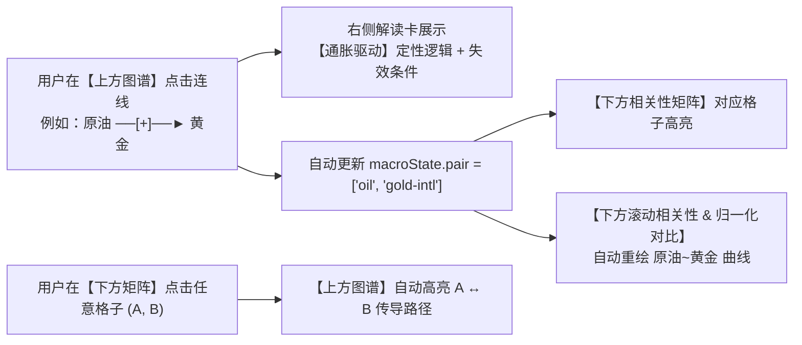
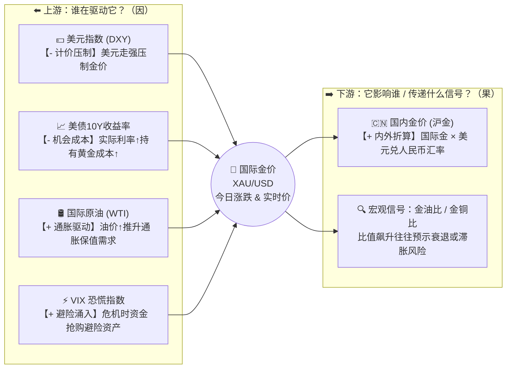

# 金融产品传导图谱与宏观逻辑沙盘 · 完整设计方案（方案 A）

> **方案核心定位（方案 A：定性 × 定量双剑合璧）**
> 直接升级现有的 **「关联分析」(`#/macro`)** 页面：
> - **上半场（定性·为什么动）**：新增 **「全球金融传导图谱与逻辑沙盘」**，通过 **全局四象限罗盘 + 单点聚焦思维导图 + 5大经典宏观剧本 + 沙盘推演 + 实时背离预警**，让用户在 3 秒内看懂黄金、石油、美元、美债、股指、加密资产之间的底层影响逻辑。
> - **下半场（定量·动了多少）**：保留并联动现有的 **13×13 相关性矩阵、领先滞后扫描、40期滚动相关性、归一化走势对比**。点击上方图谱的任意连线，下方滚动相关性折线与走势叠图自动同步切换！

---

## 一、 整体版面架构与信息层次（UI Layout）

升级后的 `#/macro` 页面采用 **「上定性沙盘、下定量检验；左图形画布、右深度解读」** 的工作台布局：

```text
┌────────────────────────────────────────────────────────────────────────────────────────┐
│ ← 返回列表   世界经济关联 · 传导图谱与统计检验              [Risk-On / Risk-Off 徽章]  │
├────────────────────────────────────────────────────────────────────────────────────────┤
│ 【模块 1：金融传导图谱与宏观逻辑沙盘】（新增核心版面）                                 │
│ ┌────────────────────────────────────────────────────────────────────────────────────┐ │
│ │ 视图模式：[🌐 全局罗盘] [🌿 单点思维导图] [⚡ 沙盘推演]                            │ │
│ │ 经典剧本：[全部关系] [①美元潮汐] [②石油通胀螺旋] [③地缘避险同涨] [④衰退交易] [⑤狂欢]│ │
│ ├────────────────────────────────────────────────────────────────────────────────────┤ │
│ │ ⚡ 实时背离提醒：检测到 [美元指数 ↔ 国际金] 近期同涨，避险/购金逻辑压倒计价压制 [查看]│ │
│ ├───────────────────────────────────────────────────────┬────────────────────────────┤ │
│ │                                                       │ 【深度机理与实盘对照卡】   │ │
│ │              中央交互式 SVG 传导图谱画布              │  🏅 国际金 ◄──[-]── 💵 美元│ │
│ │                 (viewBox: 0 0 860 540)                │                            │ │
│ │                                                       │ ● 核心机理：计价效应与替代 │ │
│ │   • 全局模式：四象限生态位 + 贝塞尔流光弧线 + 胶囊    │ ● 传导逻辑：国际金以美元计 │ │
│ │   • 导图模式：上游驱动因子 ──► 聚焦标的 ──► 下游传导  │   价，美元走强压制金价...  │ │
│ │   • 推演模式：点击 [模拟大涨↑/大跌↓] 演示一阶二阶冲击 │                            │ │
│ │                                                       │ ── 实盘数据验证 ──         │ │
│ │   [图例：──[+]─► 正向推升   - -[-]--► 负向压制        │ • 最新表现：金+0.8% 美-0.3%│ │
│ │          ··[⚡]··► 逻辑背离   ● 粒子方向=因果传导方向] │ • 250日相关：-0.41 (显著*) │ │
│ │                                                       │ • 40期滚动：-0.38 (逻辑吻合)│ │
│ │                                                       │                            │ │
│ │                                                       │ ● 何时失效（背离条件）：   │ │
│ │                                                       │   地缘冲突升级或主权信用担 │ │
│ │                                                       │   忧时，两者同为避险资产同涨│ │
│ │                                                       │ [↓ 跳转查看下方滚动相关性] │ │
│ └───────────────────────────────────────────────────────┴────────────────────────────┘ │
├────────────────────────────────────────────────────────────────────────────────────────┤
│ 【模块 2：相关性矩阵 (13×13)】（现有定量模块，支持与上方图谱双向点击联动）             │
├────────────────────────────────────────────────────────────────────────────────────────┤
│ 【模块 3：谁在影响谁 (领先滞后扫描)】                                                  │
├────────────────────────────────────────────────────────────────────────────────────────┤
│ 【模块 4：滚动相关性 (40日/周窗口)】 ◄── 点击上方图谱连线时自动切换此处的标的组合      │
├────────────────────────────────────────────────────────────────────────────────────────┤
│ 【模块 5：归一化走势对比 (起点=100)】 ◄── 自动勾选图谱当前选中的两个标的               │
└────────────────────────────────────────────────────────────────────────────────────────┘
```

### 上下半场双向联动交互流



---

## 二、 三大图形化模式详细设计（Visual & Interaction Specs）

为了同时满足 **「全局关系网宏观把握」** 与 **「单点思维导图清晰不乱」** 的需求，画布内置三种可一键切换的视图模式：

### 模式 1：🌐 全局四象限罗盘视图（默认模式）

不采用随机乱飞的力导向图（Force-Directed Graph），而是根据金融资产在宏观经济中的**功能属性**，将 `MACRO_UNIVERSE` 中的标的固定在 **四大生态位**（画布尺寸 `860 × 540`）：

| 生态位分区 | 画面位置 | 包含标的（`id`） | 视觉角色与边框色调 |
| :--- | :--- | :--- | :--- |
| **① 全球定价之锚（流动性总阀）** | **顶层中枢** (`y: 65~115`) | 美元指数 (`dxy`)、美债10Y收益率 (`us10y`) | **紫金中枢锚**：决定全球资金价格与计价分母，向四周辐射影响 |
| **② 通胀与实体之源（大宗商品）** | **左翼象限** (`x: 70~240, y: 210~370`) | WTI原油 (`oil`)、布伦特原油 (`brent`)、COMEX铜 (`copper`) | **琥珀工业色**：反映实体供需与通胀压力（“通胀之母”与“铜博士”） |
| **③ 终极避险与波动温度计** | **右翼象限** (`x: 620~790, y: 210~370`) | 国际金 (`gold-intl`)、沪金 (`gold-cn`)、VIX恐慌 (`vix`) | **明黄/青色避险盾**：抗通胀、抗信用风险、衡量市场恐慌度 |
| **④ 全球权益与高Beta风险资产** | **底层象限** (`y: 430~490`) | 纳指100 (`ndx100`)、标普500 (`sp500`)、上证 (`sh000001`)、比特币 (`btc`) | **红蓝风险层**：对利率折现（久期）、经济增长和全球流动性最敏感 |

> **同源标的聚合展示（降噪设计）**：
> 在全局罗盘默认状态下，`WTI原油` 卡片内附带 `布伦特` 子标签，`国际金` 卡片内附带 `沪金` 子标签，`VIX` 卡片内附带 `VXN` 子标签（与首页列表设计同构），把 13 个数据标的合并为主画布上的 **10 个核心节点**、**16 条主干边**；当点击展开「单点思维导图」时，再把 `WTI ↔ 布伦特 (E18)`、`国际金 ↔ 沪金 (E16)` 的簇内联动完整画出来。
> 底层 4 个风险资产节点按 `上证 (118) → 标普 (326) → 纳指 (534) → BTC (742)` 排列，使 `铜→上证 (E12)`、`标普→纳指 (E17)`、`纳指→BTC (E13)` 三条强相关边均相邻直连，无需跨节点拱出画布。

#### 连线（Edge）的视觉编码规范
1. **方向与粒子流光**：使用二次贝塞尔曲线（`M ... Q ...`），带 SVG `<marker>` 箭头；线上叠加 `stroke-dasharray: 6 10` 的流光动画（`@keyframes edgeFlow`），**光点流动方向即「谁影响谁（因 → 果）」**。
2. **正负性质配色**：
   - **`[+] 正向驱动 / 同向联动`**：暖红实线（`#f5455c`），胶囊底色 `rgba(245, 69, 92, 0.16)`。
   - **`[-] 负向压制 / 跷跷板`**：冷蓝虚线（`#5b9cf8`），胶囊底色 `rgba(91, 156, 248, 0.16)`。
   - **`[⚡] 实盘背离高亮`**：琥珀金脉冲线（`#f59e0b`），提醒用户“当前行情正打破常规理论”。
3. **线上机理胶囊（Edge Pill）**：每条主干连线中点绘制圆角矩形胶囊，直接显示 **符号 + 4字核心逻辑**（例如：`[-] 计价压制`、`[+] 通胀推升`、`[-] 估值折现`、`[-] 机会成本`）。

---

### 模式 2：🌿 单点聚焦思维导图视图（Focus Mindmap View）

当用户在全局罗盘中**双击任意节点**，或切换到 **「🌿 单点思维导图」** 模式时，画布切换为**极简、零交叉的左右双向思维导图（Ego-Centric Tree）**：



* **顶部快捷标的切换栏**：在思维导图模式下，画布上方提供一排标的胶囊（`黄金`、`原油`、`美元`、`美债10Y`、`纳指`、`标普`、`铜`、`BTC`、`VIX`、`上证`、`沪金`），点哪个就展开哪个的专属思维导图。
* **顺藤摸瓜交互**：点击导图左侧（上游）或右侧（下游）的任意关联节点卡片，中心焦点会带平滑过渡动画切换到该节点，实现“顺着因果链一路追查”。

---

### 模式 3：⚡ 沙盘推演模式（What-If Shock Simulator）

让用户从“被动看图”变成“主动推演”：
1. **触发方式**：切换到 **「⚡ 沙盘推演」** 模式，选择任意核心变量（如 `🛢️ 国际原油`、`💵 美元指数`、`📈 美债10Y`、`⚡ VIX恐慌`），点击 **`[模拟大涨 ↑]`** 或 **`[模拟大跌 ↓]`**。
2. **一阶与二阶传导计算规则**：
   - **震源节点（Source）**：高亮发光，标记 `[假设冲击：大涨 ↑]`。
   - **一阶受影响节点（1-Hop）**：沿直接出边计算方向 `dir1 = shockDir × edge.sign`，节点浮现 **`[一阶利多 ↑]`**（红）或 **`[一阶利空 ↓]`**（绿/蓝），连线加速流光。
   - **二阶受影响节点（2-Hop）**：沿一阶节点继续向外传播一层 `dir2 = dir1 × edge2.sign`。
   - **多路径博弈识别（核心亮点！）**：
     如果同一个标的通过两条路径收到**方向相反**的冲击，节点自动标记为琥珀色 **`[⚡ 多空交织]`**，右侧面板给出博弈拆解！
     > **典型案例：模拟「🛢️ 国际原油 大涨 ↑」对「🏅 黄金」的影响**
     > - **路径 A（一阶正向 `+`）**：`原油 ↑` $\rightarrow$ `[+ 通胀驱动]` $\rightarrow$ **利多黄金 `↑`**（通胀保值买盘）
     > - **路径 B（二阶负向 `-`）**：`原油 ↑` $\rightarrow$ `[+ 加息预期]` $\rightarrow$ `美债10Y ↑` $\rightarrow$ `[- 机会成本]` $\rightarrow$ **利空黄金 `↓`**（高利率压制）
     > - **沙盘结论**：短期通常交易「通胀与地缘逻辑」（黄金跟涨），中期若引发美联储实质性紧缩则转为「利率压制逻辑」。

---

## 三、 底层金融传导知识图谱字典（完整数据表）

在前端新增配置模块，内置 **18 条核心因果传导关系（`MACRO_TRANSMISSION_EDGES`）** 与 **5 大经典剧本（`MACRO_PLAYBOOKS`）**。

### 1. 18 条核心因果传导边（`MACRO_TRANSMISSION_EDGES`）

| 编号 | 驱动源 (`from`) | 受影响方 (`to`) | 理论方向 (`sign`) | 权重 (`1~3`) | 4字胶囊 (`label`) | 核心传导机理 (`mechanism`) | 何时失效 / 反常背离原因 (`divergenceReason`) |
| :---: | :--- | :--- | :---: | :---: | :--- | :--- | :--- |
| **E01** | `dxy` (美元) | `gold-intl` (黄金) | **`-1`** | 3 | `计价压制` | 国际黄金以美元计价，美元走强不仅抬高非美买家成本，也体现美元信用相对走强，压制金价。 | **地缘危机 / 主权债务担忧**：当爆发战争或市场担忧美债信用时，资金同时涌入美元与黄金避险，出现罕见「同涨」。 |
| **E02** | `dxy` (美元) | `oil` (原油) | **`-1`** | 2 | `计价效应` | 原油贸易以美元结算（石油美元），美元升值直接削弱新兴市场与欧洲的原油进口购买力。 | **供给端强冲击**：当 OPEC+ 大幅减产或中东航道受阻时，供给短缺压倒汇率计价，油价与美元会同时走强。 |
| **E03** | `dxy` (美元) | `copper` (铜) | **`-1`** | 2 | `计价与流动性` | 美元走强往往伴随全球美元流动性收紧，抑制工业金属投机需求与非美制造业采购。 | **中美制造业共振复苏**：当全球工业补库需求极强时，基本面拉动铜价无视美元走强。 |
| **E04** | `dxy` (美元) | `btc` (比特币) | **`-1`** | 2 | `流动性虹吸` | 美元指数走强代表全球风险资金回流美元现金资产，高风险、高Beta的加密资产首当其冲失血。 | **加密原生叙事/ETF资金流入**：现货 ETF 大规模净流入或监管利好期间，BTC 可走出独立行情。 |
| **E05** | `us10y` (美债10Y) | `gold-intl` (黄金) | **`-1`** | 3 | `机会成本` | 黄金是零息资产，美债收益率是持有黄金的直接机会成本；美债利率上行（尤其实际利率上行）对金价构成强压制。 | **去美元化与央行购金**：近年来全球央行战略性增持黄金、或市场担忧财政赤字货币化时，金价经常顶着高美债利率创新高。 |
| **E06** | `us10y` (美债10Y) | `ndx100` (纳指) | **`-1`** | 3 | `估值折现` | 美债10Y是全球风险资产定价的「分母」；科技成长股远期现金流占比高（长久期），对利率上行极其敏感。 | **经济强劲复苏 / AI 盈利爆发**：若利率温和上行是因为经济繁荣、企业盈利（分子端）增速远超利率涨幅，纳指可与利率同涨。 |
| **E07** | `us10y` (美债10Y) | `dxy` (美元) | **`+1`** | 3 | `利差吸引` | 美债收益率上升扩大了美元与欧元、日元、人民币的利差优势，吸引全球套息与配置资金流入美元。 | **美国财政可持续性危机**：若美债遭抛售（收益率飙升）是因为市场质疑美国财政纪律，美元反而可能随美债价格一同下跌（股债汇三杀）。 |
| **E08** | `oil` (原油) | `gold-intl` (黄金) | **`+1`** | 2 | `通胀驱动` | 原油是“通胀之母”，油价上涨直接推升 CPI 与通胀预期，激发黄金作为硬通货的抗通胀保值需求。 | **衰退型油价下跌 / 紧缩抢跑**：当经济衰退担忧升温时，原油因需求坍塌暴跌，但黄金因避险与降息预期反而上涨（金油比飙升）。 |
| **E09** | `oil` (原油) | `us10y` (美债10Y) | **`+1`** | 2 | `通胀与加息` | 油价大涨推升全面通胀预期，迫使美联储推迟降息甚至维持高利率，债券投资者要求更高的通胀补偿，推升美债收益率。 | **地缘恐慌下的避险买债**：若油价暴涨是由突发战争引起，避险资金短期涌入美债避险，可能压低美债收益率。 |
| **E10** | `oil` (原油) | `sp500` (标普) | **`-1`** | 1 | `能源成本税` | 高油价相当于对全社会企业和居民征收“能源税”，挤压航空、物流、制造利润并削弱消费能力（但能源板块除外）。 | **需求驱动型温和上涨**：在经济复苏早期，需求回暖带动油价与股市同步温和上涨（此时油价反映的是经济景气而非供给冲击）。 |
| **E11** | `copper` (铜) | `sp500` (标普) | **`+1`** | 2 | `经济晴雨表` | 铜广泛应用于电力、建筑、新能源与制造业，被称为“铜博士”，铜价走强验证全球实体经济需求扩张，利好企业盈利。 | **供给侧矿端罢工/逼仓**：若铜价暴涨纯粹由矿山停产或期货逼仓导致，并不代表实体需求好转。 |
| **E12** | `copper` (铜) | `sh000001` (上证) | **`+1`** | 2 | `中国需求映射` | 中国消耗全球约一半的精炼铜，地产基建与制造业景气度同时驱动铜价与 A 股周期/顺周期板块。 | **国内纯流动性/题材行情**：当 A 股由微盘股或科技主题驱动而宏观总需求偏弱时，两者相关性减弱。 |
| **E13** | `ndx100` (纳指) | `btc` (比特币) | **`+1`** | 3 | `科技与流动性` | 两者同属全球美元流动性与风险偏好的最前沿晴雨表，机构投资者画像高度重叠，呈显著正相关。 | **加密行业独立黑天鹅**：交易所暴雷或专属监管事件会导致 BTC 脱离美股独立剧烈波动。 |
| **E14** | `sp500` (标普) | `vix` (恐慌指数) | **`-1`** | 3 | `恐慌期权对冲` | 标普500下跌时，机构投资者恐慌性抢购看跌期权（Put）进行尾部保护，直接推升隐含波动率 VIX（实测相关性约 -0.75）。 | **极少失效（结构性负相关）**：仅在极端逼空行情中可能出现股指暴涨同时看涨期权隐含波动率短暂抬升。 |
| **E15** | `vix` (恐慌指数) | `gold-intl` (黄金) | **`+1`** | 2 | `避险买盘` | 当 VIX 飙升、全球风险资产剧烈动荡时，避险资金从股市撤出并配置黄金以对冲尾部风险。 | **流动性枯竭危机（Cash is King）**：在极端崩盘初期（如 2020 年 3 月熔断），机构为补交保证金会无差别抛售黄金换取美元现金，导致黄金随股市短暂同跌。 |
| **E16** | `gold-intl` (国际金) | `gold-cn` (沪金) | **`+1`** | 3 | `内外盘折算` | 沪金由伦敦金通过「÷ 31.1035 × 美元兑人民币汇率」传导定价，长周期周频相关性高达 +0.72 以上。 | **人民币汇率大幅波动 / 境内外溢价**：当人民币汇率单日大幅波动，或国内春节购金旺季/进口配额收紧时，内外盘会出现明显价差偏离。 |
| **E17** | `sp500` (标普) | `ndx100` (纳指) | **`+1`** | 3 | `美股共振` | 纳指100权重股（科技七巨头）同时占标普500近三成权重，两者同受美国宏观与企业盈利驱动（相关性 > +0.92）。 | **风格高低切换（价值 vs 成长）**：当利率急升引发科技股杀估值、资金轮动去传统能源/金融/道指时，纳指显著弱于标普。 |
| **E18** | `oil` (WTI) | `brent` (布伦特) | **`+1`** | 3 | `全球原油双锚` | 同受全球原油供需与 OPEC+ 政策驱动（相关性 > +0.92）；WTI 偏重美国内陆供需，布伦特偏重欧洲与中东海运。 | **美湾库欣交割库拥堵 / 地缘航运割裂**：当地缘冲突封锁红海/霍尔木兹海峡时，布伦特溢价会显著扩大。 |

---

### 2. 5 大经典宏观传导剧本（`MACRO_PLAYBOOKS`）

点击顶部剧本按钮时，画布自动压暗无关连线，仅用高对比度流光点亮该剧本的传导链，并在右侧面板展示分步叙事：

1. **`① 美元潮汐（鹰派加息冲击）`**
   - **点亮链路**：`us10y ↑` $\xrightarrow{\text{[+ 利差吸引]}}$ `dxy ↑` $\xrightarrow{\text{[- 全面压制]}}$ `gold-intl ↓` / `oil ↓` / `copper ↓` / `btc ↓`，同时 `us10y ↑` $\xrightarrow{\text{[- 估值折现]}}$ `ndx100 ↓`
   - **核心叙事**：美联储收紧货币或通胀超预期 $\rightarrow$ 美债10Y收益率与美元双双飙升 $\rightarrow$ 全球流动性收紧、分母端折现率抬升 $\rightarrow$ 黄金、大宗商品、科技股与加密货币遭遇“万物皆跌”。
2. **`② 石油通胀螺旋（滞胀魅影）`**
   - **点亮链路**：`oil ↑` $\xrightarrow{\text{[+ 通胀驱动]}}$ `gold-intl ↑`；同时 `oil ↑` $\xrightarrow{\text{[+ 通胀与加息]}}$ `us10y ↑` $\xrightarrow{\text{[- 估值折现]}}$ `ndx100 ↓` & `sp500 ↓`
   - **核心叙事**：地缘减产或供给危机引爆油价 $\rightarrow$ 通胀预期抬头首先利好黄金抗通胀 $\rightarrow$ 但顽固通胀随后倒逼美债利率走高、挤压企业利润 $\rightarrow$ 高估值科技股与消费股承压下跌。
3. **`③ 地缘危机（黄金美元罕见同涨）`**
   - **点亮链路**：`vix ↑` + `oil (供给担忧) ↑` + `gold-intl (避险) ↑` + `dxy (现金避险) ↑` + `sp500 ↓`
   - **核心叙事**：战乱或重大地缘冲突爆发 $\rightarrow$ 市场恐慌指数 VIX 飙升 $\rightarrow$ 资金同时抢购原油（防断供）、黄金（终极避险）和美元（流动性避险），**直接打破平时「美元涨、黄金跌」的跷跷板规律**！
4. **`④ 衰退恐慌交易（铜油跌、债金涨）`**
   - **点亮链路**：`copper ↓` & `oil ↓` $\xrightarrow{\text{[经济降温]}}$ `sp500 ↓` $\xrightarrow{\text{[降息预期]}}$ `us10y ↓` $\xrightarrow{\text{[- 机会成本下降]}}$ `gold-intl ↑`
   - **核心叙事**：非农/制造业数据暴雷引发衰退担忧 $\rightarrow$ 对实体需求最敏感的“铜博士”与原油率先大跌，美股跟跌 $\rightarrow$ 市场押注央行大幅降息，美债收益率跳水 $\rightarrow$ 持有成本下降叠加避险需求，推升黄金独立走强（金铜比、金油比飙升）。
5. **`⑤ 流动性狂欢（Risk-On 降息交易）`**
   - **点亮链路**：`us10y ↓` $\rightarrow$ `dxy ↓` $\rightarrow$ `btc ↑` & `ndx100 ↑` & `gold-intl ↑` & `copper ↑` & `vix ↓`
   - **核心叙事**：宽松周期开启、美债利率与美元同步回落 $\rightarrow$ 全球廉价资金充裕 $\rightarrow$ 对流动性最敏感的比特币、纳斯达克科技股、黄金与工业金属迎来普涨共振。

---

## 四、 「理论 × 实盘」实时背离检测算法（Divergence Engine）

这是将看板从“静态科普图”升级为**“实盘交易罗盘”**的核心算法。直接复用 `/api/macro` 已返回的 `data.recent.changes` 与 `data.matrix`：

```javascript
/**
 * 评估某条理论传导边 (edge: from -> to, sign: +1 | -1) 在当前实盘中的状态
 * @returns {'aligned' | 'diverged' | 'neutral'}
 */
function evaluateEdgeReality(edge, macroData) {
  const changesA = macroData.recent?.changes?.[edge.from] ?? [];
  const changesB = macroData.recent?.changes?.[edge.to] ?? [];
  if (changesA.length < 20 || changesB.length < 20) return { status: 'neutral' };

  // 1. 取最近一期非空收益率（日频或周频）及各自近期标准差
  const lastA = findLastValid(changesA);
  const lastB = findLastValid(changesB);
  const stdA = calcStd(changesA.slice(-60));
  const stdB = calcStd(changesB.slice(-60));

  // 2. 计算近 20 期 / 60 期滚动相关性（先取成对非空 pairwise 样本再截尾，避免跨时区休市空洞稀释样本）
  const roll20 = lastRollingCorr(changesA, changesB, 20);
  const roll60 = lastRollingCorr(changesA, changesB, 60);
  const longCorr = getMatrixCorr(macroData.matrix, edge.from, edge.to);

  // 3. 判定是否发生显著「逻辑背离 (Divergence)」
  // 条件 A（单期剧烈异动背离）：两端当日波动均超过 0.5 倍标准差，且方向乘积与理论 sign 相反
  const significantMove = Math.abs(lastA) > 0.5 * stdA && Math.abs(lastB) > 0.5 * stdB;
  const moveProductSign = Math.sign(lastA * lastB);
  const singleDayDiverged = significantMove && moveProductSign !== 0 && moveProductSign !== edge.sign;

  // 条件 B（短期趋势背离）：20 样本标准误约 0.24，门槛收紧至 0.35 并要求 60 期同向反号二次确认，
  // 或 20 期单窗达到 0.45（|t| > 2.13, p < 0.05 统计显著反转）
  const opp20 = roll20 != null && Math.sign(roll20) !== edge.sign;
  const opp60 = roll60 != null && Math.sign(roll60) !== edge.sign;
  const trendDiverged = opp20 && (Math.abs(roll20) >= 0.45 || (Math.abs(roll20) >= 0.35 && opp60));

  if (singleDayDiverged || trendDiverged) {
    return {
      status: 'diverged',
      badge: edge.sign === -1 && lastA > 0 && lastB > 0 ? '⚡ 罕见同涨'
           : edge.sign === -1 && lastA < 0 && lastB < 0 ? '⚡ 罕见同跌'
           : '⚡ 逻辑背离',
      lastA, lastB, roll20, longCorr,
    };
  }

  // 4. 判定是否强力兑现（Aligned）
  const isAligned = (significantMove && moveProductSign === edge.sign) ||
                    (roll20 != null && Math.sign(roll20) === edge.sign && Math.abs(roll20) >= 0.25);

  return {
    status: isAligned ? 'aligned' : 'neutral',
    badge: isAligned ? '✓ 逻辑兑现' : '○ 常态波动',
    lastA, lastB, roll20, longCorr,
  };
}
```

---

## 五、 代码工程落地计划（零依赖、模块化）

遵循项目现有的 **原生 ES Module + 纯手写 SVG + 零外部前端依赖** 工程规范（与 `public/worldmap.js` 保持一致）：

### 1. 文件变更清单

| 文件路径 | 变更类型 | 职责说明 |
| :--- | :---: | :--- |
| `public/macro-graph.js` | **新增** | 独立封装：① 13个标的生态位坐标与角色定义；② 18条传导边字典 `MACRO_TRANSMISSION_EDGES` 与 5大剧本 `MACRO_PLAYBOOKS`；③ 实盘背离检测器 `evaluateEdgeReality()`；④ 三种模式的 SVG 渲染器（全局罗盘、单点思维导图、沙盘推演）与右侧机理卡片 HTML 生成器。 |
| `public/app.js` | **修改** | 在 `renderMacro()` 顶部接入 `macroGraphSectionHTML(data, macroState)` 并绑定交互事件；实现图谱点击连线/节点与下方 `macroState.pair`、`macroState.picked` 的双向同步。 |
| `public/styles.css` | **修改** | 新增 `.macro-graph-wrap`、`.graph-stage`（桌面端左图右卡网格、移动端上下堆叠）、SVG 连线流光动画 `@keyframes edgeFlow`、节点呼吸效果、剧本胶囊栏与背离横幅样式。 |
| `README.md` | **修改** | 在「世界经济关联看板」章节补充金融传导图谱、5大剧本与实盘背离检测的设计说明。 |

### 2. 关键交互细节打磨
- **默认初始状态**：进入 `#/macro` 时，默认展示 **「🌐 全局罗盘」** 视图，并默认高亮选中最经典的 **`黄金 (gold-intl) ↔ 美元 (dxy)`** 连线（与现有代码 `public/app.js` 的默认选中对完全一致），右侧直接呈现黄金与美元的传导机理与今日实盘验证。
- **局部重绘不闪烁**：切换图谱模式、点击节点/连线、切换剧本或操作沙盘推演时，只局部刷新图谱容器与联动图表，**不重新请求 `/api/macro` 网络接口**，实现毫秒级丝滑响应。
- **响应式适配**：桌面端（`> 1024px`）采用左画布（`1fr`）+ 右解读卡（`340px`）并排；窄屏/移动端自动变为画布在上、解读卡在下的流式布局，SVG 通过 `viewBox` 自适应缩放。
