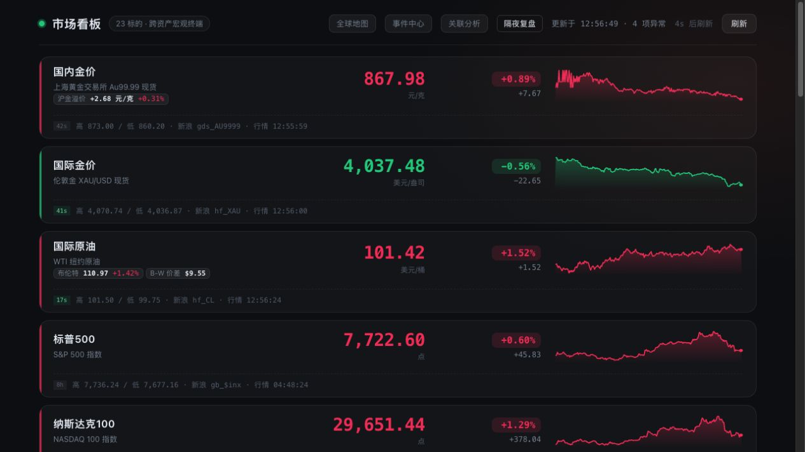
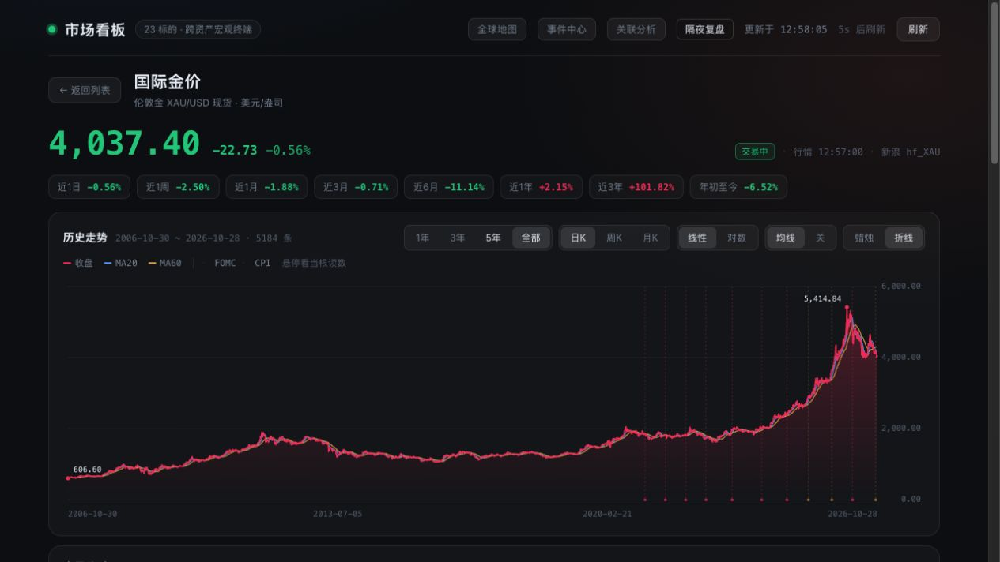
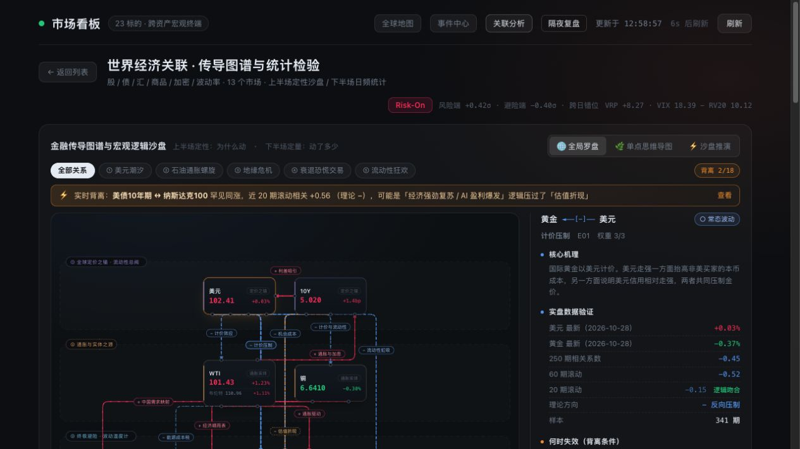
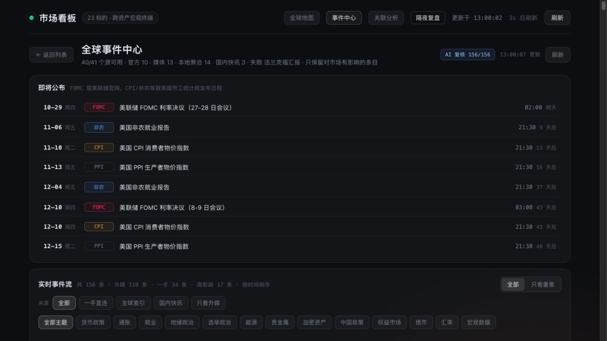

# 面向普通用户的产品功能演进建议

- 日期：2026-10-28
- 状态：产品建议，待试用验证
- 目标：让非金融用户看懂一次经济变化，能比较不同结果，并持续检查自己的理解

下一阶段建议围绕“看懂一个变化 → 比较为什么不同 → 跟踪解释是否改变”建设。当前行情、图谱、新闻和日历已经提供了较好的素材，主要机会在于把这些素材组织成用户能完成的任务。

本文补充[经济解释产品与架构方案](economic-explainer-product-and-architecture-plan.md)。上一份方案中的问题式首页、解释卡和聚焦图仍是基础；本次进一步明确新增功能、现有功能调整和取舍。工程依赖参见[开源项目借鉴与工程化方案](engineering-open-source-benchmark-and-roadmap.md)。

## 1 本次走查与判断范围

本次重新通过内置浏览器查看当前运行页面，沿“行情首页 → 国际金价详情 → 关联分析 → 事件中心”完成四步检查，并保存了当次截图。下面的页面观察来自本次走查；新增功能及排序是产品假设，尚未经过真实用户研究验证。

| 步骤 | 页面 | 整体状态 | 与产品目标的主要差距 |
| --- | --- | --- | --- |
| 1 | 行情首页 | 价格清楚，问题入口不足 | 能看到涨跌，需要自行发现值得理解的问题 |
| 2 | 国际金价详情 | 行情工具丰富，解释入口不足 | 首屏优先展示长期走势图与技术控件 |
| 3 | 关联分析 | 机制探索能力强，默认复杂 | 术语、全图、剧本、统计与提醒同时出现 |
| 4 | 事件中心 | 日历来源明确，重点解读偏后 | 多周日历占据首屏，今天最重要的事件不够突出 |

本次没有重新操作地图、沙盘、聚焦模式，也未测窄屏、键盘完整路径、屏幕阅读器或量化对比度；对这些功能的进一步建议属于设计方向，不作为本次验证结论。截图中的行情只说明页面呈现，不用于归因当日市场。

## 2 最值得新增的功能

### 2.1 对照解读

**用户问题：国际黄金跌了，国内黄金为什么显示上涨？**

首页已经存在国内金、国际金和沪金溢价。本次建议是在这些能力之上建立完整的对照阅读流程，而不是重复做一个单位换算器。

第一版只支持国内金与国际金。用户点击“为什么不同步”，先看两者是否处于可比时间窗，再分别查看国际价格、汇率、单位换算和境内外溢价。保留原始报价和统一口径，明确哪些差异是可以直接计算的，哪些解释还需要证据。

同屏红绿不同并不自动代表真实背离：不同昨收时间、盘中时点和币种都可能造成误读。无法对齐时，页面先解释不可比原因，不生成确定归因。

**优先级：P1。**与黄金解释一起做。验收重点是用户能说出至少一个差异来源，并知道当前比较的时间和单位。暂不开放任意两资产组合，先把一个高价值问题做好。

### 2.2 解释变化记录

**用户问题：昨天说和利率有关，今天这个解释还成立吗？**

每条解释下增加“与上次相比”的变化列表：新增了什么事实、哪些因素得到更多支持、哪些出现相反证据、哪些仍未确认。保留原解释和当时可知信息，让用户知道观点为何变化。

首版只跟踪黄金一个问题。内容采用事实与因素状态的变化，不展示大段文本差异；没有新证据就明确说没有实质更新。提前写明“观察到什么会削弱这个解释”，让后续更新有可检查的依据。

**优先级：P2，依赖解释快照与证据版本。**验收时加入一条反向证据，用户应能找到原结论并说清变化原因。不能因为价格方向相符就标记“预测成功”，也不能事后改写旧解释。

### 2.3 关注问题与变化简报

**用户问题：我只关心金价、换汇和出行成本，不想每天翻完所有市场。**

让用户主动选择最多三个问题，例如“国内金为什么与国际金不同步”“美元走强会影响什么”。下次进入时，先展示自上次查看以来与这些问题有关的新事件和解释变化。

首版使用本地保存，允许跳过选择，不要求注册、不接持仓。简报可以为空；没有实质变化时显示“暂无重要更新”，不为了填满版面增加新闻。同一事件的转载不重复提醒。

**优先级：P2，依赖事件聚合与解释变化。**先验证站内简报是否有用，再考虑用户主动订阅的提醒、摘要频率与免打扰。不能把后台每次数据刷新都变成通知。

### 2.4 预期与实际解读

**用户问题：数据明明变好了，市场为什么反而下跌？**

在财经日历的一个事件中展示“公布前预期、实际公布、前值及修订”，并说明两个不同问题：与上期相比如何，与公布前预期相比如何。“较上月回落”和“高于预期”可以同时成立，不能只依据数值上升或下降标注利好、利空。

第一版只选一个有可靠预期来源的指标。展示共识来源、形成时间和公布时间；随后列出共同窗口中已观察到的市场变化及候选机制，不直接把同时发生当成因果。

**优先级：P2，数据条件满足后上线。**没有可靠共识数据时保留实际值和前值，显示“预期数据暂缺”；不能让模型补一个预期值。验收要求用户能区分与前次公布值的差异、预期差和前值修订，并保留指标自身的同比或环比、季调或未季调口径。

### 2.5 原位学习与有范围的追问

**用户问题：实际收益率、基点、美元指数是什么意思？我还不知道该怎么问。**

术语在原文位置展开“一句白话、一个例子、一个容易误解的地方”。首版覆盖黄金路径中的 8–10 个词，阅读后可直接收起，不离开当前问题。

在解释末尾提供三个与上下文有关的追问，例如“为什么利率上升可能压低黄金”“什么情况下不成立”“国内金为什么不同”。回答继承当前资产、时间窗和证据，来源不足时明确说明。

**优先级：术语 P1，追问 P2。**术语内容可与解释卡并行完善。先提供可点击的问题，再决定是否增加自由输入；自由输入不是首屏必需入口。用新例子复测理解，不能只用“我看懂了”按钮证明用户已经掌握。

### 2.6 与生活和行业的连接

**用户问题：世界经济变化和我的出行、进口商品、工作行业有什么关系？**

从用户主动选择的地区和场景出发，先做一条有资料支持的路径。例如“能源变化 → 运输成本 → 出行与商品价格”，分别标明直接渠道、当地政策或合同条件、可能的延迟与未知项。

后续可围绕物价、利率、汇率、就业与贸易形成主题入口，让非投资用户也有持续使用的理由。真实资金、贸易或运输流量需要独立数据，不能用价格变化替代。

**优先级：P2 后段。**先完成一个地区和一个场景，再扩展。国际油价上涨不能直接写成“明天本地油价上涨”；没有本地数据时只展示机制与缺失项。首版不要求提供收入、持仓等个人财务信息。

## 3 现有功能应如何调整

| 功能 | 调整建议 | 保留的价值 | 观察依据或状态 |
| --- | --- | --- | --- |
| 首页 | 先呈现最多三个值得理解的问题，再看关注行情；标题说明资产和窗口 | 价格、涨跌、来源、市场状态 | 步骤 1 |
| 资产详情 | 首屏增加一句概述、候选因素、反向因素与未知项；历史图默认匹配问题窗口 | 长期历史、K 线与指标作为深入入口 | 步骤 2 |
| 图谱 | 默认围绕一个问题或资产展开一条路径；全图与统计按需进入 | 全局关系探索、机制卡和例外 | 步骤 3 |
| 事件中心 | 默认“今天重点三件事＋下一件关键发布”；完整日历与消息流下沉 | 来源、完整时间线、分类筛选 | 步骤 4 |
| 隔夜复盘 | 从涨跌列表升级为“发生了什么、可能原因、哪些尚不清楚、接下来观察什么” | 跨市场时间基准与比较 | 既有能力的设计建议，本轮未操作 |
| 沙盘 | 先选择供给、需求等冲击条件，再看直接、间接和相反作用 | 交互式理解机制 | 延续既有方案，本轮未操作 |
| 地图 | 默认围绕所选事件，说明发生地与影响范围；明确连线语义 | 地理上下文与事件定位 | 延续既有方案，本轮未操作 |

默认简洁与深入分析应当通过清楚的展开入口连接，不必一开始强迫用户选择“新手版／专家版”。高级功能按需展开符合渐进呈现原则，但不能把用户常用的来源和数据状态藏得太深。[NN/g 渐进呈现](https://www.nngroup.com/articles/progressive-disclosure/)。

### 3.1 应先修正的信任表达

- “AI 复核”改为实际完成的工作，例如“AI 辅助分类”。该标记不应被理解为原文或影响已获真实性认证。
- 将观测时间、刷新时间、市场休市与来源延迟分别表达。用户不应靠理解接口或错误码判断数据能否使用。
- 明确区分事实、一般机制、本次候选解释和情景假设。相关性与走势一致不应被包装成因果证明。
- 给出支持、反向和未确认状态，避免用没有校准依据的“可信度 92%”增加权威感。
- 涨跌方向同时使用文字和符号；来源、时间和例外说明也必须可读，不能靠淡化关键信息获得整洁效果。

### 3.2 用任务组织导航

建议主要入口逐步收敛为“今日理解”“探索关系”“我的关注”。行情、地图、统计和完整日历作为对应任务中的视图，保留现有深链接与明确返回路径。

导航收敛要先验证：新用户能否找到黄金问题，已有用户能否快速回到行情和矩阵。若常用入口反而需要更多操作，就调整入口位置，不为统一命名而增加阅读成本。

## 4 暂缓增加的功能

| 功能 | 暂缓原因 | 以后进入路线图的条件 |
| --- | --- | --- |
| 全能金融聊天助手 | 空白输入要求用户先知道问什么，也扩大无证据回答范围 | 有范围的追问被验证有效，来源与拒答机制稳定 |
| 涨跌预测与因果贡献百分比 | 容易让用户把解释当确定预测 | 有清楚的模型、验证数据和独立产品定位 |
| 模拟交易和持仓管理 | 会引入新的核心任务与敏感数据，分散理解目标 | 明确决定服务投资决策人群，并另做需求验证 |
| 社区观点流和排名 | 增加内容治理、噪声和追逐观点的动机 | 用户确有交流需求且运营能力成熟 |
| 更多地图动画和无限节点 | 信息量和视觉复杂度增加，不必然改善理解 | 现有路径理解测试表明缺少这些信息 |
| 完整课程或打卡体系 | 会建立第二套使用流程，可能偏离随看随懂 | 原位词条与案例被持续使用后再评估 |

历史案例回放可以作为后续学习功能，但应冻结当时可知的数据和解释，并展示成功与失效的案例。它的价值是理解条件变化，不是只选“预测正确”的故事。

## 5 实施顺序与产品验收

### 第一轮 让黄金问题可理解

完成解释优先的首页和黄金详情，修正时间与证据措辞；增加国内金与国际金的对照阅读和原位术语。复用当前图谱，只让它承接单条解释路径。

建议找 5 位没有金融职业背景的试用者，每人完成三项任务：找到本次变化、复述一条可能的作用路径、说出一个限制条件。首轮目标为至少 4 人能在一分钟内完成主要理解任务，并能在需要时找到来源。该目标尚未测量。

### 第二轮 让用户能持续检查解释

解释快照稳定后增加变化记录和关注问题。预期与实际功能只在共识数据来源可靠时接入；有范围的追问逐步开放。

观察用户能否准确回答“与上次相比变了什么”，以及是否会因为具体问题而回来，而不是只看访问次数。相同报道、无证据改写和无意义刷新不算有价值更新。

### 第三轮 从市场价格扩展到现实经济

增加一个地区的生活或行业路径，并挑选少量可回放案例。之后再评估跨境贸易、能源运输和真实资金流量。

每新增一类内容，都要能够解释来源、时间、适用范围和缺失项。用户应知道图上的线表示机制还是实际流量。

### 建议关注的指标

| 指标 | 如何观察 | 不宜代替它的指标 |
| --- | --- | --- |
| 理解完成率 | 用户复述一个机制并指出限制条件 | 停留时长、滚动深度 |
| 事实与假设辨别 | 用未见过的例子检查是否混淆 | 自报“看懂了” |
| 证据可达性 | 用户能找到支撑当前句子的来源与时间 | 总来源数量 |
| 变化理解率 | 用户能说出解释更新的具体原因 | 每天生成多少摘要 |
| 有价值回访 | 用户回到关注问题并读到实质变化 | 频繁刷新和推送点击 |

## 6 本次截图与逐步审查记录

### 步骤 1 行情首页

整体状态：行情清楚，问题入口不足。价格与涨跌突出，页面已有来源、时间和沪金溢价；首屏尚未把不同表现组织成可直接阅读的问题。来源和时间文字较小、较暗，需要量化检查对比度和文字放大效果。

截图中内外金显示不同方向的涨跌，但尚未验证两者基准是否可比，因此这里把它当作需要解释的问题，不当作已确认的同窗背离。

### 步骤 2 国际金价详情

整体状态：行情工具丰富，解释入口不足。首屏的区间涨跌和交易状态清楚，但较长历史区间、K 线周期、线性或对数、均线等控件同时出现。建议默认先回答当前问题，再进入这些工具。

截图支持对首屏层级的判断；没有验证所有图表控件、键盘行为或整页其他位置。较小图例和日期需要进一步检查可读性。

### 步骤 3 关联分析

整体状态：探索能力强，默认复杂。页面同时展示 Risk-On、VRP、剧本、背离提示、全局图和机制面板。已有机制与例外说明值得保留；默认展示应更聚焦用户选择的问题。

细线与小节点文字是可读性风险，建议提供等价的文字路径和键盘操作。截图不证明相关系数的正确性或因果关系，也不代表本轮已测试单点模式和沙盘。

### 步骤 4 事件中心

整体状态：日历来源明确，重点解读偏后。多周日历占据大部分首屏，新闻列表和多组筛选位于下方。建议先展示今天重点与最近一件相关发布，其余按需展开。

“AI 复核”需要解释准确范围；次要文字与筛选控件需要检查可读性。本次未审查首屏外新闻正文，不能由此判断重复报道、标签准确性或摘要事实。

可点击的问题和原位术语也有助于减少用户必须自行回忆概念的负担，参考 [NN/g 识别与回忆](https://www.nngroup.com/articles/recognition-and-recall/)。最终排序仍应由本产品的试用结果修正。

## 7 实施状态（滚动更新）

> 只记已经能在页面上看到、并有测试或走查证据的东西。

| 项 | 状态 | 现状 |
| --- | --- | --- |
| 2.1 对照解读（国内金 vs 国际金） | **已完成** | 纯分解 [`domain/explanations/comparison.js`](../src/server/domain/explanations/comparison.js)：按会计恒等式拆成「国际金（美元计价）/ 美元兑人民币 / 境内外溢价」三项，用对数分解保证可加；取数与三序列对齐在 [`services/comparison.service.js`](../src/server/services/comparison.service.js)（对齐到三序列共同覆盖的最后一个交易日，缺一个就明确 unknown）；`GET /api/comparison/gold?window=session|5d|20d`；界面 [`views/comparison.js`](../src/client/views/comparison.js)，入口放在详情页「内外盘对照」块里的「为什么不同步？」按钮，原位展开 | `tests/domain-comparison.test.js`（17：恒等式残差 <1e-9、三种场景、不可比时不给分解）、`tests/comparison-service.test.js`（14：对齐、缺序列、缓存过期警告、不碰真库）、`tests/views-comparison.test.js`（20：亏损项照常显示、残差标注、不可比只给原因）、`tests/app-router.test.js`（+3 端点）；真数据实测：cutoff 2026-10-23，国内 -4.17% / 折算 -4.22% / 残差 0.0 | 只做了黄金；原油的内外盘（WTI vs 上海原油）与铜的内外盘未做（数据源不同，需先确认可比的合约口径） |
| 2.2 解释变化记录 | **已完成** | 纯比较 [`domain/explanations/diff.js`](../src/server/domain/explanations/diff.js)：假设判定（含证据条数前后）、数据事实前后数值、contentStatus、摘要文案四类变化；**口径变化单列**（机制库/算法版本变了 → 说明判定规则改了，不是市场变了）；接口 `GET /api/explanations/:id/diff?with=<id>`（省略 `with` 自动取同资产同窗口上一版，第一版回 `no-previous` 而不是 404，附 `gapMs`）；界面 [`views/explanations/diff-panel.js`](../src/client/views/explanations/diff-panel.js) + 解释卡底部入口（≥2 版才显示） | `tests/domain-diff.test.js`（26：五种状态变化语义、浮点噪声不算变化、规则vs数据区分、禁用价值判断词）、`tests/explanations-diff-api.test.js`（7：自动取上一版、跨版本、时间差）、`tests/views-diff-panel.test.js`（16：口径说明排最前、不说好坏、新增/移除都显示） | 变化记录只在解释卡内；没做「变化日历」（按天聚合所有资产的变化），留待有需求再说 |
| 2.3 关注问题与变化简报 | 已完成 | 问题清单（6 个，最多选 3 个）、本地保存与允许跳过、变化简报（转载按标题指纹合并、「自上次查看之后」而不是最近 24h）、/api/brief、首页问题优先区、选择面板与启动流程接线（`main.js` 读本地关注项 → 拉简报 → 渲染成功后才推进 lastSeen）均已落地。测试：watchlist 21 + 简报 domain 17 + 服务/卡片 18 + 接口 5 + 首页 14 + 接线 12 |
| 2.4 预期与实际解读 | 已完成 | 两个判定族：方向（预期上行 vs 实际变化，含幅度门限）与超预期（公布值 vs 公布前预期，容差随量级缩放）；服务层只整理不重判；卡片不给命中率，「尚未公布」与「无法判定」分开。日历暂无共识预期字段，取不到就如实说「无预期值」——按方案要求「没有预期就不补一个」。测试：domain 18 + sources 20 + 服务 8 + 视图 15 + 接口 5 |
| 2.5 原位学习与有范围的追问 | 已完成 | 原位术语：12 个词，`short` + `detail`，hover **与键盘 focus** 都可展开。有范围追问：**先给可点的问题，不做自由输入**；三类问题与上下文绑定，回答继承资产·窗口·截至时刻·机制版本；证据不足时先说证据不足再说机制；不适用的问题明确说不适用。**已挂载**：追问块渲染在详情页解释卡内（`#d-followups`），随解释重绘一起更新 |
| 2.6 与生活和行业的连接 | 已完成（首版） | 一个地区 × 一个场景（中国 × 油价与出行成本）：五步链条每步标「机制可解释 / 取决于当地规则 / 取决于合同」，除第一步外每步带「有滞后，且不按固定比例传导」；已知缺口**直接显示、不折叠**；结论段固定「只讲机制与缺口，不预测、不构成建议」。上游取不到时**照样返回机制**（只把头条降级为「没有明显方向」），并记 upstreamError。/api/life-path 与首页第三块已挂。后续扩展（其余地区、物价/利率/汇率/就业贸易主题入口）不在首版范围。测试：domain 19 + 视图 14 + 服务 8 + 挂载 4 |
| §3 首页问题优先 | **部分完成** | 首页已有问题卡（`#questions`），但仍是「问题 + 行情」并列，未做「最多三个问题后置行情」的层级 |
| §3 资产详情首屏概述 | **部分完成** | 详情页已有解释卡与「快速理解」层，首屏仍以图表控件为主 |
| §3 图谱默认聚焦单条路径 | **已完成** | 焦点卡消费同一份解释，机理卡显示解释状态与统计相关并列 |
| §3 事件中心「今天重点三件」 | 已完成 | 默认只给「今天重点三件 + 下一件关键发布」，完整日历与消息流下沉。排序规则可解释并**显示给读者**；**不足三件不改口**；关键发布只报时间与倒计时。**已挂载**：事件中心顶部槽位 `#today-focus-slot`，挂载时单独取 `/api/today-focus`，取不到就保持空槽（加分项不遮挡事件流） |
| §3.1 信任表达（AI 辅助分类等） | **已完成** | 「AI 复核」已改为「AI 辅助分类」，事实 / 一般机制 / 候选解释 / 情景四层分离，无未校准概率 |
| §3.2 导航收敛 | 已完成 | 收敛为三个任务（今日理解 / 探索关系 / 我的关注），**深链接全部保留**（#/map、#/events、#/macro、#/d/<id> 照旧可直接打开）；任务只是视觉分组，**不是新的路由层**（点任务不会先进中间页），常用入口「行情与问题」仍在第一组第一项；当前任务由 hash 反推（不另存状态，避免两份状态不一致）。测试：nav 17 |
| §4 暂缓项 | 遵守 | 未新增全能聊天、预测、模拟交易、社区、课程 |
