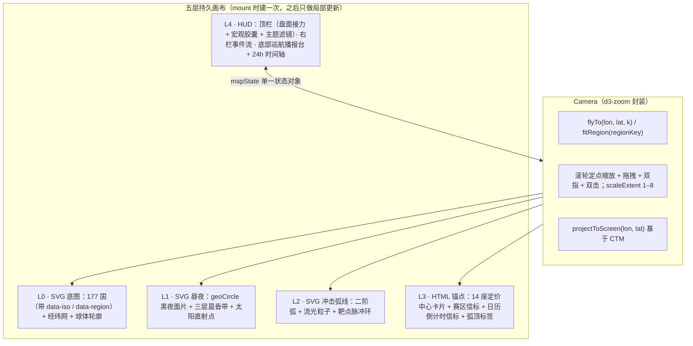
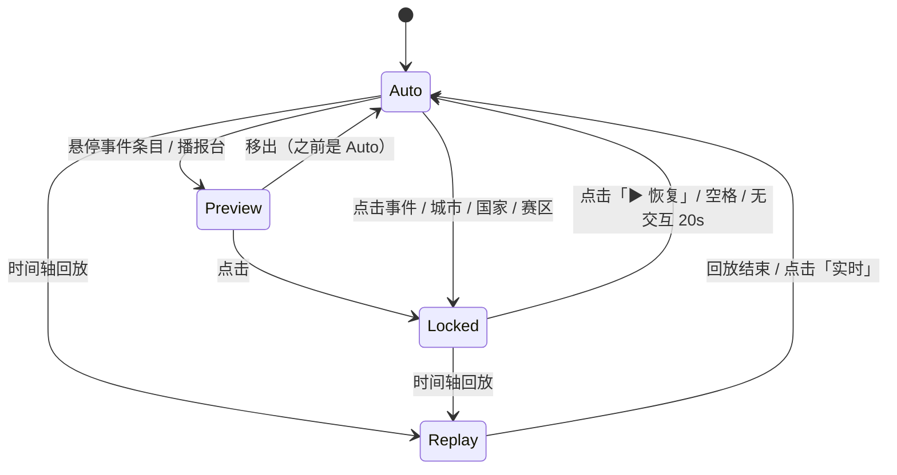
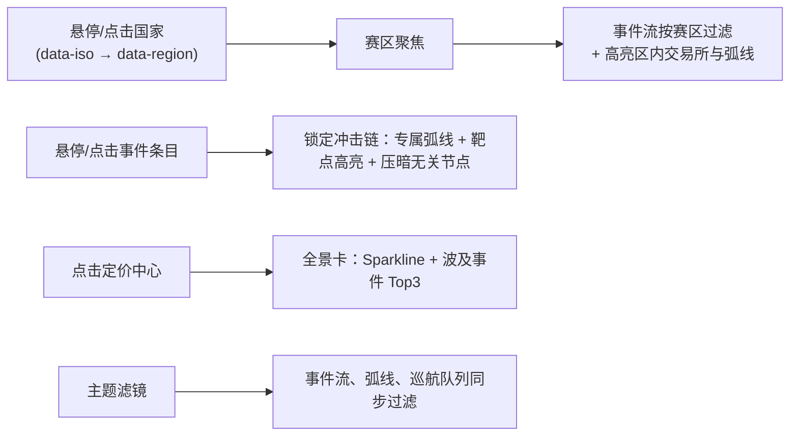

# 全球市场地图升级方案：全球宏观态势与事件冲击指挥舱（Global Situation Room）

> **修订记录**
> - v1：初稿。
> - **v2（2026-10-27）**：根据代码审阅修订。项目已改为按需引入依赖（见 README「依赖策略」），因此正式引入 `d3-geo` / `d3-zoom` + `world-atlas` 原始 TopoJSON。同时修正了 v1 中与现有数据、接口不符的地方：坐标换算、24h 数据源、赛区口径、开市状态、macro 缓存、日历时区。另外新增 Step 0（基建与前置修复），并把验收标准改成可量化的形式。

> **核心定位与设计准则**
> 1. **从「静态装饰屏保」升级为「7×24h 全球宏观态势指挥舱」**：把 `/api/quotes`（全球标的 + 日内分时）、`/api/events`（三源实时快讯 + AI 语义分类）、`/api/calendar`（FOMC / BLS 宏观日历）、`/api/macro`（Risk-On/Off、VRP）放进同一张可交互的时空画布。
> 2. **「手自一体」**：默认开启 **全球热点自动巡航（Auto-Pilot Spotlight）**。用户一介入就切到探索模式；**无交互 20 秒后自动恢复巡航**，做到真正的无人值守。
> 3. **有用的金融信息密度**：交易所节点带开休市状态和日内分时 Sparkline；每根冲击弧线标明影响的标的和实时涨跌；48h 内的重磅日历在地图上挂倒计时。
> 4. **视觉基因不变，离线可用**：沿用暗黑金融终端色板（`--bg #080b10`、涨 `--up #f5455c`、跌 `--down #0ecb81`、负向蓝 `#5b9cf8`、预警琥珀 `#f59e0b`）。地图数据随包分发，不依赖任何在线瓦片或 API Key。前端依赖打包进 `public/vendor/` 并入库，`node server.mjs` / 双击 `启动看板.command` 照常秒开。

---

## 一、 现状诊断

审视 `src/client/views/map.js`（792 行）与 `public/styles/worldmap.css`（634 行），问题集中在 **交互、数据利用率、渲染** 三个层面。

### 1. 交互断层：「地 - 事 - 价」完全割裂
| 页面元素 | 现有实现 | 体验痛点 |
| :--- | :--- | :--- |
| **右侧事件流 `.mf-item`** | `L492–502` 渲染 40 条，**没有绑定任何事件监听** | 点击或悬停新闻，地图毫无反应 |
| **区域脉冲点 `.map-region`** | CSS 写了 `cursor: pointer`，`bindMapEvents` 却没绑事件 | 点了没有任何筛选或聚焦 |
| **177 国陆地** | `L540` 只输出 `<path d>`，**丢掉了 `id` / `name`** | 不知道国名，也关联不到赛区 |
| **冲击弧线 `impactArcs`** | `L227–252` 把最新 3 条 high 事件的弧线混画在一起 | 不知道哪根线对应哪条新闻、哪个品种 |
| **事件气泡 `spawnBubble`** | 只在 30s 轮询恰好刷出新 id 时弹 6 秒 | 平时页面一片死寂，没有任何信息在滚动 |

### 2. 数据浪费
* **日历拉了不用**：`loadMap()` 每次都请求日历并写进 `store.events.calendar`，`renderMap()` 却一行都没读。
* **分时闲置**：每个 quote 都带 `history: [{ t, p }]`（最多 240 点），节点卡片里却只显示一个数字。布伦特在 `oil.extras` 里，也没有展示。
* **宏观状态孤立**：`/api/macro` 已经算出 `riskAppetite` 和 `vrp`，`#/map` 完全没用上。

### 3. 渲染缺陷
* **全量 `innerHTML` 重建**：每次报价广播（`on('quotes')`）或 30s 事件轮询都会重写整张图，结果是动画归零、事件流滚动条跳回顶部、悬停状态丢失。
* **SVG `<text>` 随缩放变形**：放大后字号被撑大，缩小后糊成一团。
* **晨昏线只是一条线**：没有黑夜面片，看不出哪边是白天、哪边是黑夜。
* **🐞 屏幕坐标换算有 letterbox 偏差**：SVG 用的是 `preserveAspectRatio="xMidYMid meet"`，但 `spawnBubble` / `openNodeCard` / `zoomAt` / 拖拽平移都直接按 `rect.width / 1200` 换算。画布宽高比偏离 1200:560 时，卡片和气泡会偏几十像素，滚轮缩放的中心点会漂，拖拽时地图也跟不上鼠标（详见第七章 B4）。

---

## 二、 技术选型（v2 拍板）

### 1. 方案对比

| 维度 | **★ 选定：`d3-geo` + `d3-zoom` + SVG 底图 + Screen-Space HTML 锚点层** | ECharts `geo` | MapLibre / Deck.gl | Leaflet | Globe.gl（3D） |
| :--- | :--- | :--- | :--- | :--- | :--- |
| 全球同屏 | 高：Natural Earth 投影，三大时区一屏看完 | 高 | 中：低缩放下墨卡托极区拉伸 | 中：墨卡托 | 差：背面半球看不见 |
| 富金融卡片 | **强**：HTML 锚点，支持毛玻璃、Sparkline、子项独立点击，字号恒定 | 弱：Canvas label | 强：HTML Marker | 强：DivIcon | 弱 |
| 昼夜面片 | **原生**：`geoCircle` 取太阳对跖点、半径 90°，d3-geo 自动做球面裁剪；可叠三层晨昏带 | 难 | 需自写图层 | 需插件 | 可（Shader） |
| 冲击弧线 | 强：SVG 二阶弧 + 流光 + HTML 弧顶标签 | 强 | 强 | 弱 | 强 |
| 离线 | **满足**：`world-atlas` TopoJSON 随 vendor 包分发 | 满足 | 默认依赖在线瓦片，离线需另配 | 依赖瓦片 | 需纹理贴图 |
| 体积 | 约 200KB（gzip 约 70KB，含 110m 地图数据） | 约 800KB | 1MB+ | 约 150KB + 瓦片 | 1MB+ |

**为什么不沿用 `public/worldmap.js`**：它存的是 `tools/topo2svg.mjs` **预先投影好**的 1200×560 SVG path，原始经纬度已经丢了，没法换投影，也没法做球面裁剪。v2 改为在浏览器里用 `topojson-client` 解析 `world-atlas/countries-110m.json`，再交给 d3-geo 投影。旧的 `worldmap.js` 和 `topo2svg.mjs` 在 Step 1 完成后删除。

### 2. 依赖与打包方式

| 包 | 用途 |
| :--- | :--- |
| `d3-geo` | 投影、`geoPath`、`geoCircle`（黑夜面片）、`geoGraticule10`、`geoArea` / `geoContains`（测试用） |
| `d3-zoom` + `d3-selection` + `d3-transition` + `d3-interpolate` | 相机：滚轮 / 拖拽 / 双指 / 双击，`flyTo` 用 `interpolateZoom` 平滑飞行 |
| `topojson-client` | TopoJSON → GeoJSON |
| `world-atlas` | `countries-110m.json`（177 国，含 ISO 数字 id） |

* 新增打包入口 `src/client/vendor/geo-kit.js`，统一 re-export 上面这些依赖并内联地图 JSON。Vite 改成多入口，产出 `public/vendor/geo-kit.js`，**产物入库**。
* d3-selection 必须打进**同一个包**：d3-transition 会给 `selection.prototype` 打补丁，分开打包会出现两份实例。
* 浏览器端在 `index.html` 加 import map：`{"imports": {"geo-kit": "/vendor/geo-kit.js"}}`。业务模块统一写 `import { geoPath } from 'geo-kit'`。
* Vitest 在 `vite.config.js` 里配 `resolve.alias: { 'geo-kit': 'src/client/vendor/geo-kit.js' }`，纯函数模块就能直接在 Node 里测试。
  > 现在的 `map.js` 写的是 `import '/worldmap.js'`（绝对 URL），Vitest 根本导入不了，所以过去地图模块一个单测都没有。

### 3. 投影与坐标空间

* 默认投影是 `geoNaturalEarth1().rotate([-10, 0])`，用 `fitExtent` 适配到固定的逻辑画布 `1200×600`，拟合时排除南极洲（id `010`）。投影只在 `geo/projection.js` 里配置，以后要换成 `geoEquirectangular` 只改这一处。
* **投影只做一次**：国家 path、经纬网、黑夜面片都在逻辑坐标里生成。缩放和平移通过 d3-zoom 的 transform 作用到 `<g id="map-viewport">`，不重新投影。描边加 `vector-effect: non-scaling-stroke`，缩放时保持 1px。
* **统一的坐标换算**：
  ```
  screen = svg.getScreenCTM() · zoomTransform · projection([lon, lat])
  ```
  `projectToScreen` / `clientToLogical` 是项目里**唯一**的换算入口。换算基于 CTM，自动吸收 letterbox 留白（修复 B4）。矩阵运算写成纯函数，CTM 作为参数传入，这样可以单测。

### 4. 五层持久场景图



**更新策略**（这是消除「轮询闪断」的关键）：

| 触发 | 只更新什么 |
| :--- | :--- |
| 报价广播（15s） | L3 卡片里的价格、涨跌幅、Sparkline 文本和 path；顶栏接力带数字 |
| 事件轮询（30s） | 事件流按 `id` 做 keyed diff（只插入新条目，`scrollTop` 不变）；巡航队列重算；赛区信标计数 |
| 缩放 / 平移 | L0–L2 只改一个 `transform`；L3 在一个 rAF 里批量更新 `translate3d`；LOD 只切 CSS class，**不再调用 `renderMap()`** |
| 每分钟 | L1 昼夜面片重算（d3-geo 一次约 1ms） |
| 每秒 | 只改日历倒计时那几个文本节点 |

**L3 的 LOD 规则**：
- `k < 1.35`：紧凑胶囊，显示领头标的 + 涨跌幅 + 开市呼吸灯 + 迷你火花线。
- `1.35 ≤ k < 2.2`：展开前 4 个标的。
- `k ≥ 2.2`：全部展开，每行带 Sparkline。

LOD 档位用 CSS class `lod-0/1/2` 控制，切档时不重建 DOM。

---

## 三、 整体布局

右侧事件流从「浮在地图上的面板」改为**独立的 grid 列**。这样地图不会再被面板盖住，现在为了把亚洲露出来做的 `tx: -200` 初始偏移和 `MAP_PANEL_GUTTER` 都可以删掉。

```text
┌──────────────────────────────────────────────────────────────────────────────────────────────────┐
│ [全球态势指挥舱] 🌏 亚太(已收盘 +0.4%) ➔ 🌍 欧洲(交易中 -0.3%) ➔ 🌎 美洲(待开盘 2h13m)                │
│ 滤镜: [全部][🔥重要][🏦美联储/利率][⚔️地缘/能源][🇨🇳中国政策][🪙贵金属]   [Risk-Off · VRP +4.2][金 WTI BTC] [▶巡航][复位][⛶] │
├─────────────────────────────────────────────────────────────────────────┬────────────────────────┤
│                                                                         │ 📡 实时事件流           │
│        [伦敦] 黄金 +0.82% ╭╮          [上海] 上证 +0.41%                 │ [区域: 全部▾][仅重要☐] │
│               富时 -0.25%                     沪金 +0.65%                ├────────────────────────┤
│                   ▲   ⚡ 地缘 ➔ 避险/能源      ▲                         │ ▶16:58 中东·重要 AI     │
│  [纽约] 标普 -0.45% ╰──────── 🔴 中东 · 5 条 ─╯                          │  红海航运受袭，油金急涨 │
│         10Y 4.28%                                                       │  🎯 WTI +2.1% 黄金 +0.8%│
│  ⚡ 美国 CPI · 20:30 · 03:21:15        ☀ / 黑夜面片 + 晨昏带             ├────────────────────────┤
│  ┌─ 🎯 巡航 (1/8) ─────────────────────────────── [◀][⏸][▶] ──┐         │  16:42 北美·重要 AI     │
│  │ [重要·地缘政治] 中东局势再度升级，布伦特突破关键关口 (16:58)  │         │  ...                    │
│  │ 靶点: [芝加哥 WTI +2.14%▲] [伦敦 黄金 +0.82%▲] [纽约 VIX +6%] │         │                        │
│  └──────────────────────────────────────────────────────────────┘         │                        │
├─────────────────────────────────────────────────────────────────────────┴────────────────────────┤
│ ⏱ 24h  [▶ 浓缩回放]  ▂▁▃▆█▄▂▁▂▄▇█▅▃▂▁▂▃▅▇  (覆盖 昨日 17:00 起 · 当前：实时)                          │
└──────────────────────────────────────────────────────────────────────────────────────────────────┘
```

* BTC 没有实体交易所。现在把它画在大西洋上的固定「卫星位」，这个做法取消，改成顶栏的宏观胶囊。
* 「全球（global）」事件**没有地理起点**。旧锚点 `(-30, 62)` 位于格陵兰外海，v2 不再在地图上画它。这类事件在巡航和预览时只高亮靶点城市，并在播报台标注「全球」。

---

## 四、 五大功能模块

### 模块 1：全球热点巡航（Auto-Pilot Spotlight）

1. **巡航队列 `buildSpotlightQueue(items, filter)`**：
   * 在当前滤镜下，取最近 12 条 `level === 'high'` 且 `targetCitiesFor(ev).length > 0` 的事件。不够的话，按 `score` 从高分 `mid` 补齐。
   * 避免连续 3 条相同主题：同一主题连续出现时，把后一条往后挪一位。
   * 事件轮询更新队列时，保持当前播放的那条不中断。
2. **单步四重奏（默认每 6s 推进一格，底部有细进度条）**：
   * **A · 事发区点亮**：`REGION_ANCHORS[ev.region]` 升起双层脉冲环。如果相机处于放大状态且该点在视口外，就 `flyTo` 带进视野。`global` 事件跳过这一步。
   * **B · 专属弧线**：从赛区锚点射向 `targetCitiesFor(ev)`。弧顶用 HTML 标签显示**主主题胶囊**（如「地缘政治 ➔ 避险/能源」）。
   * **C · 靶点高亮**：命中的城市卡片放大 1.12×，其余降到 0.38 透明度。播报台列出标题、时间，以及 `ev.symbols` 对应标的**此刻的真实涨跌幅**，直接验证新闻和盘面是否同向。
   * **D · 事件流跟随**：对应条目加 `.is-spotlight`，用 `list.scrollTo({ top, behavior: 'smooth' })` 只滚动列表容器。**不用 `scrollIntoView`**，它会连带滚动全屏容器或整页。
3. **状态机（纯 reducer `spotlightReducer(state, action)`，可单测）**：



   * 优先级：Preview > Locked > Auto。Preview 结束后回到进入前的状态。
   * 空格键只在 `#/map` 可见、并且焦点不在 `button / input / select` 上时响应。键盘监听放在 map 模块里，`unmount` 时移除；不改 `router.js` 里已有的全局 keydown。
   * `document.hidden` 时暂停计时器和所有 rAF。`prefers-reduced-motion` 下关闭粒子和飞行动画，只保留高亮。

### 模块 2：「地 - 事 - 价」联动 + 主题滤镜



1. **国家 → 赛区映射 `COUNTRY_REGION_MAP`（与后端口径对齐）**
   * **唯一口径是后端 `REGION_WORDS`**（`src/server/domain/news-lexicon.js`）：某国在后端会被归到哪个赛区，地图上就归到哪个赛区。
   * 映射表（ISO 数字 id，按 world-atlas 的格式补零）：
     | 赛区 | 国家 |
     | :--- | :--- |
     | `us` | 美国 840、**加拿大 124**（后端把「加拿大 / 多伦多」归到 us） |
     | `cn` | 中国 156（110m 底图**没有香港多边形**，香港由城市节点承担） |
     | `eu` | 德 276、法 250、意 380、西 724、荷 528、比 056、奥 040、葡 620、爱 372、希 300、芬 246，以及瑞士 756、瑞典 752、挪威 578、丹麦 208、波兰 616、捷克 203、匈牙利 348（后端 eu 词表都覆盖了） |
     | `uk` | 826 |
     | `jp` | 392 |
     | `me` | 伊朗 364、以色列 376、沙特 682、也门 887、阿联酋 784、伊拉克 368、卡塔尔 634、叙利亚 760、**土耳其 792、阿富汗 004**、黎巴嫩 422、约旦 400、科威特 414、阿曼 512，以及巴勒斯坦 275 |
     | `asia` | 韩 410、印 356、**台湾 158**（后端 asia 在 cn 之前命中）、越 704、泰 764、印尼 360、马来 458、菲 608、巴基斯坦 586、孟加拉 050、斯里兰卡 144、缅甸 104、柬埔寨 116 |
     | `latam` | 巴西 076、阿根廷 032、墨西哥 484、智利 152、委内瑞拉 862、哥伦比亚 170、秘鲁 604、乌拉圭 858、厄瓜多尔 218、玻利维亚 068 |
     | `africa` | 南非 710、埃及 818、尼日利亚 566、肯尼亚 404、摩洛哥 504、加纳 288、埃塞俄比亚 231、坦桑尼亚 834、阿尔及利亚 012 |
     | **未归属 `null`** | 俄罗斯、乌克兰、白俄罗斯、中亚各国、澳大利亚、新西兰、蒙古、格陵兰等。悬停显示国名 +「未归属赛区」，不可点击。 |
   * **一致性测试**：每个已映射国家维护一个中文名，测试断言这个中文名确实出现在 `REGION_WORDS[region]` 词表里；同时断言映射表里的每个 ISO 都存在于 world-atlas。后端词表一改，测试就会提示同步。
   * **交互**：悬停时国家块提亮，并用 tooltip 显示「国名 · 赛区」。点击国家或赛区信标进入「赛区聚焦」：事件流只保留该赛区，地图高亮区内交易所和外射弧线，`fitRegion` 飞过去。点击空白处或选「全部区域」复位。点击判定复用 d3-zoom 的拖拽阈值，避免拖动地图时误触发。
2. **事件流 → 地图**：悬停条目进入 Preview，即时预览弧线和靶点；点击进入 Locked，播报台展开正文摘要、来源链接和关联标的的实时盘面。
3. **六个主题滤镜**（按 `ev.topics[].key` 匹配；`/api/events` 返回的 `topics` 是 `{ key, label, strong }` 对象）：
   * `全部`
   * `🔥 重要`：`level === 'high'`
   * `🏦 美联储 / 利率`：`fed / inflation / jobs / rates`
   * `⚔️ 地缘 / 能源`：`geopolitics / energy`
   * `🇨🇳 中国政策`：`china`
   * `🪙 贵金属`：`precious`。v1 把 `crypto` 也算作「避险」，语义不对，已移除。加密事件在「全部」里照常显示。

### 模块 3：定价中心全景卡

```text
┌──────────────────────────────────────────────────────────┐
│ 📍 纽约 (New York)                 [🟢 交易中 · EDT 05:08]│
│ 美洲定价中心 · 7 个标的                                  │
├──────────────────────────────────────────────────────────┤
│ 标普500   5,892.40   ╭──╮╭─   -0.45% ▼   [详情] [传导图] │
│ 纳指100  20,415.10   ╭─╮╰──   -0.68% ▼   [详情] [传导图] │
│ 美债10Y     4.285%   ──╭───   +0.04% ▲   [详情] [传导图] │
│ 美元指数   104.21    ─╮╭──    -0.10% ▼   [详情] [传导图] │
│ VIX恐慌     19.42    ───╭─▲   +6.15% ▲   [详情] [传导图] │
├──────────────────────────────────────────────────────────┤
│ ⚡ 今日波及本中心的事件 (3)                               │
│ • [16:42 重要] 美联储官员暗示谨慎降息，美债收益率走高    │
└──────────────────────────────────────────────────────────┘
```

1. **Sparkline**：纯函数 `sparklinePath(history, w = 56, h = 18)`，由 `quote.history` 生成折线和面积填充，涨红跌绿。
2. **城市标的调整**（`MAP_CITIES.ids`）：
   * 纽约增加 `us10y`、`dxy`。
   * 上海增加 `usdcny`（`SYMBOL_CITY` 已经把它映射到上海和香港，节点上却一直没展示）。
   * 伦敦卡片额外显示布伦特，数据从 **`oil.extras`** 里 `id === 'brent'` 那一项读取。
3. **波及事件**：取 `targetCitiesFor(ev)` 包含本城的最新 3 条。点击后在地图上进入该事件的冲击链（Locked）。
4. **[传导图]**：本期只跳转到 `#/macro`。按资产定位到具体节点需要先给 macro 视图加深链，列为扩展 E2。

### 模块 4：盘面接力带 + 宏观 HUD + 48h 日历倒计时

1. **三大盘面接力带**：
   * 🌏 亚太：东京 `n225`、首尔 `kospi`、上海 `sh000001 / gold-cn`、香港 `hsi`、台北 `twii`、悉尼 `asx`、孟买 `nifty`
   * 🌍 欧洲：伦敦 `ftse / gold-intl`、法兰克福 `dax`、巴黎 `cac`
   * 🌎 美洲：纽约 `sp500 / ndx100 / dji / vix`、芝加哥 `oil`、多伦多 `tsx`、圣保罗 `bvsp`
   * **状态依赖后端新增字段**：现在的 `marketStatus` 只有 `{ market, open, label }`。需要在 `domain/market-hours.js` 增加 `phase: 'open' | 'pre' | 'closed' | '24x7'` 和 `nextOpenAt` / `nextCloseAt`（ISO 格式）。规则是：收盘状态下距下次开盘 ≤ 3h 记为 `pre`，界面显示为「**待开盘 · 2h13m**」。刻意不叫「盘前」，因为我们没有盘前交易的数据。
   * 盘面汇总规则：任一市场 `open` 就显示「交易中」；否则取最早的 `nextOpenAt`。涨跌温度取等权平均。点击胶囊 `flyTo` 到该大洲。
2. **宏观胶囊**：
   * 新增 **`store.macro`**（数据 + 拉取时间），`#/macro` 和 `#/map` 共用。`macro.js` 的 `loadMacro` 改为写入 `store.macro`。
   * 地图**首屏渲染完成后再懒加载** `/api/macro?window=250`，客户端 TTL 5 分钟。这个接口要拉全部日线序列，冷启动可能需要好几秒，所以不能阻塞首屏；加载失败就隐藏胶囊。
   * 展示内容：风险偏好灯（`riskAppetite.label`）、`VIX 19.4 · VRP +4.2`（`vrp.vix` / `vrp.vrp`），以及黄金、WTI、BTC 快照（直接取 quotes）。
3. **48h 日历倒计时**（**依赖第七章 B1–B3 先修复**）：
   * 后端给每条日历事件补充 **`releaseAt`**（UTC ISO 时间）。前端只认 `releaseAt`，不再自己拼 `date + time`，也不读服务端的 `today`。
   * 筛选 `now ≤ releaseAt ≤ now + 48h` 且 `importance ≥ 2` 的事件。目前的数据源都是美国（Fed / BLS），统一挂在华盛顿 `(-77.0, 38.9)`。信标是琥珀色，倒计时胶囊例如「⚡ 美国 CPI · 20:30 · 03:21:14」。
   * 点击信标弹出预览卡：发布时间（北京时间 + 美东时间）、关联标的（`ev.symbols`）及当前价格。

### 模块 5：24h 局势时间轴回放

1. **数据源（后端新增接口）**：`GET /api/events/history?hours=24`。
   * 读取 `data/events/` 下今天和昨天两份 jsonl 归档（文件按北京时间日期命名），与当前实时快照合并，按 `id` 去重，按 `time` 截取最近 24h，最多 600 条。
   * 归档里的 `topics` 只存了 label，接口要通过 `COMPILED_TOPICS` 还原成 `{ key, label }`，和实时接口保持同一形状。
   * 进入时间轴时才请求，结果缓存 5 分钟。如果数据实际覆盖不到 24h，时间轴上**明确标注「覆盖 HH:MM 起」**。
2. **热度分桶 `bucketEvents24h(items, now)`**：分成 24 个一小时桶。柱高表示事件数；颜色取桶内最高等级：high 用 `#f5455c`，mid 用 `#f59e0b`，其余用 `#5b9cf8`。
3. **回溯与回放**：
   * 点击某个桶：事件流和弧线只保留截至该时刻的事件；**太阳直射点和黑夜面片切换到那个时刻的真实位置**。
   * 「▶ 浓缩回放」：从 24h 前开始，每 0.6s 推进一个桶，约 15s 回放完一整天。黑夜面片自东向西扫过地图，高优事件按时间先后依次点亮。回放结束后回到 Auto。

---

## 五、 工程结构

```text
src/client/
├── vendor/
│   └── geo-kit.js              # 打包入口：re-export d3-geo / d3-zoom / d3-selection / d3-transition /
│                               #   d3-interpolate / topojson-client + countries-110m.json → public/vendor/geo-kit.js
└── views/
    ├── map.js                  # 入口：mountMap / unmountMap / stopMapTimer（路由契约不变）
    └── map/
        ├── state.js            # mapState 单一可变对象（替代 export let mapView 等多个可变导出）
        ├── geo/
        │   ├── projection.js   # 投影配置、clientToLogical / projectToScreen（CTM 纯函数）
        │   ├── astro.js        # sunPosition、nightGeoJSON(date, radius)、twilightBands
        │   ├── regions.js      # REGION_ANCHORS、COUNTRY_REGION_MAP、COUNTRY_NAME_CN
        │   └── cities.js       # MAP_CITIES、SYMBOL_CITY、SESSION_GROUPS、targetCitiesFor、arcBetween
        ├── logic/              # 纯逻辑，零 DOM
        │   ├── filters.js      # TOPIC_FILTERS、filterMapEvents
        │   ├── spotlight.js    # buildSpotlightQueue、spotlightReducer
        │   ├── timeline.js     # bucketEvents24h
        │   ├── calendar.js     # upcomingCalendarAlerts(cal, now)
        │   └── sparkline.js    # sparklinePath
        ├── camera.js           # d3-zoom 封装：flyTo / fitRegion / onTransform
        ├── layers/             # base.js(L0) night.js(L1) arcs.js(L2) markers.js(L3)
        └── hud/                # topbar.js feed.js broadcast.js timeline-bar.js node-card.js
```

* 所有 CSS 仍写在 `public/styles/worldmap.css` 里，不新建样式文件，避免改动 `styles-order.test.js` 的 `EXPECTED`。`--mg-neg` / `--mg-div` 目前只定义在 `.macro-graph-section` 作用域里，要提升到 `tokens.css` 的 `:root`。
* 后端改动：
  * `domain/market-hours.js`：增加 `phase` / `nextOpenAt` / `nextCloseAt`
  * `services/calendar.service.js`：增加 `releaseAt`，并修复 B1–B3
  * `services/events.service.js`：增加 `getEventsHistory(hours)`
  * `server.mjs`：注册 `/api/events/history` 路由

### 自动化测试

| 文件 | 覆盖内容 |
| :--- | :--- |
| `tests/worldmap-geo.test.js`（新增） | **黑夜面片**：对跖点在内、直射点在外（`geoContains`），面积 ≈ 2π（`geoArea`），春分 / 秋分时不出现 NaN；**太阳经度**每小时约 −15°；**坐标换算**：给定 letterbox 下的 CTM，`projectToScreen` 和 `clientToLogical` 互逆且误差 ≤ 0.5px；**赛区映射**：与 `REGION_WORDS` 一致，ISO 都存在于 world-atlas |
| `tests/worldmap-logic.test.js`（新增） | 6 个滤镜；巡航队列的排序、补位、同主题去连续；`spotlightReducer` 全部迁移（含 20s 自动恢复）；24h 分桶；48h 日历（含夏令时切换周的样例）；Sparkline 边界情况（空数组、单点、横盘） |
| `tests/market-hours.test.js`（扩展） | `phase` / `nextOpenAt`：周末、节前、跨午夜、夏令时切换日 |
| `tests/services.test.js`（扩展） | 日历 `releaseAt`（见 B1、B2 的样例）；`/api/events/history` 用 fixture jsonl 测试去重和 topic 还原 |
| `tests/client-modules.test.js`（修改） | 新增断言：所有裸模块名（bare specifier）都必须在 `index.html` 的 import map 里声明。`map.unmount` 的契约从「清气泡与拖拽」改为「调用 `destroyMapScene`」，负责移除 d3-zoom 监听、rAF、巡航计时器、倒计时 interval 和键盘监听 |

---

## 六、 分步实施（4 个里程碑）

| 阶段 | 目标 | 交付物 | 可量化验收 |
| :--- | :--- | :--- | :--- |
| **Step 0** | **基建 + 前置修复（画面不变）** | 修复日历 B1–B3（`releaseAt`）；安装依赖，产出 `geo-kit.js` 打包、import map、Vitest alias；`mapState`；持久图层骨架（mount 时建一次，之后局部更新）；CTM 坐标换算（修复 B4）；事件流改为 grid 列并做 keyed diff | 现有 270 个用例全部通过；报价广播前后 `.mf-list.scrollTop` 不变；在 16:9、21:9、4:3 三种画布比例下，节点卡片和城市点偏差 ≤ 1px；拖拽时地图和鼠标同步（误差 ≤ 1px） |
| **Step 1** | **d3-geo 底图 + 昼夜 + 国家赛区 + 相机 + HTML 锚点** | Natural Earth 底图（删除 `worldmap.js` / `topo2svg.mjs`）；黑夜面片 + 晨昏带 + 太阳直射点；`COUNTRY_REGION_MAP` 和悬停 / 点击；d3-zoom 相机、`flyTo` / `fitRegion`；L3 城市卡片（LOD 用 class 切换 + Sparkline） | 1×–8× 缩放下卡片字号恒定；跨 LOD 档位时城市卡片 DOM 节点数不变（只切 class）；`worldmap-geo.test.js` 全部通过 |
| **Step 2** | **巡航 + 联动 + 滤镜 + 全景卡** | `spotlight.js` 状态机；底部播报台；单事件专属弧线 + 弧顶标签；事件流悬停 / 点击联动；6 个滤镜；全景卡（含 `us10y` / `dxy` / `usdcny` / 布伦特 + 波及事件） | 无交互时每 6s 推进一格，事件流同步滚动且页面本身不滚动；手动操作后 20s 自动恢复巡航；`worldmap-logic.test.js` 全部通过 |
| **Step 3** | **接力带 + 宏观 HUD + 日历倒计时 + 24h 回放** | 后端 `phase` / `nextOpenAt`、`/api/events/history`；`store.macro`；顶栏接力带和宏观胶囊；华盛顿日历信标；时间轴分桶和浓缩回放 | 倒计时和 `releaseAt` 误差 ≤ 1s；回放 24 个桶耗时约 15s，且黑夜面片与对应时刻的太阳位置一致；`/api/macro` 失败时地图照常可用 |

> [!NOTE]
> Step 3 要改 `events.service.js`。这个文件以及 `news-lexicon.js` 目前有未提交的改动（新闻源工作还在进行中），建议等那批改动合入之后再开始 Step 3。

### 后续扩展（不在本期）
* **E1**：新增 `ru`（俄乌 / 独联体）和 `oceania` 赛区，需要同步改 `REGION_WORDS`、`LLM_REGIONS`、`REGION_ANCHORS`、`COUNTRY_REGION_MAP`。
* **E2**：`#/macro?focus=<id>` 深链，让全景卡的 [传导图] 直接定位到对应资产节点。
* **E3**：换成 `countries-50m`（约 750KB），补上香港、新加坡、巴林等小经济体的多边形。
* **E4**：整站迁移到 Vite `dist/` 构建。

---

## 七、 前置修复的 Bug（Step 0 处理）

| 编号 | 位置 | 问题 |
| :--- | :--- | :--- |
| **B1** | `calendar.service.js` `fetchFomcMeetings` | FOMC 的 `date` 用的是美国会议结束日，`time` 写死成北京时间 `'02:00'`。实际北京时间是**结束日的次日**凌晨，所以显示**整整提前了一天**；冬令时还应该是 03:00。 |
| **B2** | `calendar.service.js` `blsReleaseBeijingTime` 和 ICS 解析 | 夏令时按「3–10 月」粗略判断。3 月第二个周日之前、11 月第一个周日之前发布的数据，北京时间会偏 1 小时。 |
| **B3** | `calendar.service.js` `getCalendar` / `buildEventStudy` | `today` 按 UTC 计算，并且和 `upcoming` 一起缓存 6 小时。北京时间 0–8 点之间，「今天 / 明天」标签会错位，昨天的事件也会留在「即将公布」里。 |
| **B4** | `views/map.js` 坐标换算 | 没有扣除 letterbox 留白，卡片和气泡位置有偏差，缩放中心会漂，拖拽时地图跟不上鼠标。 |

修复方案：后端统一用 `Intl` 按 `America/New_York` 换算出 `releaseAt`。`date` 保留「美国交易日」的含义，因为事件研究要按交易日对齐收益。`upcoming` 和 `today` 改成每次请求时按北京时间重新计算，不再缓存。前端坐标换算统一走 CTM。
